CTF 好久没打得这么爽了，想来我已经一年没认真写过分享型的 WP 了（除了给某些比赛出题）。来做 N1CTF Junior 的题只是因为看了 Web\-ping 的附件，说真的如果我开发的话也有可能写出类似的东西来，这下学到了。是我喜欢的题目类型。

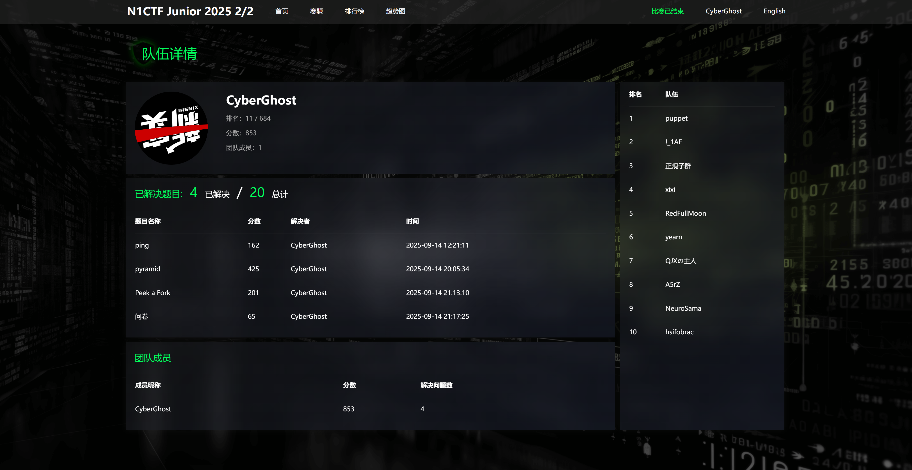

写一下逆向题 Pyramid 的 WP。很少有题目让我想要单独写一篇 WP。感觉出题人有在降低 Python Native 扩展模块部分的难度，比如让扩展模块去调用 pyc 字节码，而不是大量涉及 Python Object 的逻辑。但是似乎把难度放在了奇怪的地方，比如 RC4 短密钥空间攻击。~~我们 ruvurse 有自己的套娃题。~~

[附件下载](https://files.xinshi.fun/n1junior2502-pyramid/chal.exe)

本文主要是分享目的，有较多内容是教程的口吻，会啰嗦一下我一般怎么识别和处理这几类 Python 文件，只是因为我今天想这么写而已（也有可能是出题 WP 写多了导致的）

## PYD

首先 pyinstxtractor 然后 pycdc/pycdas，有用的就这三行

```python
import pyramid
pyramid.a_long_way_to_treasure()
os.remove('checkinput.pyd')
```

pyramid\.pyd 是 Cython 生成的，IDA 一打开看到 rdata 段很长一段，rdata 开头部分还长这样，一眼是某种有很多 `\x00` 的二进制数据循环异或 `bangdreamitsmygo` 了。

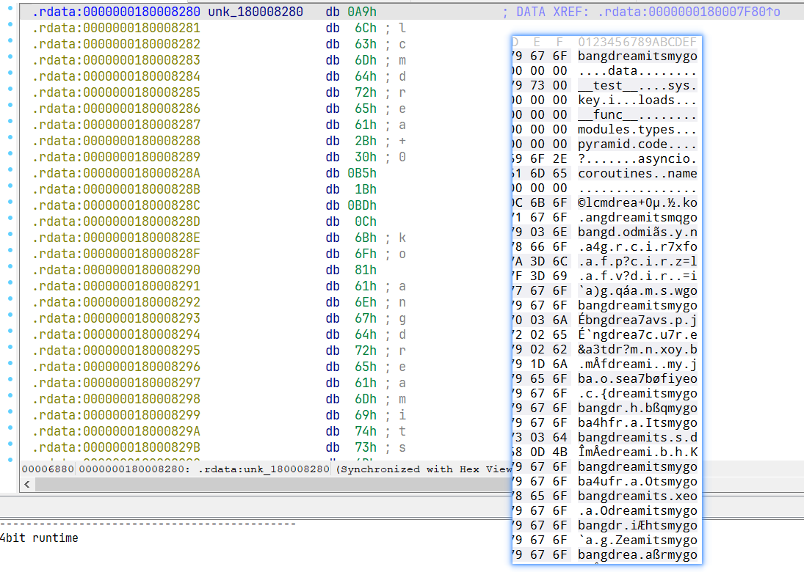

先不急，看看 `a_long_way_to_treasure` 的实现。

（啰嗦几句）我一般会从导出函数 `PyInit_pyramid` 开始，点进 `PyModuleDef_Init` 第一个参数，对应的是关于扩展模块定义的结构体，在它前后找到函数名称字符串，紧挨着函数名称下面的一个地址就是它的实现。`a_long_way_to_treasure` 的实现在 `loc_180001000`。断点打在第一行开始调试，我喜欢先开一个 Python REPL，import 这个 pyd，然后用 IDA 调试器附加到这个进程。以前我还 `os.getpid()`，现在喜欢偷懒，直接进程列表翻到最下面找到 python 路径就是了。附加上之后继续运行，这时可以在 REPL 输入下一行代码，`>>> pyramid.a_long_way_to_treasure()` 然后就可以在被调用 native 函数的第一行断下来。

单步几下就会发现在一个大的 while\(1\) 循环里：

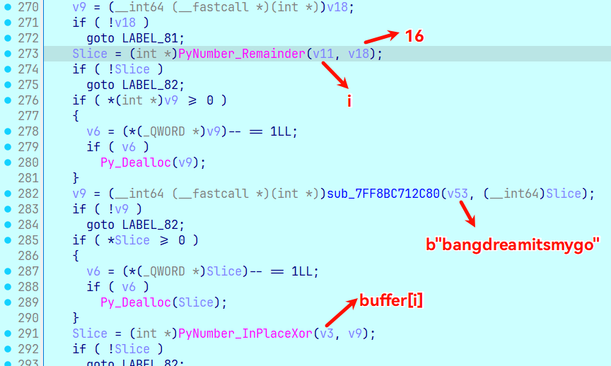

buffer 是 bytearray 类型，足足有 0x327B2 这么长，那么从文件中（从文件偏移 0x6880 开始）导出这段数据异或一下。

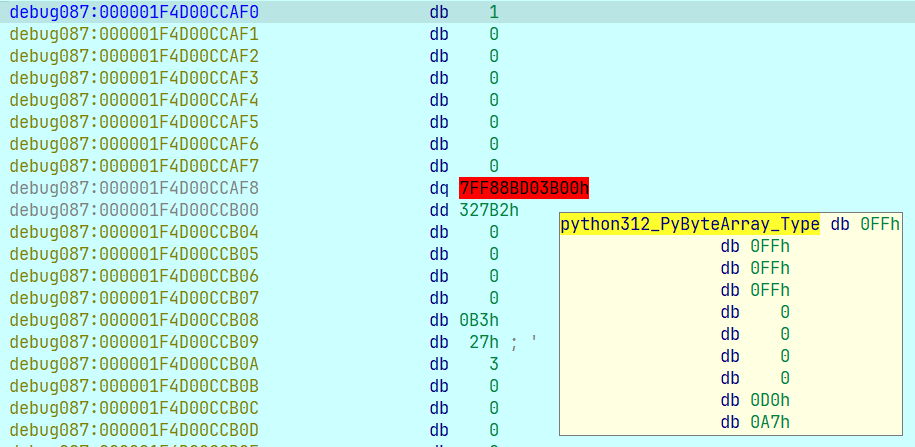

pyd 下面就没什么了，获得 name "marshal" 的 attr "loads"，获得 buffer\[16:\]，调用一下，最后 exec\(\)。

得到的文件看到 0xE3 跟一串 0，是 marshal 的 code object 的特征。（出题人甚至留了 pyc 文件头，他真的我哭死）

这个文件我上传到了：https://files.xinshi.fun/n1junior2502-pyramid/pyramid_6880h_327B2h_bangdreamitsmygo.pyc

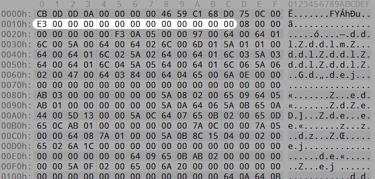

pycdc/pycdas 得到

```python
# Source Generated with Decompyle++
# File: pyramid_6880h_327B2h_bangdreamitsmygo.pyc (Python 3.12)

import ctypes
from ctypes import wintypes
import struct
import os
import importlib.util as importlib
import sys

class BUF(ctypes.Structure):
    _fields_ = [
        ("Length", wintypes.ULONG),
        ("Unused", wintypes.ULONG),
        ("Ptr", ctypes.c_void_p),
    ]

key = input("Input your key: ")
tmp = 0x811C9DC5
for ch in key:
    tmp = 16777619 * (tmp ^ ord(ch)) & 0xFFFFFFFF
key_bytes = struct.pack("<I", tmp)
advapi32 = ctypes.WinDLL("advapi32", use_last_error=True)
SystemFunction033 = advapi32.SystemFunction033
FNPROTO = ctypes.WINFUNCTYPE(None, ctypes.POINTER(BUF), ctypes.POINTER(BUF))
fn = FNPROTO(ctypes.cast(SystemFunction033, ctypes.c_void_p).value)
data = b"\xb7\xc3\xbc\xe5 <skip> "
data_buffer = ctypes.create_string_buffer(data)
key_buffer = ctypes.create_string_buffer(key_bytes)
data_buf = BUF(len(data), 0, ctypes.addressof(data_buffer))
key_buf = BUF(4, 0, ctypes.addressof(key_buffer))
fn(ctypes.byref(data_buf), ctypes.byref(key_buf))
pyd_path = os.path.join(os.getcwd(), "checkinput.pyd")
# WARNING: Decompyle incomplete

```

data 字节串也同样从 pyc 二进制文件导出，从文件偏移 0x6DA 开始，marshal 的字节串前面一个 u32 表示字节串的长度，为 0x31C00。

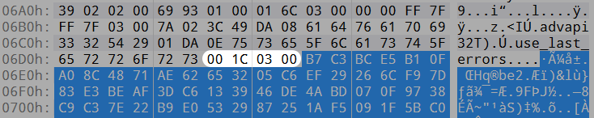

查了一下 magic number，前面对 key 的处理是 FNV 哈希，反正得到 key\_bytes 4 个字节，和 data 一起传给 `advapi32.SystemFunction033`。查了一下这个函数是 RC4，构造数据调用一下可以验证。RC4 解密之后存到 checkinput\.pyd 里，pycdc 没有反编译出来的部分从 pycdas 读，大致是用 importlib import 进来，然后 `result = module.check(flag.encode('utf-8'))`。如果发生异常则是 `Wrong key!`

## RC4 短密钥空间爆破

RC4 密文流 = 明文流 ^ 密钥流，我们已知：

- 密文前 4 个字节是 `\xb7\xc3\xbc\xe5`，明文是 pyd，前 4 个字节是 `MZ\x90\x00`

- 密钥长度为 4 字节

可以穷举所有 256\*\*4 的可能的密钥，看哪个能生成对应的密钥流。在我的 16 核轻薄本上，tqdm 进度条告诉我用纯 Python 实现的 RC4 需要 40 小时，如果用 Python 调用 `advapi32.SystemFunction033` 则需 20 小时。后来在看雪找到了这篇：

[\[讨论\]RC4算法暴力破解的尝试\(附源码\)](https://bbs.kanxue.com/thread-174969.htm)

脚本下下来改一下参数（密钥流前 4 字节），将密钥范围从可打印字符改成全字节。编译时我的 gcc 不带其他参数即可，观察能跑满 16 核。

```c
/*
    MistHill, created on 10:24:34 2013-7-3

    compile:
        Visual Studio 6:
            CL /Og /Os /Oy /Ob1 /GT /Gs /Gf /Gy /G6 /MT rc4KStream75MT.c /link /RELEASE

    Refs:
    1) Optimizing C++/Code optimization/Faster operations
        http://en.wikibooks.org/wiki/Optimizing_C%2B%2B/Code_optimization/Faster_operations
    2) Writing Efficient C and C Code Optimization
        http://www.codeproject.com/Articles/6154/Writing-Efficient-C-and-C-Code-Optimization

    3) Multithreading Tutorial #1
        http://www.computersciencelab.com/MultithreadingTut1.htm
    4) Walkthrough: Debugging a Multithreaded Application
        http://msdn.microsoft.com/en-us/library/bb157784(v=vs.90).aspx
*/
#include <windows.h>
#include <process.h>

#define TARGETKS1 0xe52c99fa

void prepare_key(unsigned char *key_data_ptr, int key_data_len, unsigned char *state);
BOOL GetKeyStream(unsigned char *buffer_ptr, int buffer_len, unsigned char *state);

unsigned _Recursion(void*);
unsigned __stdcall _RecursionT1(void*);
unsigned __stdcall _RecursionT2(void*);
unsigned __stdcall _RecursionT3(void*);
void Recursion(int idx, unsigned char *pKey, unsigned char *pKeyStream, unsigned char *pstate);

BOOL WINAPI ConsoleHandler(DWORD dwCtrlType);
void ShowExecutionTime(BOOL bBreaked);
void ShowMatchedKeystream(unsigned char*);

//static int TargetKS1 = 0x62383550, TargetKS2 = 0x6F0C1E2C;    /* Target KS = 50 35 38 62 2C 1E 0C 6F */
#define KeyLength 4

static char szErrMsgCT[] = "Create thread%d failed!\n";
static char szFmtHex2[] = "%02X ";
static char szFmtDate[] = "\n%s\t%04d-%02d-%02d %02d:%02d:%02d.%03d";

static unsigned char stateinit[256];

static unsigned char Key[8], KeyT1[8], KeyT2[8], KeyT3[8];

// Size: just 4 is fine. Exec. time of function GetKeyStream() reduced!
static unsigned char KeyStream[4], KeyStreamT1[4], KeyStreamT2[4], KeyStreamT3[4];

static unsigned char state[256], stateT1[256], stateT2[256], stateT3[256];

static SYSTEMTIME lt0, lt1;
static DWORD dw0, dw1;

int main(void)
{
    int i;
    HANDLE hThread[3];
    unsigned threadID[3];

    if (SetConsoleCtrlHandler( (PHANDLER_ROUTINE)ConsoleHandler, TRUE)==FALSE)
    {
        printf("Unable to install handler!\n");
        return -1;
    }

    GetLocalTime(&lt0);
    dw0 = GetTickCount();

    for(i = 0; i < 256; i++)
        stateinit[i] = i;

    // Create the threads.
    hThread[0] = (HANDLE)_beginthreadex( NULL, 0, &_RecursionT1, NULL, 0, &threadID[0] );
    if(!hThread[0]) {
        printf(szErrMsgCT, 1);
        return -1;
    }

    hThread[1] = (HANDLE)_beginthreadex( NULL, 0, &_RecursionT2, NULL, 0, &threadID[1] );
    if(!hThread[1]) {
        printf(szErrMsgCT, 2);
        CloseHandle(hThread[0]);
        return -1;
    }

    hThread[2] = (HANDLE)_beginthreadex( NULL, 0, &_RecursionT3, NULL, 0, &threadID[2] );
    if(!hThread[2]) {
        printf(szErrMsgCT, 3);
        CloseHandle(hThread[0]);
        CloseHandle(hThread[1]);
        return -1;
    }

    _Recursion(NULL);

    WaitForMultipleObjects(3, hThread, TRUE, INFINITE);

    CloseHandle(hThread[0]);
    CloseHandle(hThread[1]);
    CloseHandle(hThread[2]);

    ShowExecutionTime(FALSE);

    return 0;
}

unsigned _Recursion(void* pArguments)
{
    register int i;

    // 0x30~0x7A: T0(0x30~0x42), T1(0x43~0x55), T2(0x56~0x68), T3(0x69~0x7A)
    for(i=0;i<64;i++) {
        Key[0] = i;
        Recursion(1, Key, KeyStream, state);
    }
    return 0;
}

unsigned __stdcall _RecursionT1(void* pArguments)
{
    register int i;

    for(i=64;i<128;i++) {
        KeyT1[0] = i;
        Recursion(1, KeyT1, KeyStreamT1, stateT1);
    }
    _endthreadex(0);
    return 0;
}

unsigned __stdcall _RecursionT2(void* pArguments)
{
    register int i;

    for(i=128;i<192;i++) {
        KeyT2[0] = i;
        Recursion(1, KeyT2, KeyStreamT2, stateT2);
    }
    _endthreadex(0);
    return 0;
}

unsigned __stdcall _RecursionT3(void* pArguments)
{
    register int i;

    for(i=192;i<256;i++) {
        KeyT3[0] = i;
        Recursion(1, KeyT3, KeyStreamT3, stateT3);
    }
    _endthreadex(0);
    return 0;
}

void Recursion(int idx, unsigned char *pKey, unsigned char *pKeyStream, unsigned char *pstate)
{
    register int i;

    for(i=0;i<256;i++) {
        pKey[idx] = i;
        if(idx + 1 < KeyLength)
            Recursion(idx + 1, pKey, pKeyStream, pstate);
        else {
            memcpy(pstate, stateinit, sizeof(stateinit));
            prepare_key(pKey, KeyLength, pstate);

            if( GetKeyStream(pKeyStream, sizeof(KeyStream), pstate) )
                ShowMatchedKeystream(pKey);
        }
    }
}

void prepare_key(unsigned char *key_data_ptr, int key_data_len, unsigned char *state)
{
    unsigned char swapByte;
    unsigned char index1, index2;
    int counter;

    index1 = index2 = 0;
    for(counter = 0; counter < 256; counter++)
    {
        index2 = key_data_ptr[index1] + state[counter] + index2;

        swapByte = state[counter];
        state[counter] = state[index2];
        state[index2] = swapByte;

        index1++;
        while(index1 == key_data_len)
            index1 -= key_data_len;
    }
}

BOOL GetKeyStream(unsigned char *buffer_ptr, int buffer_len, unsigned char *state)
{
    unsigned char swapByte;
    unsigned char x;
    unsigned char y;
    unsigned char xorIndex;
    int counter;

    x = y = 0;

    for(counter = 0; counter < buffer_len; counter ++)
    {
        x++;
        y = state[x] + y;

        swapByte = state[x];
        state[x] = state[y];
        state[y] = swapByte;

        xorIndex = state[x] + state[y];

        buffer_ptr[counter] = state[xorIndex];
    }

    if( *(int*)buffer_ptr == TARGETKS1 )
        return TRUE;
    else
        return FALSE;
}

BOOL WINAPI ConsoleHandler(DWORD dwCtrlType)
{
    if(dwCtrlType == CTRL_C_EVENT) {
        int i;
        printf("\r");
        for(i=0;i<KeyLength;i++)
            printf(szFmtHex2, Key[i]);
        printf(", ");
        for(i=0;i<KeyLength;i++)
            printf(szFmtHex2, KeyT1[i]);
        printf(", ");
        for(i=0;i<KeyLength;i++)
            printf(szFmtHex2, KeyT2[i]);
        printf(", ");
        for(i=0;i<KeyLength;i++)
            printf(szFmtHex2, KeyT3[i]);

        return TRUE;
    }
    else if(dwCtrlType == CTRL_BREAK_EVENT)
        ShowExecutionTime(TRUE);

    return FALSE;
}

void ShowExecutionTime(BOOL bBreaked)
{
    int i;

    GetLocalTime(&lt1);
    dw1 = GetTickCount();

    if(bBreaked) {
        printf("\nCurrent Keys:\n\t");
        for(i=0;i<KeyLength;i++)
            printf(szFmtHex2, Key[i]);
        printf("\n\t");
        for(i=0;i<KeyLength;i++)
            printf(szFmtHex2, KeyT1[i]);
        printf("\n\t");
        for(i=0;i<KeyLength;i++)
            printf(szFmtHex2, KeyT2[i]);
        printf("\n\t");
        for(i=0;i<KeyLength;i++)
            printf(szFmtHex2, KeyT3[i]);
        printf("\n");
    }

    printf(szFmtDate, "Start:", lt0.wYear, lt0.wMonth, lt0.wDay, lt0.wHour, lt0.wMinute, lt0.wSecond, lt0.wMilliseconds);
    printf(szFmtDate, "End:",   lt1.wYear, lt1.wMonth, lt1.wDay, lt1.wHour, lt1.wMinute, lt1.wSecond, lt1.wMilliseconds);
    printf("\n\nExecution time:\t%d.%d seconds.\n", (dw1 - dw0)/1000, (dw1 - dw0)%1000);
}

void ShowMatchedKeystream(unsigned char *pKey)
{
    int j;

    printf("\n\tFound:\t");
    for(j=0;j<KeyLength;j++)
        printf(szFmtHex2, pKey[j]);

    dw1 = GetTickCount();
    printf("\t%d.%d sec.\n", (dw1 - dw0)/1000, (dw1 - dw0)%1000);
}
```

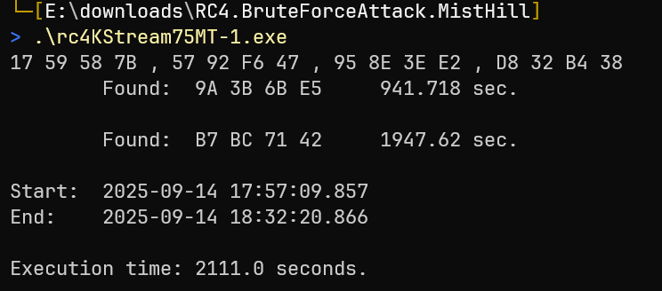

试了一下 `B7 BC 71 42` 能得到合理的 PE 文件。

这次的 pyd 不像是 Cython 生成的了，更像是人工写的 C 扩展模块。这种 pyd 基本没有 Python 方面的障碍。

容易定位到唯一的加密函数：

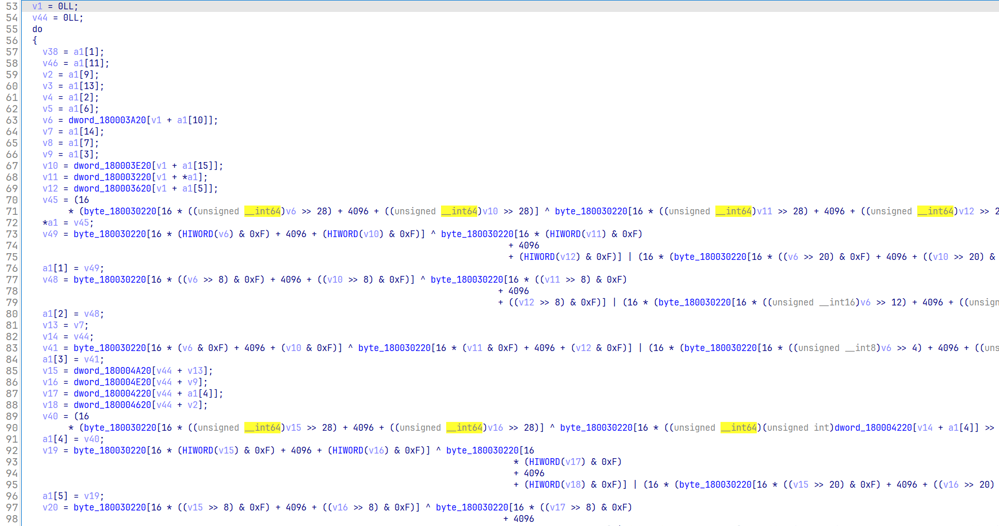

这个文件我也放在：https://files.xinshi.fun/n1junior2502-pyramid/checkinput.pyd

## RE 手无脑学会解白盒 AES

我曾经认为白盒 AES 这种东西不应该属于 RE 手需要掌握的知识，并且认为我不会去学这种东西。直到我在 CTF 以外的两个地方见到了白盒 AES。

先说明，白盒 AES 就是普通的 AES，不是另一套算法。它和 “查表法 AES” 也是同一回事，为什么会有查表法 AES 呢，多数情况下是用到的密码学库的优化\+编译优化的结果。AES 实在太常用了，而且时间复杂度没那么低；一些密码学库会在 `AES_init` 的时候预处理并展开 key；如果 key 是字面量，还可能在编译时进行常量计算。这样编译后的可执行文件中就没有明文 key 了。所以少数情况下人们也用它来隐藏 key。

理解原理固然是好事，但是你是 RE 手，不是密码手，会跑脚本就行了，原理的事由做密码分析的人和写工具的人干。那魔改算法（比如说异或个东西）的 CTF 题是另一回事。

要无脑解白盒 AES，需要以下条件：

- 能调试并动态修改运行的程序实例

- `pip install phoenixAES`

- 下载并编译 https://github.com/SideChannelMarvels/Stark/blob/master/aes_keyschedule.c

一般 16 字节密钥的 AES 解密过程有 10 轮，将最后一轮部分过程移出循环并调换部分相对独立步骤的顺序，会得到最外层有 9 次循环（伪代码摘抄自文末参考资料 1）：

```Plain Text
state ← plaintext
for r = 1 ... 9
    ShiftRows(state)
    AddRoundKey(state, k_{r-1})
    SubBytes(state)
    MixColumns(state)
ShiftRows(state)
AddRoundKey(state, k_9)
SubBytes(state)
AddRoundKey(state, k_{10})
ciphertext ← state
```

本题中的 9 次循环：

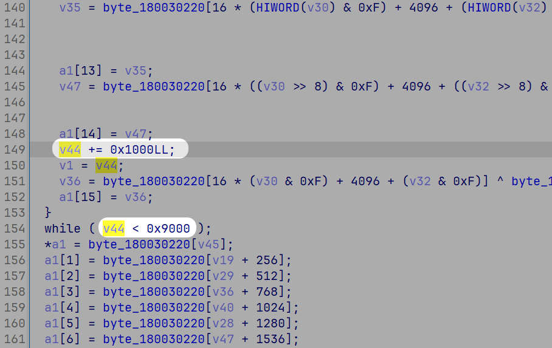

只加密 16 个字节的函数，一律视为 ECB/NoPadding 模式。

故障注入攻击的时机可以在倒数第二轮列混淆后、最后一轮列混淆前，比如可以在最后一次循环前，目的是使得最后的结果与正确的结果有 4 个字节的不同（为什么选在这个时机：图示见文末参考资料 2）

我们要记录下正确的结果 \+ 16 组故障的结果，然后跑脚本。

16 组故障的结果是，对同一组明文分别加密，第一组在注入时机改 16 字节中间密文中的第一个字节，第二组改第二个字节，以此类推。我照搬了参考资料 2，分别把它们改成 0x10。

hook 是很好的，但我目前只会打断点手改。为了在最后一轮循环前修改 1 个字节数据，在这里打条件断点：

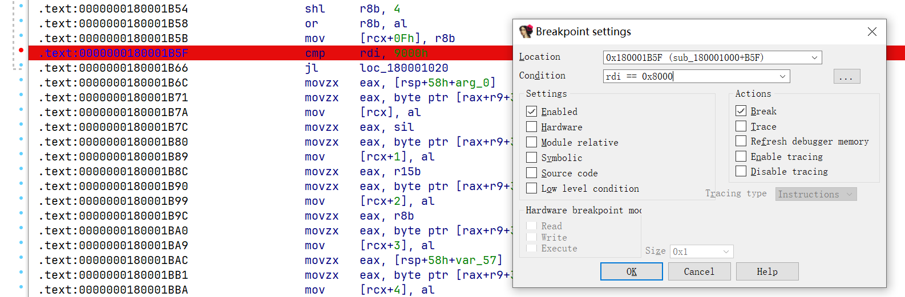

为了记录最后的结果，在这里打断点：

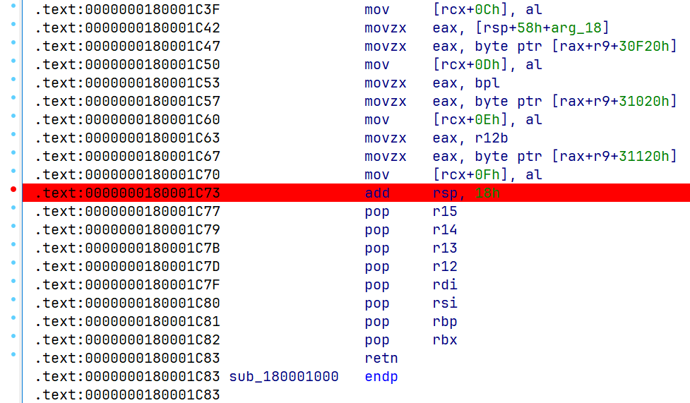

启动调试已经在前面说过了，输入一个明文（保持一致），我这里传全 \\x00：

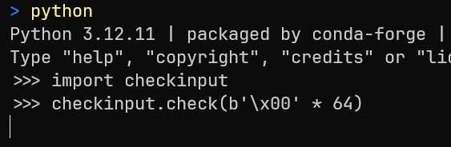

断在注入时机的时候，将第一个字节改成 0x10：

`idc.patch_byte(ida_dbg.get_reg_val("rcx") + 0, 0x10)`

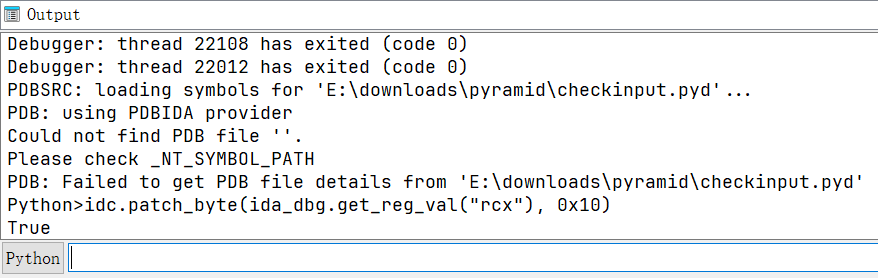

继续运行，断在结束的时候，点进 rcx 的地址记录下 16 字节结果：

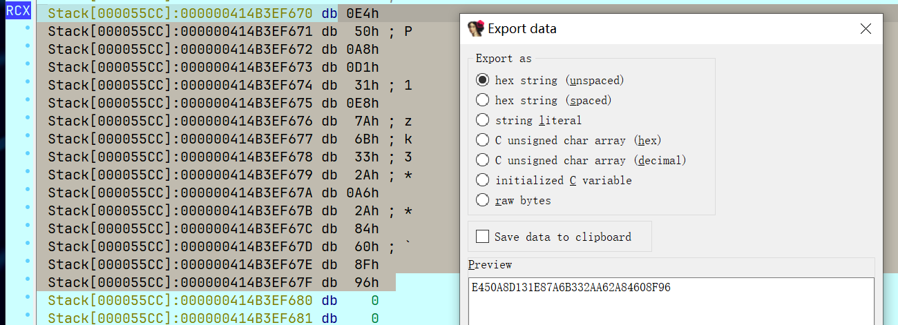

如果与正确的结果相差 4 个字节，就是好的。

以此类推，总共记录下正确结果 \+ 16 组故障结果：

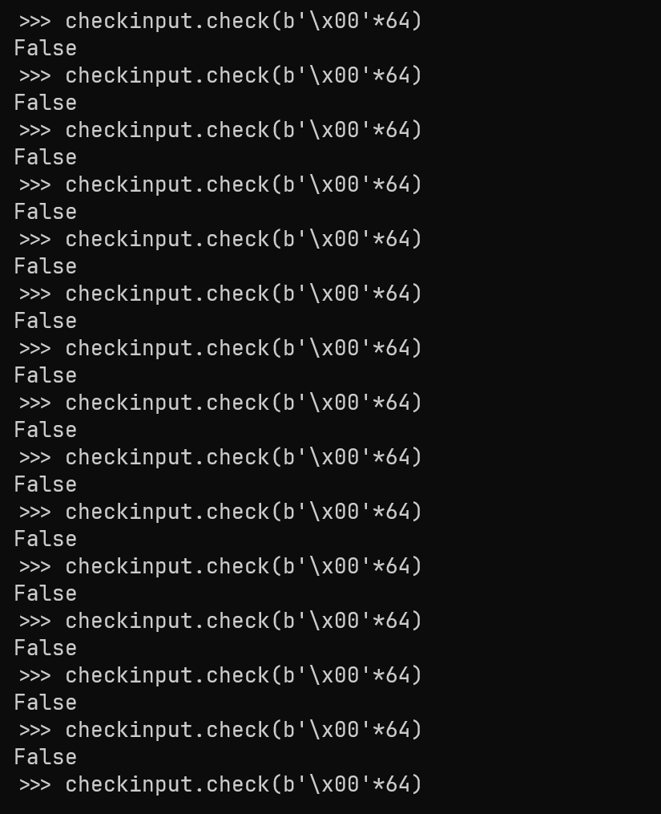

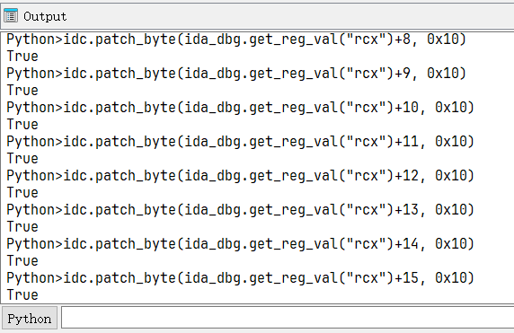

```python
import phoenixAES

with open("tracefile", "w") as t:
    t.write("""
0150A8D131E87AE1332AE72A84C28F96
E450A8D131E87A6B332AA62A84608F96
0150A83E31E893E13313E72A7AC28F96
0150FED131537AE12A2AE72A84C28F0E
016BA8D18EE87AE1332AE76084C2D696
01C0A8D1A4E87AE1332AE74E84C2D296
F150A8D131E87A38332A5A2A84718F96
0150A81031E8B6E1335BE72A4CC28F96
0150C2D131ED7AE16F2AE72A84C28F02
015098D131AE7AE1B62AE72A84C28F2C
0141A8D166E87AE1332AE7D484C29796
6A50A8D131E87AB0332A102A84698F96
0150A86031E887E13369E72A47C28F96
0150A82231E8EAE133EBE72A4AC28F96
015075D131477AE1442AE72A84C28F48
015BA8D17BE87AE1332AE79C84C24D96
1E50A8D131E87AB5332A5C2A84718F96
""")

phoenixAES.crack_file("tracefile", [], True, False, 3)

```

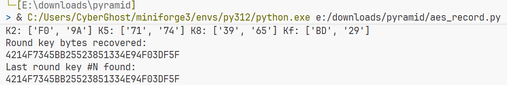

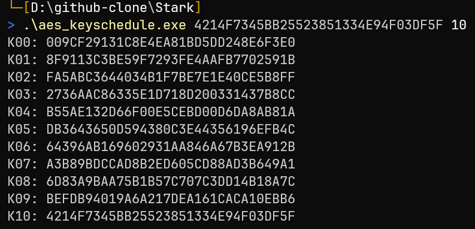

`009CF29131C8E4EA81BD5DD248E6F3E0` 就是 AES key。

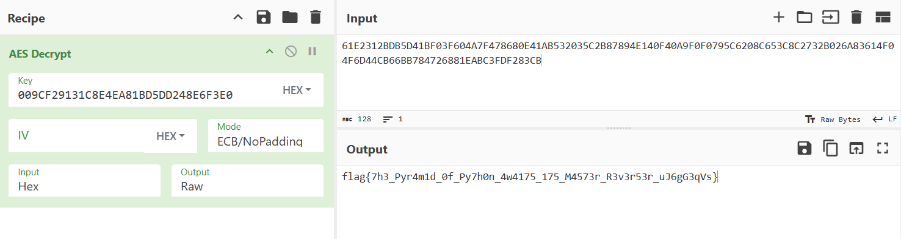

参考资料：

1. 详解白盒AES以及C代码实现（以CTF赛题讲解白盒AES） https://xz.aliyun.com/news/16176

2. DFA还原白盒AES密钥 https://www.zskkk.cn/posts/15785/
