个人赛，排名：34 / 1048

除签到和问卷外共 37 题，解出 6 题。这次 Misc 解出人数很多，解出的 4 道 Misc 分数加起来还没有 1 道 Crypto 高。我的分数主要来源于 Crypto 题。

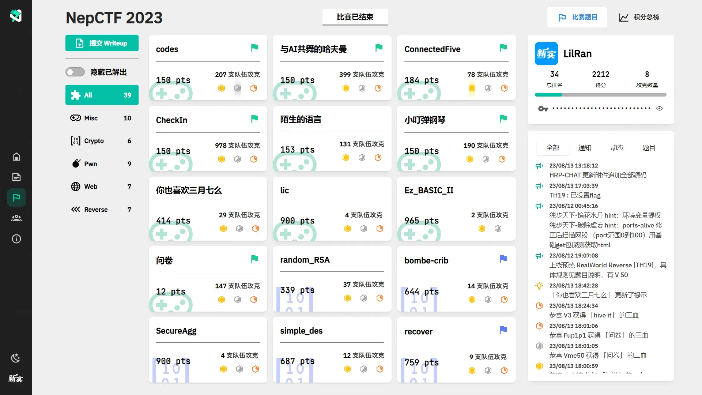

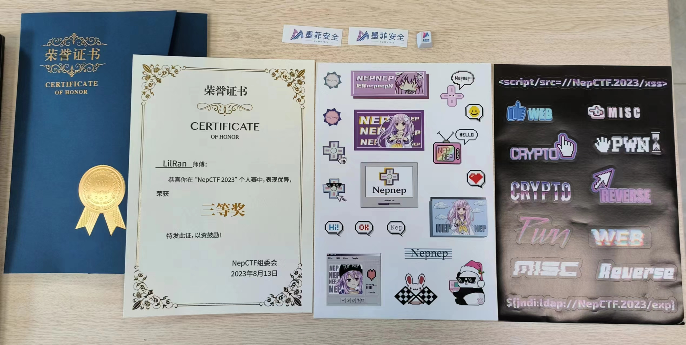

## Crypto

### bombe-crib

> [附件下载](https://files.xinshi.fun/nepctf-2023/crib.zip)
> 
> 面对每天六点德军铺天盖地的天气预报，你突然想到了怎么确定关键信息的位置。
> 
> 14 人攻克 644 pts

题目随机选取 rotor 、原文、插入特定字符串的位置 pos ，然后重复 20 次随机选取 key 和 plugin 并得到密文。求 pos 。

网上搜索 Enigma ，看到 CyberChef 的 wiki ，上面指出原文和密文同一位置上的字母不可能相同。


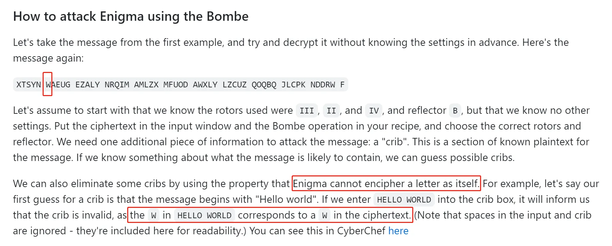


由于我们有 20 条密文，据此可以排除大部分 pos 。用一组数据测试，效果很好。


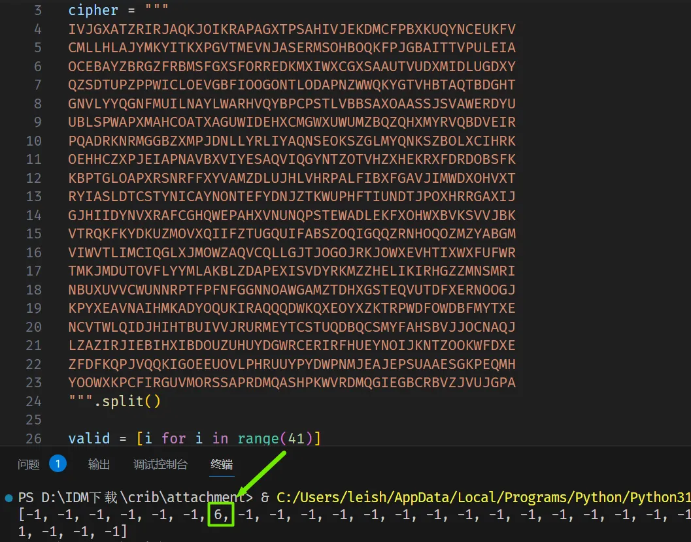


用 pwntools 交互，完整程序：

```python
import string
import hashlib
from pwn import *

def Pow(req,dig):
    print(req)
    print(dig)
    for i1 in string.ascii_letters+string.digits:
        for i2 in string.ascii_letters+string.digits:
            for i3 in string.ascii_letters+string.digits:
                for i4 in string.ascii_letters+string.digits:
                    if hashlib.sha256((i1+i2+i3+i4+req).encode()).hexdigest()==dig:
                        return i1+i2+i3+i4

s = remote('nepctf.1cepeak.cn','8888')
context.log_level = 'debug'

powtask = s.recvline().decode()
powres = Pow(powtask[16:32],powtask[37:101])
s.sendline(powres.encode())

crib = 'WETTERBERICHT'
for _ in range(10):

    s.recv()

    cipher = []
    for i in range(20):
        cipher.append(s.recvline().decode().strip())
    
    print(cipher)
    s.recvline()
    
    valid = [i for i in range(41)]
    for i in range(41):
        for j in range(20):
            if cipher[j][i] == 'W':
                valid[i] = -1
            elif cipher[j][i] == 'E':
                valid[i-1] = -1 if i-1>=0 else valid[i-1]
                valid[i-4] = -1 if i-4>=0 else valid[i-4]
                valid[i-7] = -1 if i-7>=0 else valid[i-7]
            elif cipher[j][i] == 'T':
                valid[i-2] = -1 if i-2>=0 else valid[i-2]
                valid[i-3] = -1 if i-3>=0 else valid[i-3]
                valid[i-12] = -1 if i-12>=0 else valid[i-12]
            elif cipher[j][i] == 'R':
                valid[i-5] = -1 if i-5>=0 else valid[i-5]
                valid[i-8] = -1 if i-8>=0 else valid[i-8]
            elif cipher[j][i] == 'B':
                valid[i-6] = -1 if i-6>=0 else valid[i-6]
            elif cipher[j][i] == 'I':
                valid[i-9] = -1 if i-9>=0 else valid[i-9]
            elif cipher[j][i] == 'C':
                valid[i-10] = -1 if i-10>=0 else valid[i-10]
            elif cipher[j][i] == 'H':
                valid[i-11] = -1 if i-11>=0 else valid[i-11]

    for i in valid:
        if i != -1:
            s.sendline(str(i).encode())
            break

s.interactive()
```


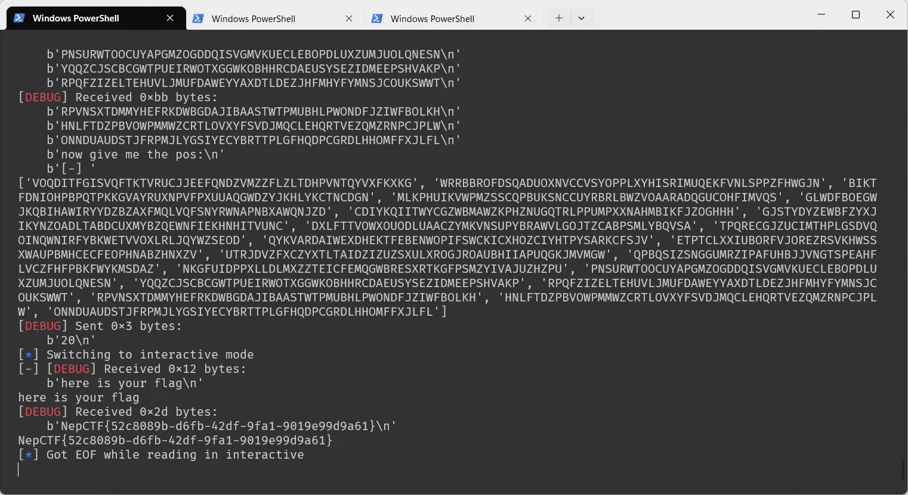


🚩 `NepCTF{52c8089b-d6fb-42df-9fa1-9019e99d9a61}`

### recover

> [附件下载](https://files.xinshi.fun/nepctf-2023/recover.zip)
> 
> 小A发现一段纯P盒加密的密文，但等待他还原的其实是……？
> 
> 9 人攻克 759 pts

题目很妙。

凌晨两点以为做完了，结果发现只做了一半，当时就破防了。

注意到 flag 长度为 58 ，被填充成 64 字节，然后分成 8 组加密，各组互不影响。题目中指出 flag 格式为 `flag{纯小写字母}` ，则第一个分组明文为 `b"\0\0\0\0\0\0fl"` 。

又注意到 P 盒是 8 项一组，各组互不干扰，相当于 8 个 P 盒拼起来。这样，我们就可以对明文**每个字节单独加密**，减少爆破所需次数。

我们又有 flag 前缀一些字节的明文和密文，可以尝试找出与每个字节对应的 key 。从第一个字节（ `'\0' -> 0b11101100` ）和第九个字节（ `'a' -> 0b11000100` ）开始，这样会得到 `key[0:24:8]` ：

```python recover-key0.py

P1= [[0, 2, 3, 4, 5, 6],
     [1, 4],
     [0, 3],
     [0, 3, 4, 5],
     [0, 1, 2, 3, 4, 7],
     [2, 3, 4, 5, 6],
     [0, 1, 2, 3],
     [1, 2, 3, 4, 5, 7]]

def enc(v, keys, le=8):
    t = v
    for i in keys:
        q = []
        for j in P1:
            tmp = 0
            for k in j:
                tmp ^= t[k]
            q.append(tmp)
        t = [int(q[j]) ^ int(i[j]) for j in range(le)]
    return t

byte1 = [0] * 8
byte9 = [0,1,1,0,0,0,0,1]

cipher1 = [1,1,1,0,1,1,0,0]
cipher9 = [0,1,1,0,0,1,1,0]

keys1 = [[0] * 8, [0] * 8, [0] * 8]
for i in range(2**24):
    m = bin(i)[2:].zfill(24)
    keys1[0] = [int(j) for j in m[:8]]
    keys1[1] = [int(j) for j in m[8:16]]
    keys1[2] = [int(j) for j in m[16:]]
    res1 = enc(byte1,keys1,8)
    res9 = enc(byte9,keys1,8)
    if all([res1[x]==cipher1[x] for x in range(8)]) and all([res9[x]==cipher9[x] for x in range(8)]):
        print(keys1)
```

得到的是 `[ key[0], key[8], key[16] ]` ，有很多种可能。特殊地，存在 `key[0] = key[8] = 0` 。


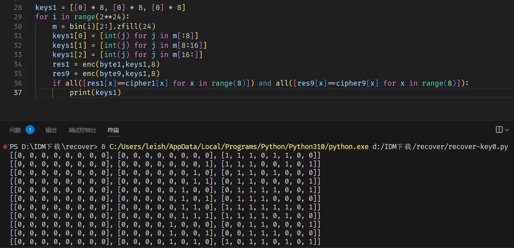


那么猜想存在一个可行的 `key` ，使得 `key[:16]=0` 。（大胆猜测，没有证明，~~猜对就赚了~~）

尝试用 flag 的前 8 字节 `b"\0\0\0\0\0\0fl"` 算出这个 key ：

```python recover-key.py

from Crypto.Util.number import *
from 题目 import P

P = [[i%8 for i in j] for j in P]

def enc(v, keys, le, Pcertain):
    t = v
    for i in keys:
        q = []
        for j in Pcertain:
            tmp = 0
            for k in j:
                tmp ^= t[k]
            q.append(tmp)
        t = [int(q[j]) ^ int(i[j]) for j in range(le)]
    return t

msg0 = [int(i) for i in bin(bytes_to_long(b"\0\0\0\0\0\0fl"))[2:].zfill(64)]

cipher = [int(i) for i in '1110110010000011010110010110000110011101110010011100000001011000']

keys = []
for t in range(0,64,8):
    key = [[0] * 8] * 3
    for i in range(2**8):
        m = bin(i)[2:].zfill(8)
        key[2] = [int(j) for j in m]
        res = enc(msg0[t:t+8], key, 8, P[t:t+8])
        if all([res[x]==cipher[t:t+8][x] for x in range(8)]):
            keys += key[2]

print(keys)

# [1, 1, 1, 0, 1, 1, 0, 0, 1, 0, 0, 0, 0, 0, 1, 1, 0, 1, 0, 1, 1, 0, 0, 1, 0, 1, 1, 0, 0, 0, 0, 1, 1, 0, 0, 1, 1, 1, 0, 1, 1, 1, 0, 0, 1, 0, 0, 1, 1, 0, 0, 0, 0, 0, 1, 0, 1, 0, 0, 0, 0, 0, 1, 0]
```

以上得到的是 key 的后 8 字节；前 16 字节为 0 。尝试用这个 key 得到 flag ：

```python recover-msg.py

from Crypto.Util.number import *
from 题目 import P

P = [[i%8 for i in j] for j in P]

def enc(v, keys, le, Pcertain):
    t = v
    for i in keys:
        q = []
        for j in Pcertain:
            tmp = 0
            for k in j:
                tmp ^= t[k]
            q.append(tmp)
        t = [int(q[j]) ^ int(i[j]) for j in range(le)]
    return t

cipher = [int(i) for i in '11101100100000110101100101100001100111011100100111000000010110000110011011000100110101110111010000100100001100010011001100010100101000110001011101000000100010101000000110000110011110001101110110110111000000100010011011011011101011101000000000100010000101001110100101011000001110010000000000100110001101110011111010001100101101111010101111101110100110101010011010011010101110100001001101100110010000010000011100100101111010010000011001000110000100110111100010101011000100100111010000101010110110001010110101111111']

keys = [1, 1, 1, 0, 1, 1, 0, 0, 1, 0, 0, 0, 0, 0, 1, 1, 0, 1, 0, 1, 1, 0, 0, 1, 0, 1, 1, 0, 0, 0, 0, 1, 1, 0, 0, 1, 1, 1, 0, 1, 1, 1, 0, 0, 1, 0, 0, 1, 1, 0, 0, 0, 0, 0, 1, 0, 1, 0, 0, 0, 0, 0, 1, 0]

msg = 'fl'

for t in range(8,64):
    for c in range(32,127):
        m = [int(i) for i in bin(c)[2:].zfill(8)]
        res = enc(m,
                  [ [0] * 64, [0] * 64, keys[t%8*8:t%8*8+8] ],
                  8,
                  P[t%8*8:t%8*8+8])
        if all([res[x]==cipher[t*8:t*8+8][x] for x in range(8)]):
            msg += chr(c)

print(msg)

# flag{flag_is_the_readable_key_whose_md5_starts_with_3fe04}
```

能得到结果，但并不是最终的 flag 。我们现在有完整的明文和密文，还要求出一个特定的 key 。这个 key 结构如下：


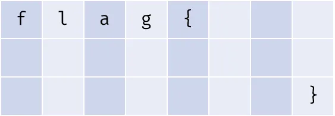


可以用上面用过的思路，枚举所有可能的 key 。（屎山代码，能跑就行）

```python recover-ans.py

from Crypto.Util.number import *
from hashlib import md5
from tqdm import tqdm
from 题目 import P

P = [[i%8 for i in j] for j in P]

def enc(v, keys, le, Pcertain):
    t = v
    for i in keys:
        q = []
        for j in Pcertain:
            tmp = 0
            for k in j:
                tmp ^= t[k]
            q.append(tmp)
        t = [int(q[j]) ^ int(i[j]) for j in range(le)]
    return t

msg = [int(i) for i in bin(bytes_to_long(b"\0\0\0\0\0\0flag{flag_is_the_readable_key_whose_md5_starts_with_3fe04}"))[2:].zfill(512)]

cipher = [int(i) for i in '11101100100000110101100101100001100111011100100111000000010110000110011011000100110101110111010000100100001100010011001100010100101000110001011101000000100010101000000110000110011110001101110110110111000000100010011011011011101011101000000000100010000101001110100101011000001110010000000000100110001101110011111010001100101101111010101111101110100110101010011010011010101110100001001101100110010000010000011100100101111010010000011001000110000100110111100010101011000100100111010000101010110110001010110101111111']

def threecharkey(z):

    keys = []

    key = [[0] * 8] * 3
    for i in range(0x61,0x61+26):
        m = bin(i)[2:].zfill(8)
        key[0] = [int(u) for u in m]
        for j in range(0x61,0x61+26):
            n = bin(j)[2:].zfill(8)
            key[1] = [int(u) for u in n]
            for k in range(0x61,0x61+26):
                o = bin(k)[2:].zfill(8)
                key[2] = [int(u) for u in o]

                if all(enc(msg[t:t+8], key, 8, P[t%64:t%64+8])==cipher[t:t+8] for t in range(z,512,64)):
                    keys.append(chr(i)+chr(j)+chr(k))
    
    return keys

def twocharkey(z,ch):

    keys = []

    key = [[0] * 8] * 3
    i = ord(ch)
    m = bin(i)[2:].zfill(8)
    key[0] = [int(u) for u in m]
    for j in range(0x61,0x61+26):
        n = bin(j)[2:].zfill(8)
        key[1] = [int(u) for u in n]
        for k in range(0x61,0x61+26):
            o = bin(k)[2:].zfill(8)
            key[2] = [int(u) for u in o]

            if all(enc(msg[t:t+8], key, 8, P[t%64:t%64+8])==cipher[t:t+8] for t in range(z,512,64)):
                keys.append(chr(i)+chr(j)+chr(k))
    
    return keys

def lastcharkey(z):

    keys = []

    key = [[0] * 8] * 3
    for i in range(0x61,0x61+26):
        m = bin(i)[2:].zfill(8)
        key[0] = [int(u) for u in m]
        for j in range(0x61,0x61+26):
            n = bin(j)[2:].zfill(8)
            key[1] = [int(u) for u in n]
            k = ord('}')
            o = bin(k)[2:].zfill(8)
            key[2] = [int(u) for u in o]

            if all(enc(msg[t:t+8], key, 8, P[t%64:t%64+8])==cipher[t:t+8] for t in range(z,512,64)):
                keys.append(chr(i)+chr(j)+chr(k))
    
    return keys

keysset = [twocharkey(0,'f'),twocharkey(8,'l'),twocharkey(16,'a'),twocharkey(24,'g'),twocharkey(32,'{'),threecharkey(40),threecharkey(48),lastcharkey(56)]

with tqdm(total=3*3*4*5*3*77*70*4) as pbar:
 for a in keysset[0]:
  for b in keysset[1]:
   for c in keysset[2]:
    for d in keysset[3]:
     for e in keysset[4]:
      for f in keysset[5]:
       for g in keysset[6]:
        for h in keysset[7]:
            keypossible = (a+b+c+d+e+f+g+h)[0:24:3]+(a+b+c+d+e+f+g+h)[1:24:3]+(a+b+c+d+e+f+g+h)[2:24:3]
            pbar.update(1)
            if md5(keypossible.encode()).hexdigest()[:5]=='3fe04':
                print('\n'+keypossible)
```

爆破 30 秒内可以得到正确的 key：


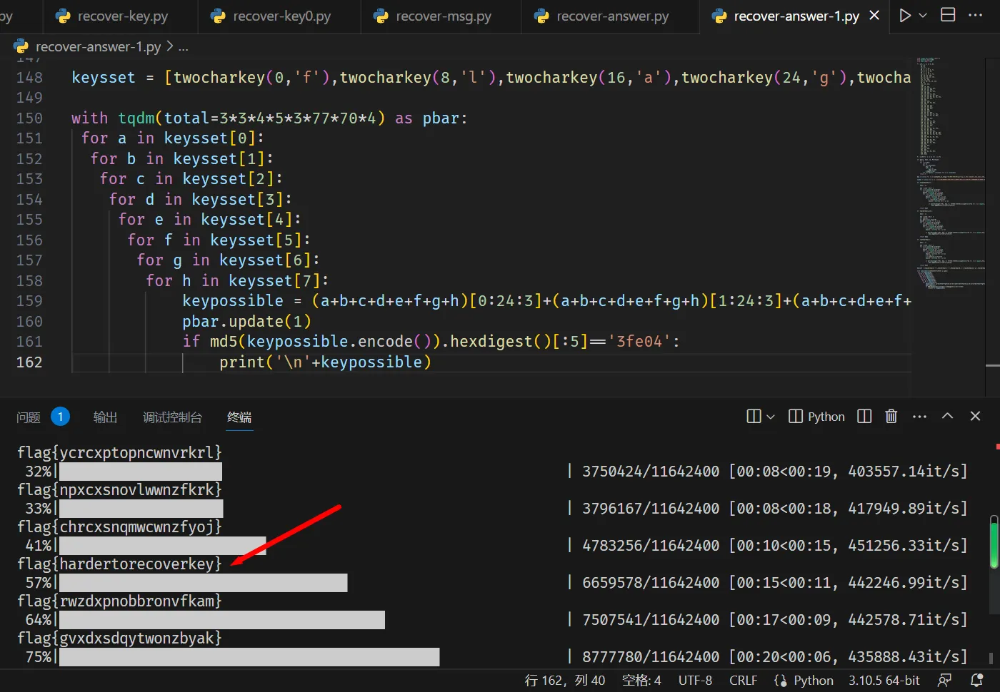


🚩 `flag{hardertorecoverkey}`

## Misc

### codes

> 你很会写代码吗，你会写有什么用！出来混 讲的是皮 tips:flag格式为Nepctf{},flag存在环境变量
> 
> 207 人攻克 150 pts

经尝试，如果源码中出现了 `sys` , `env` , `open` 等字样，就拒绝编译。

尝试半小时，必应一分钟。搜到的第一条就可以。


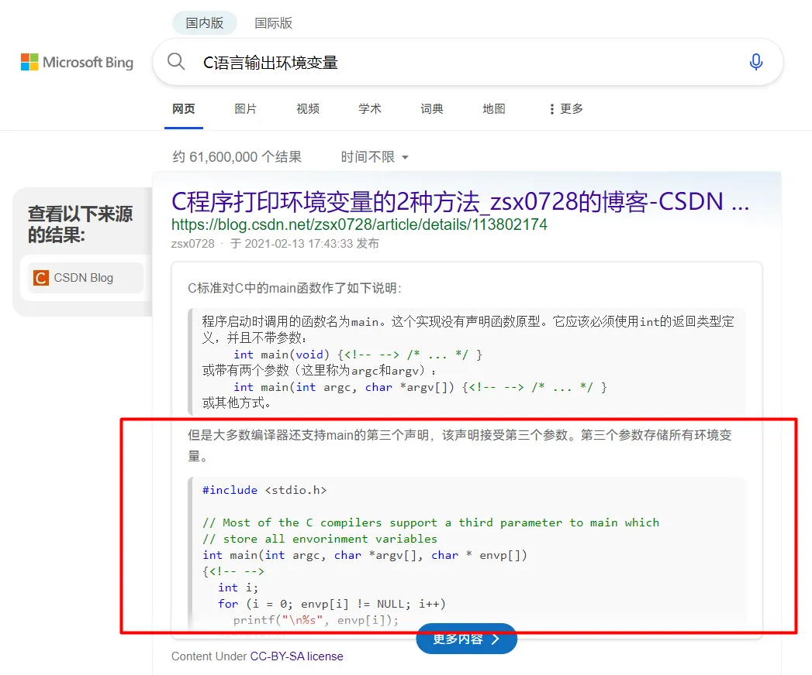


```c
#include <stdio.h>

int main(int argc, char* argv[], char* e[]) {
    int i; 
    for (i = 0; e[i] != NULL; i++) 
        printf("\n%s", e[i]);
    return 0;
}
```


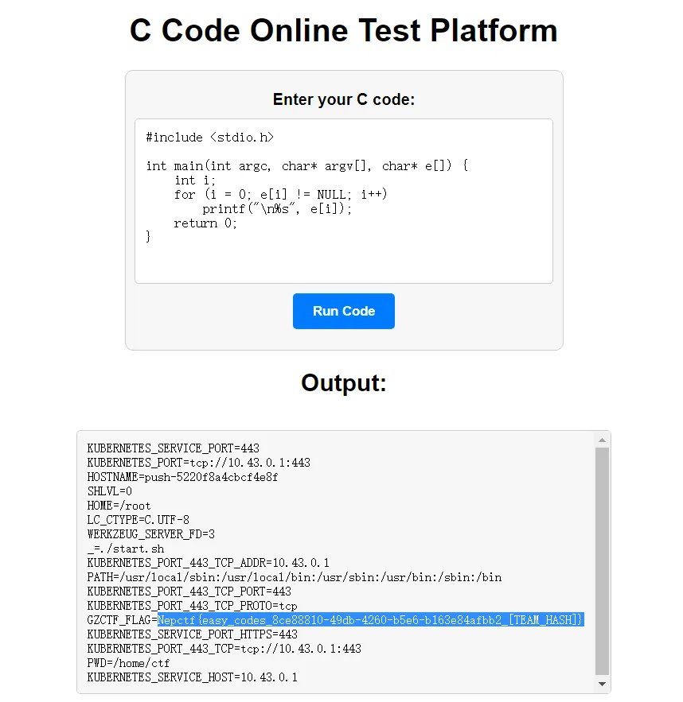


🚩 `Nepctf{easy_codes_8ce88810-49db-4260-b5e6-b163e84afbb2_[TEAM_HASH]}`

### 小叮弹钢琴

> 小叮今天终于学会了弹钢琴，来看看他弹得怎么样吧
> 
> 190 人攻克 150 pts

MIDI 文件，用 Audacity 打开。


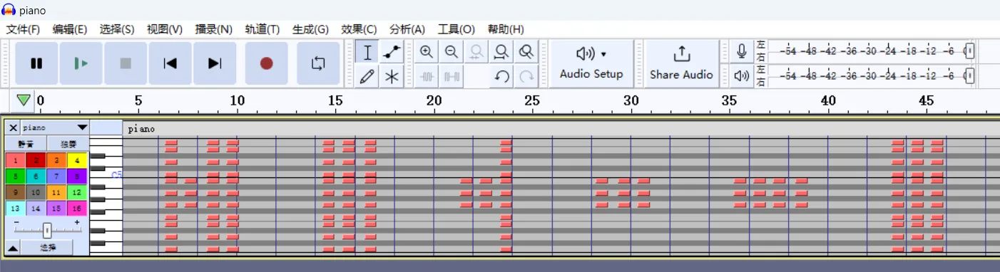


前半部分是摩斯电码，后半部分是用形状表示的十六进制数字。


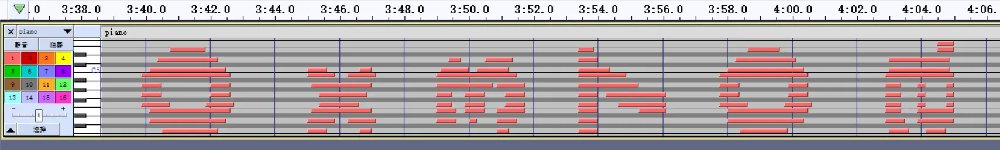


```plaintext
-.--/---/..-/.../..../---/..-/.-../-../..-/..././-/..../../.../-/---/-..-/---/.-./.../---/--/./-/..../../-./--.
youshouldusethistoxorsomething

0x370a05303c290e045005031c2b1858473a5f052117032c39230f005d1e17
```

要注意本题的摩斯电码必须全部解码为小写字母，如果是大写字母就得不到正确的 flag 。

```c
#include <stdio.h>
int main() {
    char strxor[] = "youshouldusethistoxorsomething";
    char strraw[] = "\x37\x0a\x05\x30\x3c\x29\x0e\x04\x50\x05\x03\x1c\x2b\x18\x58\x47\x3a\x5f\x05\x21\x17\x09\x2c\x39\x23\x0f\x00\x5d\x1e\x17";
    for(int i=0; i<30; i++) {
        strraw[i] ^= strxor[i];
    }
    printf(strraw);
    return 0;
}
```


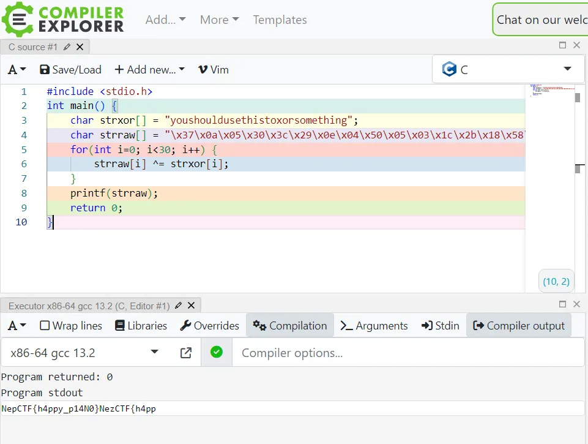


🚩 `NepCTF{h4ppy_p14N0}`

### ConnectedFive

> Let's play five in a row with something strange.
> 
> Input Format : two lowercase letter
> 
> Target: 42 x 5 in a row
> 
> Time: 600 s
> 
> 78 人攻克 184 pts

人工队获胜，一血是手动玩出来的。

利用好连续六子的情况，这种情况会一次加 2 分。

好像电脑会帮我下几步棋？直到最后也没搞明白游戏规则。玩着玩着就赢 42 次了，就一血了。


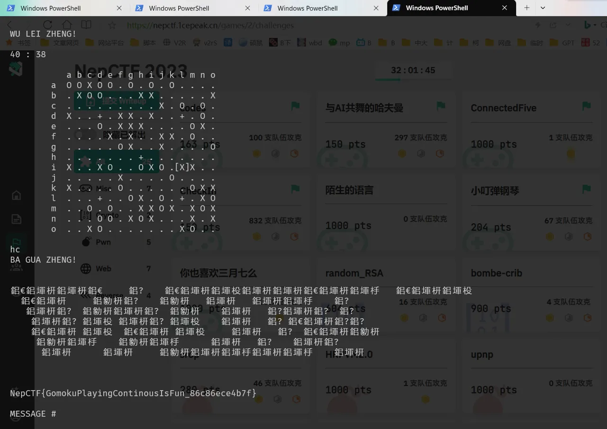


🚩 `NepCTF{GomokuPlayingContinousIsFun_86c86ece4b7f}`

### 与AI共舞的哈夫曼

> 年轻人就要年轻，正经人谁自己写代码啊~
> 
> 399 人攻克 150 pts

打开二进制文件，

Nepctf{human_zi6}……

2个p，3个f，2个_，3个6……

那当然是

🚩 `Nepctf{huffman_zip_666}`

（应该是出题人故意的）

> 哈夫曼编码是前缀编码的一种最优算法。贪心的过程是按出现频次从底层向顶层生成二叉树，出现频次低的字符被放在树的底层，编码更长。编码得到的二进制串能唯一地进行解码还原。
