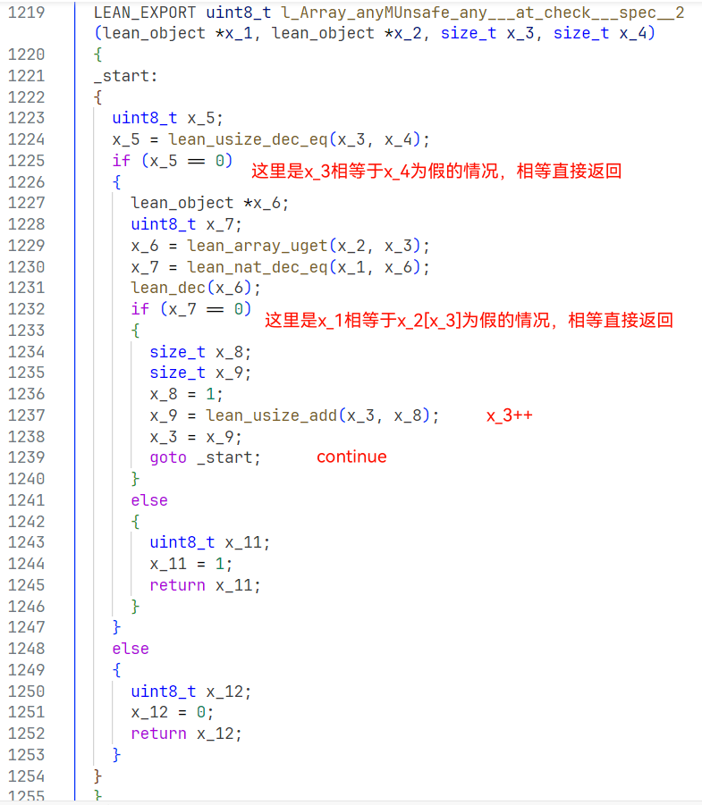
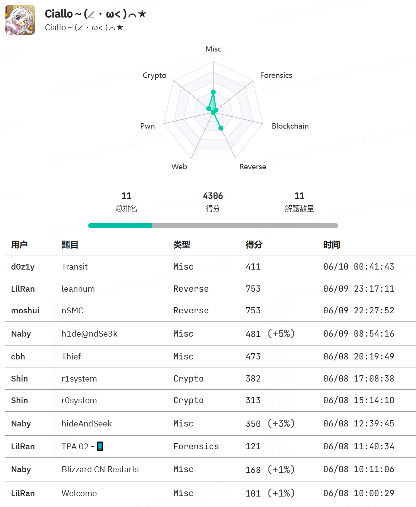
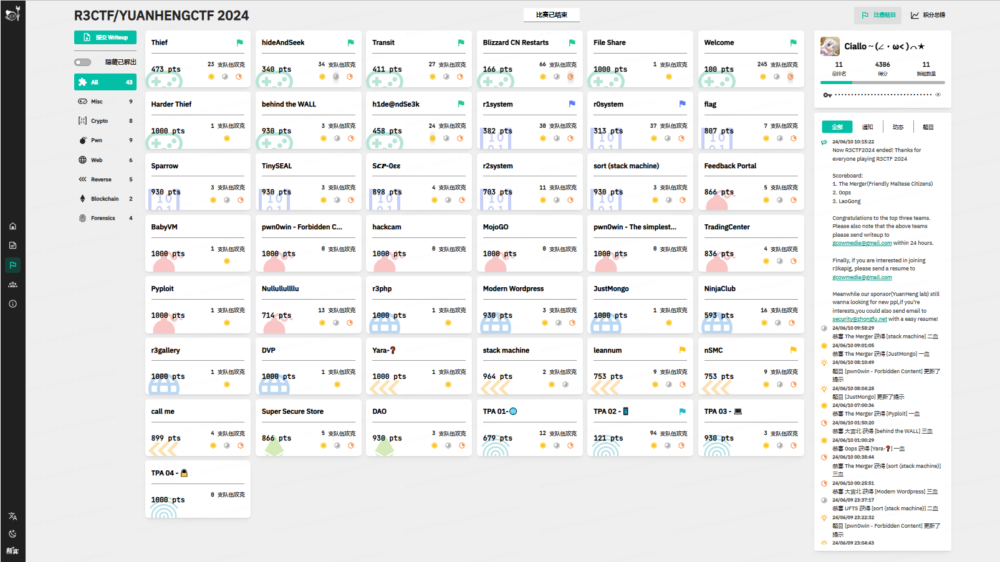

Ciallo～(∠・ω< )⌒★

# Reverse - leannum

[附件下载](https://files.xinshi.fun/r3ctf-2024/leannum.zip)

题目给的是 Lean 编程语言的编译产物和中间文件，Lean 是一种函数式编程语言。上次 AkiraHomework 没做出来，这次想做出来。

## 概览

比较有用的文件有 ir/Main.c 和 bin/leannum。

运行和动态调试用二进制文件，题目给的是 Nix 环境下的，Ubuntu/Kali 直接运行会提示没有那个文件或目录。墨水师傅教我的 patch：

> patchelf --set-interpreter /lib64/ld-linux-x86-64.so.2 --set-rpath /nix/store/apab5i73dqa09wx0q27b6fbhd1r18ihl-glibc-2.39-31/lib leannum

patch 完就可以运行和动态调试了。

二进制文件反编译后可以看到很多判断整数最低位的操作，属于 Lean 的数据结构，不好看。https://lean-lang.org/lean4/doc/dev/ffi.html

读程序逻辑时看 C 文件，因为 Lean 库函数还没有展开和内联，能把注意力集中在用户代码。

包含的 lean.h 是开源的，在遇到光看函数名称看不懂的时候可以查阅：https://github.com/leanprover/lean4/blob/master/src/include/lean/lean.h

先缩进一下，大概看看两千多行每个部分在干什么。前面的函数声明不用看，中间对函数装箱的函数没被调用也不用看。前面一半79个函数，接近9*9，是在构造挖空的目标数独矩阵，被最后的 initialize_Main 函数依次调用。_lean_main 函数从标准输入读字符串，调用 l_fromString 转化为数独矩阵（标志性的减48），然后调用 l_check 判断是否符合数独规则，最后输出结果。中间那些名字很长的函数，就是判断逻辑的片段。

数组、数组的数组、装箱等都是 lean_object。有非常多的 lean_inc 和 lean_dec 函数调用，都不用看，是在引用计数。

所以要看的就是 目标矩阵构造过程 和 简化判断逻辑。

断点打在 l_fromString 和 l_check，会发现输入连续 81 个范围在0..9（而不是1..=9）的阿拉伯数字，才能进入 l_check 函数。

## 目标矩阵构造过程

可执行文件反编译中，这个过程是内联的，但立即数是按 Lean 数据结构写的，是实际数乘2加1。直接看C也很好看。

lean_array_push 是一个**先copy后push**的过程，每次 push 都会得到一个新的对象，旧的对象也不会析构。第一个参数是一个数组，第二个参数（地址或立即数）直接作为一个数 push 进去。

全局变量 l_target 在 l_check 中被使用，l_target 就是 l_target___closed__79，回溯 l_target___closed__79 的 push 过程，开始是立即数 9，然后接 l_target___closed__12、21、27、38、42、46、55、62、70 共 9 个数组地址。回溯 l_target___closed__12 的 push 过程，开始是立即数 9，然后接立即数6、box(0)、立即数1、6个box(0)。以此类推，就得到了 9*9 二维数组。

```lua
a1 = 6
a2 = 1
a3 = 9
a4 = a3, a1
a5 = a4, {}
a6 = a5, a2
a7 = a6, {}
a8 = a7, {}
a9 = a8, {}
a10 = a9, {}
a11 = a10, {}
a12 = a11, {}
a13 = a3, {}
a14 = a13, {}
a15 = a14, {}
a16 = a15, {}
a17 = a16, {}
a18 = a17, {}
a19 = a18, {}
a20 = a19, {}
a21 = a20, {}
a22 = 5
a23 = a16, a22
a24 = a23, {}
a25 = a24, {}
a26 = a25, {}
a27 = a26, {}
a28 = 4
a29 = 2
a30 = a3, a28
a31 = a30, {}
a32 = a31, a22
a33 = a32, {}
a34 = a33, a29
a35 = a34, {}
a36 = a35, {}
a37 = a36, {}
a38 = a37, {}
a39 = 0
a40 = a18, a39
a41 = a40, a29
a42 = a41, {}
a43 = 7
a44 = a18, a43
a45 = a44, {}
a46 = a45, a22
a47 = 3
a48 = a13, a47
a49 = a48, {}
a50 = a49, {}
a51 = a50, {}
a52 = a51, {}
a53 = a52, a28
a54 = a53, {}
a55 = a54, {}
a56 = a14, a43
a57 = a56, a28
a58 = a57, {}
a59 = a58, a2
a60 = a59, {}
a61 = a60, {}
a62 = a61, {}
a63 = a13, a28
a64 = a63, {}
a65 = a64, {}
a66 = a65, {}
a67 = a66, {}
a68 = a67, {}
a69 = a68, {}
a70 = a69, {}
a71 = a3, a12
a72 = a71, a21
a73 = a72, a27
a74 = a73, a38
a75 = a74, a42
a76 = a75, a46
a77 = a76, a55
a78 = a77, a62
a79 = a78, a70
```

```python
[ 6, -1,  1, -1, -1, -1, -1, -1, -1], 
[-1, -1, -1, -1, -1, -1, -1, -1, -1], 
[-1, -1, -1, -1,  5, -1, -1, -1, -1], 
[ 4, -1,  5, -1,  2, -1, -1, -1, -1], 
[-1, -1, -1, -1, -1, -1,  0,  2, -1], 
[-1, -1, -1, -1, -1, -1,  7, -1,  5], 
[-1,  3, -1, -1, -1, -1,  4, -1, -1], 
[-1, -1,  7,  4, -1,  1, -1, -1, -1], 
[-1,  4, -1, -1, -1, -1, -1, -1, -1],
```

已定的格子非常少，可能除了横向、纵向外，还有别的必须满足的规则，还是要逆逻辑。

## 简化判断逻辑

由于编译中间语言的原因，一两条语句能说明白的东西拆分成了很多条语句。

### for 循环

以 init_l_target 之后第一个函数 l_Array_anyMUnsafe_any___at_check___spec__2 为例：



这个函数只被调用一次，传入的 x_3 是 0，x_4 是数组长度。所以可以简化为：

```c
LEAN_EXPORT uint8_t l_Array_anyMUnsafe_any___at_check___spec__2(lean_object *x_1, lean_object *x_2, size_t x_3, size_t x_4)
{
  for (x_3 /* = 0 */; x_3 < x_4; x_3++)
  {
    if (x_2[x_3] == *x_1)
      return 1;
  }
  return 0;
}
```

这个函数的作用是判断 x_1 是否存在于 x_2 数组。

以此类推，很多函数的 for 循环都变成了这样，可以化简或者看多几个就习惯了。至于是立即数还是装箱后的数，凭感觉判断就行。

### 数组按索引取值和赋值

```c
lean_array_uget(a, b)        a[b]
lean_array_uset(a, b, c)     a[b] = c
lean_array_get(T, a, b)      (typeof(T))(a[b])
```

以下面这个函数为例，它被调用 9 次，传入的 x_1 分别是 0 至 8。

```c
LEAN_EXPORT lean_object *l_Array_mapMUnsafe_map___at_check___spec__4(lean_object *x_1, size_t x_2, size_t x_3, lean_object *x_4)    // in: idx(0..9), 9, 0, msg
{
_start:
{
  while(x_3 < x_2)
  {
    lean_object *x_6;
    lean_object *x_7;
    lean_object *x_8;
    lean_object *x_9;
    lean_object *x_10;
    lean_object *x_13;
    x_6 = lean_array_uget(x_4, x_3);          // 得到一行（这一行的地址）
    x_7 = lean_unsigned_to_nat(0u);
    x_8 = lean_array_uset(x_4, x_3, x_7);
    x_9 = l_instInhabitedNat;
    x_10 = lean_array_get(x_9, x_6, x_1);     // 再从这一行得到一个数
    x_13 = lean_array_uset(x_8, x_3, x_10);   // 用这一个数代替这一行
    x_3 ++;
    x_4 = x_13;
  }
  return x_4;
}
}
```

这个函数的作用是从矩阵中获得某一列，好判断这一列是否包含了 0..9。

类似的，l_Array_mapMUnsafe_map___at_check___spec__7 是从矩阵中获得某一条主对角线，好判断这一条主对角线是否包含了 0..9。总共要判断 9 条主对角线。

到这里就可以猜出判定逻辑、求解了，不过再看看 l_check 的逻辑。

### l_check

函数由好几个代码块组成，每个代码块要么返回，要么通过 goto 显式跳转到另一个代码块。控制流有很多判断条件，最后的目标是要返回 1。观察一下就可以发现，如果返回 1，那么必定是在 block_15 这个代码块返回的。有几个条件是已经知道正常情况下的值的，比如正常情况下矩阵长度大于 0 为真。一点一点地把正常情况不会执行的部分注释掉，剪枝一下，可以找到返回 1 的唯一控制流。

```c
LEAN_EXPORT uint8_t l_check(lean_object *x_1)
{
_start:
{
  lean_object *x_2;
  lean_object *x_3;
  uint8_t x_4;
  uint8_t x_5;
  lean_object *x_6;
  uint8_t x_7;
  lean_object *x_8;
  lean_object *x_9;
  lean_object *x_10;
  uint8_t x_11;
  uint8_t x_12;
  uint8_t x_16;
  x_2 = lean_array_get_size(x_1);    // 9
  x_3 = lean_unsigned_to_nat(0u);    // 0
  x_4 = lean_nat_dec_lt(x_3, x_2);   // true
  x_5 = LR____horizontal_all_0_to_len_i_in_a_for_a_in_x_1____l_Nat_allTR_loop___at_check___spec__6(x_1, x_2, x_2, x_2);  // sat requires x_5==true
  x_6 = l_size;
  x_7 = l_Nat_allTR_loop___at_check___spec__9(x_1, x_6, x_6);       // sat requires x_7==true
  x_8 = l_target;
  x_9 = l_Array_zip___rarg(x_1, x_8);
  x_10 = lean_array_get_size(x_9);
  x_11 = lean_nat_dec_lt(x_3, x_10);  // true
  if (x_4 == 0)                       // should never
  {
    // if (x_11 == 0)
    // {
    //   x_12 = 1;
    //   goto block_15_must_return_here;
    // }
    // else
    // {
    //   x_16 = 1;
    //   goto block_34;
    // }
  }
  else
  {
    size_t x_38;
    uint8_t x_39;
    x_38 = lean_usize_of_nat(x_2);
    x_39 = LR____not_that_all_0_to_len_i_in_a_for_a_in_x_1____l_Array_anyMUnsafe_any___at_check___spec__12(x_1, 0, x_38);
    if (x_39 == 0)                    // should always
    {
      if (x_11 == 0)                  // should never
      {
        // x_12 = 1;
        // goto block_15_must_return_here;
      }
      else
      {
        x_16 = 1;
        goto block_34;
      }
    }
    else
    {
      // if (x_11 == 0)
      // {
      //   return 0;
      // }
      // else
      // {
      //   x_16 = 0;
      //   goto block_34;
      // }
    }
  }
block_15_must_return_here:
  {
    if (x_5 == 0)
    {
      return 0;
    }
    else
    {
      if (x_7 == 0)
      {
        return 0;
      }
      else
      {
        return x_12;
      }
    }
  }
block_34:
  {
    uint8_t x_17;
    x_17 = lean_nat_dec_le(x_10, x_10);  // true
    if (x_17 == 0)
    {
      // if (x_11 == 0)
      // {
      //   if (x_16 == 0)
      //   {
      //     return 0;
      //   }
      //   else
      //   {
      //     x_12 = 1;
      //     goto block_15_must_return_here;
      //   }
      // }
      // else
      // {
      //   size_t x_21;
      //   uint8_t x_22;
      //   x_21 = lean_usize_of_nat(x_10);
      //   x_22 = l_Array_anyMUnsafe_any___at_check___spec__11(x_9, 0, x_21);
      //   if (x_22 == 0)
      //   {
      //     if (x_16 == 0)
      //     {
      //       return 0;
      //     }
      //     else
      //     {
      //       x_12 = 1;
      //       goto block_15_must_return_here;
      //     }
      //   }
      //   else
      //   {
      //     return 0;
      //     // if (x_16 == 0)
      //     // {
      //     //   return 0;
      //     // }
      //     // else
      //     // {
      //     //   x_12 = 0;
      //     //   goto block_15_must_return_here;
      //     // }
      //   }
      // }
    }
    else                               // should always
    {
      size_t x_28;
      uint8_t x_29;
      x_28 = lean_usize_of_nat(x_10);
      x_29 = l_Array_anyMUnsafe_any___at_check___spec__11(x_9, 0, x_28);       // sat requires x_29==false
      if (x_29 == 0)
      {
        if (x_16 == 0)                 // should never
        {
          // return 0;
        }
        else
        {
          x_12 = 1;
          goto block_15_must_return_here;
        }
      }
      else
      {
        return 0;
        // if (x_16 == 0)
        // {
        //   return 0;
        // }
        // else
        // {
        //   x_12 = 0;
        //   goto block_15_must_return_here;
        // }
      }
    }
  }
}
}
```

可以看到依次需要通过以下判断：

```plain
输入81个0..9的阿拉伯数字        true == l_fromString()
每列都是0..9                  true == l_Nat_allTR_loop___at_check___spec__6()
每条对角线都是0..9             true == l_Nat_allTR_loop___at_check___spec__9()
每行都是0..9                  false == l_Array_anyMUnsafe_any___at_check___spec__12()
输入符合构造的挖空矩阵（猜的）    false == l_Array_anyMUnsafe_any___at_check___spec__11()
```

### 我简化完的 C 伪代码

伪代码是给人看的，不能编译。

```c
// Lean compiler output
// Module: Main
// Imports: Init Init.Data.List
#include <lean/lean.h>
#if defined(__clang__)
#pragma clang diagnostic ignored "-Wunused-parameter"
#pragma clang diagnostic ignored "-Wunused-label"
#elif defined(__GNUC__) && !defined(__CLANG__)
#pragma GCC diagnostic ignored "-Wunused-parameter"
#pragma GCC diagnostic ignored "-Wunused-label"
#pragma GCC diagnostic ignored "-Wunused-but-set-variable"
#endif
static lean_object *l_target___closed__60;
LEAN_EXPORT uint8_t l_Array_anyMUnsafe_any___at_fromString___spec__3(lean_object *, size_t, size_t);
static lean_object *l_target___closed__50;
static lean_object *l_target___closed__58;
LEAN_EXPORT uint8_t LR____arg2_in_arg1____l_Array_contains___at_check___spec__1(lean_object *, lean_object *);
static lean_object *l_target___closed__56;
static lean_object *l_target___closed__25;
static lean_object *l_target___closed__21;
lean_object *lean_mk_empty_array_with_capacity(lean_object *);
LEAN_EXPORT lean_object *_lean_main(lean_object *);
static lean_object *l_target___closed__71;
lean_object *lean_uint32_to_nat(uint32_t);
static lean_object *l_target___closed__22;
LEAN_EXPORT uint8_t LR____done____l_Array_anyMUnsafe_any___at_check___spec__2(lean_object *, lean_object *, size_t, size_t);
static lean_object *l_target___closed__61;
static lean_object *l_target___closed__4;
static lean_object *l_target___closed__37;
lean_object *lean_array_push(lean_object *, lean_object *);
static lean_object *l_target___closed__59;
LEAN_EXPORT lean_object *LR____horizontal____l_Array_mapMUnsafe_map___at_check___spec__4(lean_object *, size_t, size_t, lean_object *);
uint8_t lean_usize_dec_eq(size_t, size_t);
LEAN_EXPORT lean_object *l_fromString___lambda__1(lean_object *, lean_object *);
LEAN_EXPORT uint8_t l_Nat_allTR_loop___at_check___spec__9(lean_object *, lean_object *, lean_object *);
static lean_object *l_target___closed__75;
LEAN_EXPORT lean_object *l_Array_mapMUnsafe_map___at_check___spec__7(lean_object *, lean_object *, size_t, size_t, lean_object *);
static lean_object *l_target___closed__73;
static lean_object *l_target___closed__63;
static lean_object *l_target___closed__76;
LEAN_EXPORT lean_object *l_Array_mapMUnsafe_map___at_fromString___spec__2___boxed(lean_object *, lean_object *, lean_object *, lean_object *);
static lean_object *l_target___closed__13;
LEAN_EXPORT lean_object *l_Nat_allTR_loop___at_check___spec__9___boxed(lean_object *, lean_object *, lean_object *);
static lean_object *l_target___closed__66;
static lean_object *l_target___closed__57;
extern lean_object *l_instInhabitedNat;
LEAN_EXPORT uint8_t l_check(lean_object *);
static lean_object *l_target___closed__51;
static lean_object *l_target___closed__17;
LEAN_EXPORT lean_object *LR____all_0_to_len_i_in_x_1____l_Nat_allTR_loop___at_check___spec__5___boxed(lean_object *, lean_object *, lean_object *);
static lean_object *l_target___closed__10;
LEAN_EXPORT lean_object *l_Array_mapMUnsafe_map___at_fromString___spec__2(lean_object *, size_t, size_t, lean_object *);
lean_object *l_IO_println___at_Lean_instEval___spec__1(lean_object *, lean_object *);
size_t lean_usize_of_nat(lean_object *);
static lean_object *l_target___closed__12;
static lean_object *l_target___closed__49;
static lean_object *l_target___closed__38;
lean_object *lean_string_data(lean_object *);
static lean_object *l_target___closed__41;
static lean_object *l_target___closed__65;
LEAN_EXPORT lean_object *l_target;
uint8_t lean_nat_dec_eq(lean_object *, lean_object *);
static lean_object *l_target___closed__74;
static lean_object *l_target___closed__52;
lean_object *l_Array_zip___rarg(lean_object *, lean_object *);
static lean_object *l_target___closed__78;
static lean_object *l_target___closed__19;
static lean_object *l_target___closed__3;
static lean_object *l_target___closed__28;
static lean_object *l_target___closed__35;
LEAN_EXPORT lean_object *l_Nat_allTR_loop___at_check___spec__8___boxed(lean_object *, lean_object *, lean_object *);
static lean_object *l_target___closed__47;
static lean_object *l_target___closed__2;
static lean_object *l_target___closed__29;
static lean_object *l_target___closed__18;
static lean_object *l_target___closed__6;
static lean_object *l_target___closed__31;
LEAN_EXPORT lean_object *l_Array_anyMUnsafe_any___at_check___spec__10___boxed(lean_object *, lean_object *, lean_object *);
LEAN_EXPORT lean_object *LR____all_0_to_x_3_in_x_1____l_Nat_allTR_loop___at_check___spec__3___boxed(lean_object *, lean_object *, lean_object *);
LEAN_EXPORT lean_object *l_fromString___lambda__2___boxed(lean_object *, lean_object *);
lean_object *lean_get_stdin(lean_object *);
LEAN_EXPORT lean_object *l_size;
static lean_object *l_target___closed__14;
LEAN_EXPORT lean_object *LR____horizontal_all_0_to_len_i_in_a_for_a_in_x_1____l_Nat_allTR_loop___at_check___spec__6___boxed(lean_object *, lean_object *, lean_object *, lean_object *);
lean_object *l_IO_print___at_IO_println___spec__1(lean_object *, lean_object *);
static lean_object *l_target___closed__23;
static lean_object *l_target___closed__69;
LEAN_EXPORT uint8_t LR____all_0_to_x_3_in_x_1____l_Nat_allTR_loop___at_check___spec__3(lean_object *, lean_object *, lean_object *);
static lean_object *l_target___closed__7;
LEAN_EXPORT lean_object *l_Array_mapMUnsafe_map___at_check___spec__7___boxed(lean_object *, lean_object *, lean_object *, lean_object *, lean_object *);
static lean_object *l_target___closed__67;
LEAN_EXPORT uint8_t LR____all_0_to_len_i_in_x_1____l_Nat_allTR_loop___at_check___spec__5(lean_object *, lean_object *, lean_object *);
static lean_object *l_target___closed__11;
static lean_object *l_target___closed__42;
lean_object *l_Array_range(lean_object *);
static lean_object *l_target___closed__9;
LEAN_EXPORT lean_object *LR____done____l_Array_anyMUnsafe_any___at_check___spec__2___boxed(lean_object *, lean_object *, lean_object *, lean_object *);
static lean_object *l_target___closed__62;
static lean_object *l_target___closed__20;
static lean_object *l_fromString___lambda__2___closed__1;
static lean_object *l_target___closed__16;
static lean_object *l_target___closed__54;
static lean_object *l_target___closed__64;
static lean_object *l_target___closed__70;
lean_object *l_Array_extract___rarg(lean_object *, lean_object *, lean_object *);
LEAN_EXPORT lean_object *LR____not_that_all_0_to_len_i_in_a_for_a_in_x_1____l_Array_anyMUnsafe_any___at_check___spec__12___boxed(lean_object *, lean_object *, lean_object *);
static lean_object *l_target___closed__44;
LEAN_EXPORT uint8_t LR____horizontal_all_0_to_len_i_in_a_for_a_in_x_1____l_Nat_allTR_loop___at_check___spec__6(lean_object *, lean_object *, lean_object *, lean_object *);
static lean_object *l_target___closed__5;
uint8_t lean_nat_dec_eq(lean_object *, lean_object *);
static lean_object *l_target___closed__68;
uint8_t lean_nat_dec_lt(lean_object *, lean_object *);
lean_object *lean_nat_mod(lean_object *, lean_object *);
static lean_object *l_target___closed__46;
static lean_object *l_target___closed__77;
static lean_object *l_target___closed__40;
static lean_object *l_target___closed__55;
LEAN_EXPORT lean_object *LR____horizontal____l_Array_mapMUnsafe_map___at_check___spec__4___boxed(lean_object *, lean_object *, lean_object *, lean_object *);
static lean_object *l_target___closed__45;
static lean_object *l_target___closed__53;
LEAN_EXPORT uint8_t l_Nat_allTR_loop___at_check___spec__8(lean_object *, lean_object *, lean_object *);
static lean_object *l_target___closed__32;
static lean_object *l_target___closed__26;
LEAN_EXPORT lean_object *l_fromString(lean_object *);
static lean_object *l_Nat_allTR_loop___at_check___spec__9___closed__1;
LEAN_EXPORT lean_object *l_boxSize;
lean_object *lean_nat_sub(lean_object *, lean_object *);
LEAN_EXPORT uint8_t l_Array_anyMUnsafe_any___at_check___spec__10(lean_object *, size_t, size_t);
lean_object *lean_nat_mul(lean_object *, lean_object *);
LEAN_EXPORT uint8_t l_Array_anyMUnsafe_any___at_check___spec__11(lean_object *, size_t, size_t);
static lean_object *l_target___closed__8;
static lean_object *l_target___closed__1;
static lean_object *l_target___closed__24;
static lean_object *l_target___closed__79;
static lean_object *l_target___closed__30;
static size_t l_Nat_allTR_loop___at_check___spec__9___closed__3;
lean_object *l_List_reverse___rarg(lean_object *);
LEAN_EXPORT lean_object *l_Array_anyMUnsafe_any___at_fromString___spec__3___boxed(lean_object *, lean_object *, lean_object *);
LEAN_EXPORT lean_object *l_Array_anyMUnsafe_any___at_check___spec__11___boxed(lean_object *, lean_object *, lean_object *);
size_t lean_usize_add(size_t, size_t);
static lean_object *l_target___closed__36;
static lean_object *l_target___closed__43;
lean_object *lean_array_uget(lean_object *, size_t);
static lean_object *l_target___closed__72;
static lean_object *l_target___closed__48;
lean_object *l_List_redLength___rarg(lean_object *);
lean_object *l_String_trimRight(lean_object *);
static lean_object *l_target___closed__27;
static lean_object *l_target___closed__39;
lean_object *lean_array_get_size(lean_object *);
LEAN_EXPORT lean_object *l_fromString___lambda__2(lean_object *, lean_object *);
static lean_object *l_target___closed__33;
uint8_t lean_nat_dec_le(lean_object *, lean_object *);
uint8_t lean_usize_dec_lt(size_t, size_t);
LEAN_EXPORT lean_object *l_fromString___lambda__1___boxed(lean_object *, lean_object *);
lean_object *lean_nat_add(lean_object *, lean_object *);
LEAN_EXPORT lean_object *l_check___boxed(lean_object *);
static lean_object *l_target___closed__34;
lean_object *lean_array_uset(lean_object *, size_t, lean_object *);
lean_object *lean_array_get(lean_object *, lean_object *, lean_object *);
LEAN_EXPORT lean_object *l_Array_contains___at_check___spec__1___boxed(lean_object *, lean_object *);
LEAN_EXPORT lean_object *l_List_mapTR_loop___at_fromString___spec__1(lean_object *, lean_object *);
lean_object *l_List_toArrayAux___rarg(lean_object *, lean_object *);
LEAN_EXPORT uint8_t LR____not_that_all_0_to_len_i_in_a_for_a_in_x_1____l_Array_anyMUnsafe_any___at_check___spec__12(lean_object *, size_t, size_t);
static lean_object *l_target___closed__15;
static lean_object *_init_l_target___closed__1()
{
_start:
{
  lean_object *x_1;
  lean_object *x_2;
  x_1 = lean_unsigned_to_nat(6u);
  x_2 = lean_alloc_ctor(1, 1, 0);
  lean_ctor_set(x_2, 0, x_1);
  return x_2;
}
}
static lean_object *_init_l_target___closed__2()
{
_start:
{
  lean_object *x_1;
  lean_object *x_2;
  x_1 = lean_unsigned_to_nat(1u);
  x_2 = lean_alloc_ctor(1, 1, 0);
  lean_ctor_set(x_2, 0, x_1);
  return x_2;
}
}
static lean_object *_init_l_target___closed__3()
{
_start:
{
  lean_object *x_1;
  lean_object *x_2;
  x_1 = lean_unsigned_to_nat(9u);
  x_2 = lean_mk_empty_array_with_capacity(x_1);
  return x_2;
}
}
static lean_object *_init_l_target___closed__4()
{
_start:
{
  lean_object *x_1;
  lean_object *x_2;
  lean_object *x_3;
  x_1 = l_target___closed__3;
  x_2 = l_target___closed__1;
  x_3 = lean_array_push(x_1, x_2);
  return x_3;
}
}
static lean_object *_init_l_target___closed__5()
{
_start:
{
  lean_object *x_1;
  lean_object *x_2;
  lean_object *x_3;
  x_1 = lean_box(0);
  x_2 = l_target___closed__4;
  x_3 = lean_array_push(x_2, x_1);
  return x_3;
}
}
static lean_object *_init_l_target___closed__6()
{
_start:
{
  lean_object *x_1;
  lean_object *x_2;
  lean_object *x_3;
  x_1 = l_target___closed__5;
  x_2 = l_target___closed__2;
  x_3 = lean_array_push(x_1, x_2);
  return x_3;
}
}
static lean_object *_init_l_target___closed__7()
{
_start:
{
  lean_object *x_1;
  lean_object *x_2;
  lean_object *x_3;
  x_1 = lean_box(0);
  x_2 = l_target___closed__6;
  x_3 = lean_array_push(x_2, x_1);
  return x_3;
}
}
static lean_object *_init_l_target___closed__8()
{
_start:
{
  lean_object *x_1;
  lean_object *x_2;
  lean_object *x_3;
  x_1 = lean_box(0);
  x_2 = l_target___closed__7;
  x_3 = lean_array_push(x_2, x_1);
  return x_3;
}
}
static lean_object *_init_l_target___closed__9()
{
_start:
{
  lean_object *x_1;
  lean_object *x_2;
  lean_object *x_3;
  x_1 = lean_box(0);
  x_2 = l_target___closed__8;
  x_3 = lean_array_push(x_2, x_1);
  return x_3;
}
}
static lean_object *_init_l_target___closed__10()
{
_start:
{
  lean_object *x_1;
  lean_object *x_2;
  lean_object *x_3;
  x_1 = lean_box(0);
  x_2 = l_target___closed__9;
  x_3 = lean_array_push(x_2, x_1);
  return x_3;
}
}
static lean_object *_init_l_target___closed__11()
{
_start:
{
  lean_object *x_1;
  lean_object *x_2;
  lean_object *x_3;
  x_1 = lean_box(0);
  x_2 = l_target___closed__10;
  x_3 = lean_array_push(x_2, x_1);
  return x_3;
}
}
static lean_object *_init_l_target___closed__12()
{
_start:
{
  lean_object *x_1;
  lean_object *x_2;
  lean_object *x_3;
  x_1 = lean_box(0);
  x_2 = l_target___closed__11;
  x_3 = lean_array_push(x_2, x_1);
  return x_3;
}
}
static lean_object *_init_l_target___closed__13()
{
_start:
{
  lean_object *x_1;
  lean_object *x_2;
  lean_object *x_3;
  x_1 = lean_box(0);
  x_2 = l_target___closed__3;
  x_3 = lean_array_push(x_2, x_1);
  return x_3;
}
}
static lean_object *_init_l_target___closed__14()
{
_start:
{
  lean_object *x_1;
  lean_object *x_2;
  lean_object *x_3;
  x_1 = lean_box(0);
  x_2 = l_target___closed__13;
  x_3 = lean_array_push(x_2, x_1);
  return x_3;
}
}
static lean_object *_init_l_target___closed__15()
{
_start:
{
  lean_object *x_1;
  lean_object *x_2;
  lean_object *x_3;
  x_1 = lean_box(0);
  x_2 = l_target___closed__14;
  x_3 = lean_array_push(x_2, x_1);
  return x_3;
}
}
static lean_object *_init_l_target___closed__16()
{
_start:
{
  lean_object *x_1;
  lean_object *x_2;
  lean_object *x_3;
  x_1 = lean_box(0);
  x_2 = l_target___closed__15;
  x_3 = lean_array_push(x_2, x_1);
  return x_3;
}
}
static lean_object *_init_l_target___closed__17()
{
_start:
{
  lean_object *x_1;
  lean_object *x_2;
  lean_object *x_3;
  x_1 = lean_box(0);
  x_2 = l_target___closed__16;
  x_3 = lean_array_push(x_2, x_1);
  return x_3;
}
}
static lean_object *_init_l_target___closed__18()
{
_start:
{
  lean_object *x_1;
  lean_object *x_2;
  lean_object *x_3;
  x_1 = lean_box(0);
  x_2 = l_target___closed__17;
  x_3 = lean_array_push(x_2, x_1);
  return x_3;
}
}
static lean_object *_init_l_target___closed__19()
{
_start:
{
  lean_object *x_1;
  lean_object *x_2;
  lean_object *x_3;
  x_1 = lean_box(0);
  x_2 = l_target___closed__18;
  x_3 = lean_array_push(x_2, x_1);
  return x_3;
}
}
static lean_object *_init_l_target___closed__20()
{
_start:
{
  lean_object *x_1;
  lean_object *x_2;
  lean_object *x_3;
  x_1 = lean_box(0);
  x_2 = l_target___closed__19;
  x_3 = lean_array_push(x_2, x_1);
  return x_3;
}
}
static lean_object *_init_l_target___closed__21()
{
_start:
{
  lean_object *x_1;
  lean_object *x_2;
  lean_object *x_3;
  x_1 = lean_box(0);
  x_2 = l_target___closed__20;
  x_3 = lean_array_push(x_2, x_1);
  return x_3;
}
}
static lean_object *_init_l_target___closed__22()
{
_start:
{
  lean_object *x_1;
  lean_object *x_2;
  x_1 = lean_unsigned_to_nat(5u);
  x_2 = lean_alloc_ctor(1, 1, 0);
  lean_ctor_set(x_2, 0, x_1);
  return x_2;
}
}
static lean_object *_init_l_target___closed__23()
{
_start:
{
  lean_object *x_1;
  lean_object *x_2;
  lean_object *x_3;
  x_1 = l_target___closed__16;
  x_2 = l_target___closed__22;
  x_3 = lean_array_push(x_1, x_2);
  return x_3;
}
}
static lean_object *_init_l_target___closed__24()
{
_start:
{
  lean_object *x_1;
  lean_object *x_2;
  lean_object *x_3;
  x_1 = lean_box(0);
  x_2 = l_target___closed__23;
  x_3 = lean_array_push(x_2, x_1);
  return x_3;
}
}
static lean_object *_init_l_target___closed__25()
{
_start:
{
  lean_object *x_1;
  lean_object *x_2;
  lean_object *x_3;
  x_1 = lean_box(0);
  x_2 = l_target___closed__24;
  x_3 = lean_array_push(x_2, x_1);
  return x_3;
}
}
static lean_object *_init_l_target___closed__26()
{
_start:
{
  lean_object *x_1;
  lean_object *x_2;
  lean_object *x_3;
  x_1 = lean_box(0);
  x_2 = l_target___closed__25;
  x_3 = lean_array_push(x_2, x_1);
  return x_3;
}
}
static lean_object *_init_l_target___closed__27()
{
_start:
{
  lean_object *x_1;
  lean_object *x_2;
  lean_object *x_3;
  x_1 = lean_box(0);
  x_2 = l_target___closed__26;
  x_3 = lean_array_push(x_2, x_1);
  return x_3;
}
}
static lean_object *_init_l_target___closed__28()
{
_start:
{
  lean_object *x_1;
  lean_object *x_2;
  x_1 = lean_unsigned_to_nat(4u);
  x_2 = lean_alloc_ctor(1, 1, 0);
  lean_ctor_set(x_2, 0, x_1);
  return x_2;
}
}
static lean_object *_init_l_target___closed__29()
{
_start:
{
  lean_object *x_1;
  lean_object *x_2;
  x_1 = lean_unsigned_to_nat(2u);
  x_2 = lean_alloc_ctor(1, 1, 0);
  lean_ctor_set(x_2, 0, x_1);
  return x_2;
}
}
static lean_object *_init_l_target___closed__30()
{
_start:
{
  lean_object *x_1;
  lean_object *x_2;
  lean_object *x_3;
  x_1 = l_target___closed__3;
  x_2 = l_target___closed__28;
  x_3 = lean_array_push(x_1, x_2);
  return x_3;
}
}
static lean_object *_init_l_target___closed__31()
{
_start:
{
  lean_object *x_1;
  lean_object *x_2;
  lean_object *x_3;
  x_1 = lean_box(0);
  x_2 = l_target___closed__30;
  x_3 = lean_array_push(x_2, x_1);
  return x_3;
}
}
static lean_object *_init_l_target___closed__32()
{
_start:
{
  lean_object *x_1;
  lean_object *x_2;
  lean_object *x_3;
  x_1 = l_target___closed__31;
  x_2 = l_target___closed__22;
  x_3 = lean_array_push(x_1, x_2);
  return x_3;
}
}
static lean_object *_init_l_target___closed__33()
{
_start:
{
  lean_object *x_1;
  lean_object *x_2;
  lean_object *x_3;
  x_1 = lean_box(0);
  x_2 = l_target___closed__32;
  x_3 = lean_array_push(x_2, x_1);
  return x_3;
}
}
static lean_object *_init_l_target___closed__34()
{
_start:
{
  lean_object *x_1;
  lean_object *x_2;
  lean_object *x_3;
  x_1 = l_target___closed__33;
  x_2 = l_target___closed__29;
  x_3 = lean_array_push(x_1, x_2);
  return x_3;
}
}
static lean_object *_init_l_target___closed__35()
{
_start:
{
  lean_object *x_1;
  lean_object *x_2;
  lean_object *x_3;
  x_1 = lean_box(0);
  x_2 = l_target___closed__34;
  x_3 = lean_array_push(x_2, x_1);
  return x_3;
}
}
static lean_object *_init_l_target___closed__36()
{
_start:
{
  lean_object *x_1;
  lean_object *x_2;
  lean_object *x_3;
  x_1 = lean_box(0);
  x_2 = l_target___closed__35;
  x_3 = lean_array_push(x_2, x_1);
  return x_3;
}
}
static lean_object *_init_l_target___closed__37()
{
_start:
{
  lean_object *x_1;
  lean_object *x_2;
  lean_object *x_3;
  x_1 = lean_box(0);
  x_2 = l_target___closed__36;
  x_3 = lean_array_push(x_2, x_1);
  return x_3;
}
}
static lean_object *_init_l_target___closed__38()
{
_start:
{
  lean_object *x_1;
  lean_object *x_2;
  lean_object *x_3;
  x_1 = lean_box(0);
  x_2 = l_target___closed__37;
  x_3 = lean_array_push(x_2, x_1);
  return x_3;
}
}
static lean_object *_init_l_target___closed__39()
{
_start:
{
  lean_object *x_1;
  lean_object *x_2;
  x_1 = lean_unsigned_to_nat(0u);
  x_2 = lean_alloc_ctor(1, 1, 0);
  lean_ctor_set(x_2, 0, x_1);
  return x_2;
}
}
static lean_object *_init_l_target___closed__40()
{
_start:
{
  lean_object *x_1;
  lean_object *x_2;
  lean_object *x_3;
  x_1 = l_target___closed__18;
  x_2 = l_target___closed__39;
  x_3 = lean_array_push(x_1, x_2);
  return x_3;
}
}
static lean_object *_init_l_target___closed__41()
{
_start:
{
  lean_object *x_1;
  lean_object *x_2;
  lean_object *x_3;
  x_1 = l_target___closed__40;
  x_2 = l_target___closed__29;
  x_3 = lean_array_push(x_1, x_2);
  return x_3;
}
}
static lean_object *_init_l_target___closed__42()
{
_start:
{
  lean_object *x_1;
  lean_object *x_2;
  lean_object *x_3;
  x_1 = lean_box(0);
  x_2 = l_target___closed__41;
  x_3 = lean_array_push(x_2, x_1);
  return x_3;
}
}
static lean_object *_init_l_target___closed__43()
{
_start:
{
  lean_object *x_1;
  lean_object *x_2;
  x_1 = lean_unsigned_to_nat(7u);
  x_2 = lean_alloc_ctor(1, 1, 0);
  lean_ctor_set(x_2, 0, x_1);
  return x_2;
}
}
static lean_object *_init_l_target___closed__44()
{
_start:
{
  lean_object *x_1;
  lean_object *x_2;
  lean_object *x_3;
  x_1 = l_target___closed__18;
  x_2 = l_target___closed__43;
  x_3 = lean_array_push(x_1, x_2);
  return x_3;
}
}
static lean_object *_init_l_target___closed__45()
{
_start:
{
  lean_object *x_1;
  lean_object *x_2;
  lean_object *x_3;
  x_1 = lean_box(0);
  x_2 = l_target___closed__44;
  x_3 = lean_array_push(x_2, x_1);
  return x_3;
}
}
static lean_object *_init_l_target___closed__46()
{
_start:
{
  lean_object *x_1;
  lean_object *x_2;
  lean_object *x_3;
  x_1 = l_target___closed__45;
  x_2 = l_target___closed__22;
  x_3 = lean_array_push(x_1, x_2);
  return x_3;
}
}
static lean_object *_init_l_target___closed__47()
{
_start:
{
  lean_object *x_1;
  lean_object *x_2;
  x_1 = lean_unsigned_to_nat(3u);
  x_2 = lean_alloc_ctor(1, 1, 0);
  lean_ctor_set(x_2, 0, x_1);
  return x_2;
}
}
static lean_object *_init_l_target___closed__48()
{
_start:
{
  lean_object *x_1;
  lean_object *x_2;
  lean_object *x_3;
  x_1 = l_target___closed__13;
  x_2 = l_target___closed__47;
  x_3 = lean_array_push(x_1, x_2);
  return x_3;
}
}
static lean_object *_init_l_target___closed__49()
{
_start:
{
  lean_object *x_1;
  lean_object *x_2;
  lean_object *x_3;
  x_1 = lean_box(0);
  x_2 = l_target___closed__48;
  x_3 = lean_array_push(x_2, x_1);
  return x_3;
}
}
static lean_object *_init_l_target___closed__50()
{
_start:
{
  lean_object *x_1;
  lean_object *x_2;
  lean_object *x_3;
  x_1 = lean_box(0);
  x_2 = l_target___closed__49;
  x_3 = lean_array_push(x_2, x_1);
  return x_3;
}
}
static lean_object *_init_l_target___closed__51()
{
_start:
{
  lean_object *x_1;
  lean_object *x_2;
  lean_object *x_3;
  x_1 = lean_box(0);
  x_2 = l_target___closed__50;
  x_3 = lean_array_push(x_2, x_1);
  return x_3;
}
}
static lean_object *_init_l_target___closed__52()
{
_start:
{
  lean_object *x_1;
  lean_object *x_2;
  lean_object *x_3;
  x_1 = lean_box(0);
  x_2 = l_target___closed__51;
  x_3 = lean_array_push(x_2, x_1);
  return x_3;
}
}
static lean_object *_init_l_target___closed__53()
{
_start:
{
  lean_object *x_1;
  lean_object *x_2;
  lean_object *x_3;
  x_1 = l_target___closed__52;
  x_2 = l_target___closed__28;
  x_3 = lean_array_push(x_1, x_2);
  return x_3;
}
}
static lean_object *_init_l_target___closed__54()
{
_start:
{
  lean_object *x_1;
  lean_object *x_2;
  lean_object *x_3;
  x_1 = lean_box(0);
  x_2 = l_target___closed__53;
  x_3 = lean_array_push(x_2, x_1);
  return x_3;
}
}
static lean_object *_init_l_target___closed__55()
{
_start:
{
  lean_object *x_1;
  lean_object *x_2;
  lean_object *x_3;
  x_1 = lean_box(0);
  x_2 = l_target___closed__54;
  x_3 = lean_array_push(x_2, x_1);
  return x_3;
}
}
static lean_object *_init_l_target___closed__56()
{
_start:
{
  lean_object *x_1;
  lean_object *x_2;
  lean_object *x_3;
  x_1 = l_target___closed__14;
  x_2 = l_target___closed__43;
  x_3 = lean_array_push(x_1, x_2);
  return x_3;
}
}
static lean_object *_init_l_target___closed__57()
{
_start:
{
  lean_object *x_1;
  lean_object *x_2;
  lean_object *x_3;
  x_1 = l_target___closed__56;
  x_2 = l_target___closed__28;
  x_3 = lean_array_push(x_1, x_2);
  return x_3;
}
}
static lean_object *_init_l_target___closed__58()
{
_start:
{
  lean_object *x_1;
  lean_object *x_2;
  lean_object *x_3;
  x_1 = lean_box(0);
  x_2 = l_target___closed__57;
  x_3 = lean_array_push(x_2, x_1);
  return x_3;
}
}
static lean_object *_init_l_target___closed__59()
{
_start:
{
  lean_object *x_1;
  lean_object *x_2;
  lean_object *x_3;
  x_1 = l_target___closed__58;
  x_2 = l_target___closed__2;
  x_3 = lean_array_push(x_1, x_2);
  return x_3;
}
}
static lean_object *_init_l_target___closed__60()
{
_start:
{
  lean_object *x_1;
  lean_object *x_2;
  lean_object *x_3;
  x_1 = lean_box(0);
  x_2 = l_target___closed__59;
  x_3 = lean_array_push(x_2, x_1);
  return x_3;
}
}
static lean_object *_init_l_target___closed__61()
{
_start:
{
  lean_object *x_1;
  lean_object *x_2;
  lean_object *x_3;
  x_1 = lean_box(0);
  x_2 = l_target___closed__60;
  x_3 = lean_array_push(x_2, x_1);
  return x_3;
}
}
static lean_object *_init_l_target___closed__62()
{
_start:
{
  lean_object *x_1;
  lean_object *x_2;
  lean_object *x_3;
  x_1 = lean_box(0);
  x_2 = l_target___closed__61;
  x_3 = lean_array_push(x_2, x_1);
  return x_3;
}
}
static lean_object *_init_l_target___closed__63()
{
_start:
{
  lean_object *x_1;
  lean_object *x_2;
  lean_object *x_3;
  x_1 = l_target___closed__13;
  x_2 = l_target___closed__28;
  x_3 = lean_array_push(x_1, x_2);
  return x_3;
}
}
static lean_object *_init_l_target___closed__64()
{
_start:
{
  lean_object *x_1;
  lean_object *x_2;
  lean_object *x_3;
  x_1 = lean_box(0);
  x_2 = l_target___closed__63;
  x_3 = lean_array_push(x_2, x_1);
  return x_3;
}
}
static lean_object *_init_l_target___closed__65()
{
_start:
{
  lean_object *x_1;
  lean_object *x_2;
  lean_object *x_3;
  x_1 = lean_box(0);
  x_2 = l_target___closed__64;
  x_3 = lean_array_push(x_2, x_1);
  return x_3;
}
}
static lean_object *_init_l_target___closed__66()
{
_start:
{
  lean_object *x_1;
  lean_object *x_2;
  lean_object *x_3;
  x_1 = lean_box(0);
  x_2 = l_target___closed__65;
  x_3 = lean_array_push(x_2, x_1);
  return x_3;
}
}
static lean_object *_init_l_target___closed__67()
{
_start:
{
  lean_object *x_1;
  lean_object *x_2;
  lean_object *x_3;
  x_1 = lean_box(0);
  x_2 = l_target___closed__66;
  x_3 = lean_array_push(x_2, x_1);
  return x_3;
}
}
static lean_object *_init_l_target___closed__68()
{
_start:
{
  lean_object *x_1;
  lean_object *x_2;
  lean_object *x_3;
  x_1 = lean_box(0);
  x_2 = l_target___closed__67;
  x_3 = lean_array_push(x_2, x_1);
  return x_3;
}
}
static lean_object *_init_l_target___closed__69()
{
_start:
{
  lean_object *x_1;
  lean_object *x_2;
  lean_object *x_3;
  x_1 = lean_box(0);
  x_2 = l_target___closed__68;
  x_3 = lean_array_push(x_2, x_1);
  return x_3;
}
}
static lean_object *_init_l_target___closed__70()
{
_start:
{
  lean_object *x_1;
  lean_object *x_2;
  lean_object *x_3;
  x_1 = lean_box(0);
  x_2 = l_target___closed__69;
  x_3 = lean_array_push(x_2, x_1);
  return x_3;
}
}
static lean_object *_init_l_target___closed__71()
{
_start:
{
  lean_object *x_1;
  lean_object *x_2;
  lean_object *x_3;
  x_1 = l_target___closed__3;
  x_2 = l_target___closed__12;
  x_3 = lean_array_push(x_1, x_2);
  return x_3;
}
}
static lean_object *_init_l_target___closed__72()
{
_start:
{
  lean_object *x_1;
  lean_object *x_2;
  lean_object *x_3;
  x_1 = l_target___closed__71;
  x_2 = l_target___closed__21;
  x_3 = lean_array_push(x_1, x_2);
  return x_3;
}
}
static lean_object *_init_l_target___closed__73()
{
_start:
{
  lean_object *x_1;
  lean_object *x_2;
  lean_object *x_3;
  x_1 = l_target___closed__72;
  x_2 = l_target___closed__27;
  x_3 = lean_array_push(x_1, x_2);
  return x_3;
}
}
static lean_object *_init_l_target___closed__74()
{
_start:
{
  lean_object *x_1;
  lean_object *x_2;
  lean_object *x_3;
  x_1 = l_target___closed__73;
  x_2 = l_target___closed__38;
  x_3 = lean_array_push(x_1, x_2);
  return x_3;
}
}
static lean_object *_init_l_target___closed__75()
{
_start:
{
  lean_object *x_1;
  lean_object *x_2;
  lean_object *x_3;
  x_1 = l_target___closed__74;
  x_2 = l_target___closed__42;
  x_3 = lean_array_push(x_1, x_2);
  return x_3;
}
}
static lean_object *_init_l_target___closed__76()
{
_start:
{
  lean_object *x_1;
  lean_object *x_2;
  lean_object *x_3;
  x_1 = l_target___closed__75;
  x_2 = l_target___closed__46;
  x_3 = lean_array_push(x_1, x_2);
  return x_3;
}
}
static lean_object *_init_l_target___closed__77()
{
_start:
{
  lean_object *x_1;
  lean_object *x_2;
  lean_object *x_3;
  x_1 = l_target___closed__76;
  x_2 = l_target___closed__55;
  x_3 = lean_array_push(x_1, x_2);
  return x_3;
}
}
static lean_object *_init_l_target___closed__78()
{
_start:
{
  lean_object *x_1;
  lean_object *x_2;
  lean_object *x_3;
  x_1 = l_target___closed__77;
  x_2 = l_target___closed__62;
  x_3 = lean_array_push(x_1, x_2);
  return x_3;
}
}
static lean_object *_init_l_target___closed__79()
{
_start:
{
  lean_object *x_1;
  lean_object *x_2;
  lean_object *x_3;
  x_1 = l_target___closed__78;
  x_2 = l_target___closed__70;
  x_3 = lean_array_push(x_1, x_2);
  return x_3;
}
}
LEAN_EXPORT uint8_t LR____done____l_Array_anyMUnsafe_any___at_check___spec__2(lean_object *x_1, lean_object *x_2, size_t x_3, size_t x_4)
{
  for (size_t x_3 /* = 0 */; x_3 < x_4; x_3++)
  {
    if (x_2[x_3] == *x_1)
      return 1;
  }
  return 0;
}
LEAN_EXPORT uint8_t LR____arg2_in_arg1____l_Array_contains___at_check___spec__1(lean_object *x_1, lean_object *x_2)
{
_start:
{
  if (len(x_1) == 0)
    return 0;
  // return LR____done____l_Array_anyMUnsafe_any___at_check___spec__2(x_2, x_1, x_7, x_8);
  for (size_t x_7 = 0; x_7 < len(x_3); x_7++)
  {
    if (x_1[x_7] == *x_2)
      return 1;
  }
  return 0;
}
}
LEAN_EXPORT uint8_t LR____all_0_to_x_3_in_x_1____l_Nat_allTR_loop___at_check___spec__3(lean_object *x_1, lean_object *x_2, lean_object *x_3)
{
_start:
{
  if (*x_3 == 0)
    return 1;
  x_9 = *x_2 - *x_3;
  x_10 = LR____arg2_in_arg1____l_Array_contains___at_check___spec__1(x_1, x_9);
  if (x_10 == 0)
  {
    return 0;
  }
  else
  {
    *x_3--;
    goto _start;
  }
}
}
LEAN_EXPORT lean_object *LR____horizontal____l_Array_mapMUnsafe_map___at_check___spec__4(lean_object *x_1, size_t x_2, size_t x_3, lean_object *x_4)    // in: idx(0..9), 9, 0, msg
{
_start:
{
  while(x_3 < x_2)
  {
    lean_object *x_6;
    lean_object *x_7;
    lean_object *x_8;
    lean_object *x_9;
    lean_object *x_10;
    lean_object *x_13;
    x_6 = lean_array_uget(x_4, x_3);          // 得到一行
    x_7 = lean_unsigned_to_nat(0u);
    x_8 = lean_array_uset(x_4, x_3, x_7);
    x_9 = l_instInhabitedNat;
    x_10 = lean_array_get(x_9, x_6, x_1);     // 再从这一行得到一个
    x_13 = lean_array_uset(x_8, x_3, x_10);   // 用这一个代替这一行
    x_3 ++;
    x_4 = x_13;
  }
  return x_4;
}
}
LEAN_EXPORT uint8_t LR____all_0_to_len_i_in_x_1____l_Nat_allTR_loop___at_check___spec__5(lean_object *x_1, lean_object *x_2, lean_object *x_3)    // in: 上一步返回的数组, box(9), box(9)
{
_start:
{
  if (x_3 == 0)
    return 1;
  lean_object *x_6;
  lean_object *x_7;
  lean_object *x_8;
  lean_object *x_9;
  uint8_t x_10;
  x_6 = lean_unsigned_to_nat(1u);
  x_7 = lean_nat_sub(x_3, x_6);
  lean_dec(x_3);
  x_8 = lean_nat_add(x_7, x_6);
  x_9 = lean_nat_sub(x_2, x_8);
  lean_dec(x_8);
  x_10 = LR____arg2_in_arg1____l_Array_contains___at_check___spec__1(x_1, x_9);
  if (x_10 == 0)
  {
    return 0;
  }
  else
  {
    x_3 = x_7;
    goto _start;
  }
}
}
LEAN_EXPORT uint8_t LR____horizontal_all_0_to_len_i_in_a_for_a_in_x_1____l_Nat_allTR_loop___at_check___spec__6(lean_object *x_1, lean_object *x_2, lean_object *x_3, lean_object *x_4)   // in: msg, box(9), box(9), box(9)
{
_start:
{
  if (*x_4 == 0)
    return 1;
  lean_object *x_7;
  lean_object *x_8;
  lean_object *x_10;
  size_t x_11;
  size_t x_12;
  lean_object *x_13;
  lean_object *x_14;
  uint8_t x_15;
  x_10 = lean_nat_sub(x_3, x_4);
  x_11 = lean_usize_of_nat(x_2);
  x_12 = 0;
  x_13 = LR____horizontal____l_Array_mapMUnsafe_map___at_check___spec__4(x_10, x_11, x_12, x_1);
  x_14 = lean_array_get_size(x_13);
  x_15 = LR____all_0_to_len_i_in_x_1____l_Nat_allTR_loop___at_check___spec__5(x_13, x_14, x_14);
  if (x_15 == 0)
  {
    return 0;
  }
  else
  {
    x_4 --;
    goto _start;
  }
}
}
LEAN_EXPORT lean_object *l_Array_mapMUnsafe_map___at_check___spec__7(lean_object *x_1, lean_object *x_2, size_t x_3, size_t x_4, lean_object *x_5)    // in: msg_mat, idx(0..9), 9, 0, ano_msg_mat
{
_start:
{
  uint8_t x_6;
  x_6 = lean_usize_dec_lt(x_4, x_3);
  if (x_6 == 0)
  {
    return x_5;
  }
  else
  {
    lean_object *x_7;
    lean_object *x_8;
    lean_object *x_9;
    lean_object *x_10;
    lean_object *x_11;
    lean_object *x_12;
    lean_object *x_13;
    lean_object *x_14;
    lean_object *x_15;
    lean_object *x_16;
    size_t x_17;
    size_t x_18;
    lean_object *x_19;
    x_7 = lean_array_uget(x_5, x_4);              // 得到一个0到9的数（？）
    x_8 = lean_unsigned_to_nat(0u);
    x_9 = lean_array_uset(x_5, x_4, x_8);
    x_10 = l_Array_mapMUnsafe_map___at_check___spec__7___closed__1;  // is an empty array
    x_11 = lean_array_get(x_10, x_1, x_7);        // 得到一行（下标是？）
    x_12 = lean_nat_add(x_7, x_2);                // 值加下标？对角线？
    lean_dec(x_7);
    x_13 = l_size;
    x_14 = lean_nat_mod(x_12, x_13);
    lean_dec(x_12);
    x_15 = l_instInhabitedNat;
    x_16 = lean_array_get(x_15, x_11, x_14);
    lean_dec(x_14);
    lean_dec(x_11);
    x_17 = 1;
    x_18 = lean_usize_add(x_4, x_17);
    x_19 = lean_array_uset(x_9, x_4, x_16);
    x_4 = x_18;
    x_5 = x_19;
    goto _start;
  }
}
}
LEAN_EXPORT uint8_t l_Nat_allTR_loop___at_check___spec__8(lean_object *x_1, lean_object *x_2, lean_object *x_3)
{
_start:
{
  lean_object *x_4;
  uint8_t x_5;
  x_4 = lean_unsigned_to_nat(0u);
  x_5 = lean_nat_dec_eq(x_3, x_4);
  if (x_5 == 0)
  {
    lean_object *x_6;
    lean_object *x_7;
    lean_object *x_8;
    lean_object *x_9;
    uint8_t x_10;
    x_6 = lean_unsigned_to_nat(1u);
    x_7 = lean_nat_sub(x_3, x_6);
    lean_dec(x_3);
    x_8 = lean_nat_add(x_7, x_6);
    x_9 = lean_nat_sub(x_2, x_8);
    lean_dec(x_8);
    x_10 = LR____arg2_in_arg1____l_Array_contains___at_check___spec__1(x_1, x_9);
    lean_dec(x_9);
    if (x_10 == 0)
    {
      return 0;
    }
    else
    {
      x_3 = x_7;
      goto _start;
    }
  }
  else
  {
    return 1;
  }
}
}
LEAN_EXPORT uint8_t l_Nat_allTR_loop___at_check___spec__9(lean_object *x_1, lean_object *x_2, lean_object *x_3)
{
_start:
{
  if (x_3 == 0)
    return 1;
  lean_object *x_6;
  lean_object *x_7;
  lean_object *x_8;
  lean_object *x_9;
  size_t x_11;
  lean_object *x_12;
  lean_object *x_13;
  lean_object *x_14;
  uint8_t x_15;
  x_9 = x_2 - x_3;
  x_11 = l_Nat_allTR_loop___at_check___spec__9___closed__3;
  x_12 = l_Nat_allTR_loop___at_check___spec__9___closed__1;
  x_13 = l_Array_mapMUnsafe_map___at_check___spec__7(x_1, x_9, x_11, 0, x_12);
  x_14 = lean_array_get_size(x_13);
  x_15 = l_Nat_allTR_loop___at_check___spec__8(x_13, x_14, x_14);
  if (x_15 == 0)
  {
    return 0;
  }
  else
  {
    x_3--;
    goto _start;
  }
}
}
LEAN_EXPORT uint8_t l_Array_anyMUnsafe_any___at_check___spec__10(lean_object *x_1, size_t x_2, size_t x_3)
{
_start:
{
  uint8_t x_4;
  x_4 = lean_usize_dec_eq(x_2, x_3);
  if (x_4 == 0)
  {
    lean_object *x_5;
    lean_object *x_6;
    x_5 = lean_array_uget(x_1, x_2);
    x_6 = lean_ctor_get(x_5, 1);
    lean_inc(x_6);
    if (lean_obj_tag(x_6) == 0)
    {
      size_t x_7;
      size_t x_8;
      lean_dec(x_5);
      x_7 = 1;
      x_8 = lean_usize_add(x_2, x_7);
      x_2 = x_8;
      goto _start;
    }
    else
    {
      lean_object *x_10;
      lean_object *x_11;
      uint8_t x_12;
      x_10 = lean_ctor_get(x_5, 0);
      lean_inc(x_10);
      lean_dec(x_5);
      x_11 = lean_ctor_get(x_6, 0);
      lean_inc(x_11);
      lean_dec(x_6);
      x_12 = lean_nat_dec_eq(x_10, x_11);
      lean_dec(x_11);
      lean_dec(x_10);
      if (x_12 == 0)
      {
        return 1;
      }
      else
      {
        x_2++;
        goto _start;
      }
    }
  }
  else
  {
    return 0;
  }
}
}
LEAN_EXPORT uint8_t l_Array_anyMUnsafe_any___at_check___spec__11(lean_object *x_1, size_t x_2, size_t x_3)
{
_start:
{
  uint8_t x_4;
  x_4 = lean_usize_dec_eq(x_2, x_3);
  if (x_4 == 0)
  {
    lean_object *x_5;
    lean_object *x_6;
    lean_object *x_7;
    lean_object *x_8;
    lean_object *x_9;
    lean_object *x_10;
    uint8_t x_11;
    x_5 = lean_array_uget(x_1, x_2);
    x_6 = lean_ctor_get(x_5, 0);
    lean_inc(x_6);
    x_7 = lean_ctor_get(x_5, 1);
    lean_inc(x_7);
    lean_dec(x_5);
    x_8 = l_Array_zip___rarg(x_6, x_7);
    lean_dec(x_7);
    lean_dec(x_6);
    x_9 = lean_array_get_size(x_8);
    x_10 = lean_unsigned_to_nat(0u);
    x_11 = lean_nat_dec_lt(x_10, x_9);
    if (x_11 == 0)
    {
      size_t x_12;
      size_t x_13;
      lean_dec(x_9);
      lean_dec(x_8);
      x_12 = 1;
      x_13 = lean_usize_add(x_2, x_12);
      x_2 = x_13;
      goto _start;
    }
    else
    {
      size_t x_15;
      size_t x_16;
      uint8_t x_17;
      x_15 = 0;
      x_16 = lean_usize_of_nat(x_9);
      lean_dec(x_9);
      x_17 = l_Array_anyMUnsafe_any___at_check___spec__10(x_8, x_15, x_16);
      lean_dec(x_8);
      if (x_17 == 0)
      {
        x_2++;
        goto _start;
      }
      else
      {
        return 1;
      }
    }
  }
  else
  {
    return 0;
  }
}
}
LEAN_EXPORT uint8_t LR____not_that_all_0_to_len_i_in_a_for_a_in_x_1____l_Array_anyMUnsafe_any___at_check___spec__12(lean_object *x_1, size_t x_2, size_t x_3)
{
_start:
{
  if (x_2 == x_3)
    return 0;
  lean_object *x_5;
  lean_object *x_6;
  uint8_t x_7;
  x_5 = &x_1[x_2];
  x_6 = len(x_5);
  x_7 = LR____all_0_to_x_3_in_x_1____l_Nat_allTR_loop___at_check___spec__3(x_5, x_6, x_6);
  if (x_7 == 0)
  {
    return 1;
  }
  else
  {
    x_2++;
    goto _start;
  }
}
}
LEAN_EXPORT uint8_t l_check(lean_object *x_1)
{
_start:
{
  lean_object *x_2;
  lean_object *x_3;
  uint8_t x_4;
  uint8_t x_5;
  lean_object *x_6;
  uint8_t x_7;
  lean_object *x_8;
  lean_object *x_9;
  lean_object *x_10;
  uint8_t x_11;
  uint8_t x_12;
  uint8_t x_16;
  x_2 = lean_array_get_size(x_1);    // 9
  x_3 = lean_unsigned_to_nat(0u);    // 0
  x_4 = lean_nat_dec_lt(x_3, x_2);   // true
  x_5 = LR____horizontal_all_0_to_len_i_in_a_for_a_in_x_1____l_Nat_allTR_loop___at_check___spec__6(x_1, x_2, x_2, x_2);  // sat requires x_5==true
  x_6 = l_size;
  x_7 = l_Nat_allTR_loop___at_check___spec__9(x_1, x_6, x_6);       // sat requires x_7==true
  x_8 = l_target;
  x_9 = l_Array_zip___rarg(x_1, x_8);
  x_10 = lean_array_get_size(x_9);
  x_11 = lean_nat_dec_lt(x_3, x_10);  // true
  if (x_4 == 0)                       // should never
  {
    // if (x_11 == 0)
    // {
    //   x_12 = 1;
    //   goto block_15_must_return_here;
    // }
    // else
    // {
    //   x_16 = 1;
    //   goto block_34;
    // }
  }
  else
  {
    size_t x_38;
    uint8_t x_39;
    x_38 = lean_usize_of_nat(x_2);
    x_39 = LR____not_that_all_0_to_len_i_in_a_for_a_in_x_1____l_Array_anyMUnsafe_any___at_check___spec__12(x_1, 0, x_38);
    if (x_39 == 0)                    // should always
    {
      if (x_11 == 0)                  // should never
      {
        // x_12 = 1;
        // goto block_15_must_return_here;
      }
      else
      {
        x_16 = 1;
        goto block_34;
      }
    }
    else
    {
      // if (x_11 == 0)
      // {
      //   return 0;
      // }
      // else
      // {
      //   x_16 = 0;
      //   goto block_34;
      // }
    }
  }
block_15_must_return_here:
  {
    if (x_5 == 0)
    {
      return 0;
    }
    else
    {
      if (x_7 == 0)
      {
        return 0;
      }
      else
      {
        return x_12;
      }
    }
  }
block_34:
  {
    uint8_t x_17;
    x_17 = lean_nat_dec_le(x_10, x_10);  // true
    if (x_17 == 0)
    {
      // if (x_11 == 0)
      // {
      //   if (x_16 == 0)
      //   {
      //     return 0;
      //   }
      //   else
      //   {
      //     x_12 = 1;
      //     goto block_15_must_return_here;
      //   }
      // }
      // else
      // {
      //   size_t x_21;
      //   uint8_t x_22;
      //   x_21 = lean_usize_of_nat(x_10);
      //   x_22 = l_Array_anyMUnsafe_any___at_check___spec__11(x_9, 0, x_21);
      //   if (x_22 == 0)
      //   {
      //     if (x_16 == 0)
      //     {
      //       return 0;
      //     }
      //     else
      //     {
      //       x_12 = 1;
      //       goto block_15_must_return_here;
      //     }
      //   }
      //   else
      //   {
      //     return 0;
      //     // if (x_16 == 0)
      //     // {
      //     //   return 0;
      //     // }
      //     // else
      //     // {
      //     //   x_12 = 0;
      //     //   goto block_15_must_return_here;
      //     // }
      //   }
      // }
    }
    else                               // should always
    {
      size_t x_28;
      uint8_t x_29;
      x_28 = lean_usize_of_nat(x_10);
      x_29 = l_Array_anyMUnsafe_any___at_check___spec__11(x_9, 0, x_28);       // sat requires x_29==false
      if (x_29 == 0)
      {
        if (x_16 == 0)                 // should never
        {
          // return 0;
        }
        else
        {
          x_12 = 1;
          goto block_15_must_return_here;
        }
      }
      else
      {
        return 0;
        // if (x_16 == 0)
        // {
        //   return 0;
        // }
        // else
        // {
        //   x_12 = 0;
        //   goto block_15_must_return_here;
        // }
      }
    }
  }
}
}
LEAN_EXPORT lean_object *l_List_mapTR_loop___at_fromString___spec__1(lean_object *x_1, lean_object *x_2)
{
_start:
{
  if (lean_obj_tag(x_1) == 0)
  {
    lean_object *x_3;
    x_3 = l_List_reverse___rarg(x_2);
    return x_3;
  }
  else
  {
    uint8_t x_4;
    x_4 = !lean_is_exclusive(x_1);
    if (x_4 == 0)
    {
      lean_object *x_5;
      lean_object *x_6;
      uint32_t x_7;
      lean_object *x_8;
      lean_object *x_9;
      lean_object *x_10;
      x_5 = lean_ctor_get(x_1, 0);
      x_6 = lean_ctor_get(x_1, 1);
      x_7 = lean_unbox_uint32(x_5);
      lean_dec(x_5);
      x_8 = lean_uint32_to_nat(x_7);
      x_9 = lean_unsigned_to_nat(48u);
      x_10 = lean_nat_sub(x_8, x_9);
      lean_dec(x_8);
      lean_ctor_set(x_1, 1, x_2);
      lean_ctor_set(x_1, 0, x_10);
      {
        lean_object *_tmp_0 = x_6;
        lean_object *_tmp_1 = x_1;
        x_1 = _tmp_0;
        x_2 = _tmp_1;
      }
      goto _start;
    }
    else
    {
      lean_object *x_12;
      lean_object *x_13;
      uint32_t x_14;
      lean_object *x_15;
      lean_object *x_16;
      lean_object *x_17;
      lean_object *x_18;
      x_12 = lean_ctor_get(x_1, 0);
      x_13 = lean_ctor_get(x_1, 1);
      lean_inc(x_13);
      lean_inc(x_12);
      lean_dec(x_1);
      x_14 = lean_unbox_uint32(x_12);
      lean_dec(x_12);
      x_15 = lean_uint32_to_nat(x_14);
      x_16 = lean_unsigned_to_nat(48u);
      x_17 = lean_nat_sub(x_15, x_16);
      lean_dec(x_15);
      x_18 = lean_alloc_ctor(1, 2, 0);
      lean_ctor_set(x_18, 0, x_17);
      lean_ctor_set(x_18, 1, x_2);
      x_1 = x_13;
      x_2 = x_18;
      goto _start;
    }
  }
}
}
LEAN_EXPORT lean_object *l_Array_mapMUnsafe_map___at_fromString___spec__2(lean_object *x_1, size_t x_2, size_t x_3, lean_object *x_4)
{
_start:
{
  uint8_t x_5;
  x_5 = lean_usize_dec_lt(x_3, x_2);
  if (x_5 == 0)
  {
    return x_4;
  }
  else
  {
    lean_object *x_6;
    lean_object *x_7;
    lean_object *x_8;
    lean_object *x_9;
    lean_object *x_10;
    lean_object *x_11;
    lean_object *x_12;
    size_t x_13;
    size_t x_14;
    lean_object *x_15;
    x_6 = lean_array_uget(x_4, x_3);
    x_7 = lean_unsigned_to_nat(0u);
    x_8 = lean_array_uset(x_4, x_3, x_7);
    x_9 = l_size;
    x_10 = lean_nat_mul(x_6, x_9);
    lean_dec(x_6);
    x_11 = lean_nat_add(x_10, x_9);
    x_12 = l_Array_extract___rarg(x_1, x_10, x_11);
    lean_dec(x_11);
    x_13 = 1;
    x_14 = lean_usize_add(x_3, x_13);
    x_15 = lean_array_uset(x_8, x_3, x_12);
    x_3 = x_14;
    x_4 = x_15;
    goto _start;
  }
}
}
LEAN_EXPORT uint8_t l_Array_anyMUnsafe_any___at_fromString___spec__3(lean_object *x_1, size_t x_2, size_t x_3)
{
_start:
{
  uint8_t x_4;
  x_4 = lean_usize_dec_eq(x_2, x_3);
  if (x_4 == 0)
  {
    lean_object *x_5;
    lean_object *x_6;
    uint8_t x_7;
    x_5 = lean_array_uget(x_1, x_2);
    x_6 = l_size;
    x_7 = lean_nat_dec_lt(x_5, x_6);
    lean_dec(x_5);
    if (x_7 == 0)
    {
      return 1;
    }
    else
    {
      x_2 ++;
      goto _start;
    }
  }
  else
  {
    return 0;
  }
}
}
LEAN_EXPORT lean_object *l_fromString___lambda__1(lean_object *x_1, lean_object *x_2)
{
_start:
{
  size_t x_4;
  lean_object *x_5;
  lean_object *x_6;
  lean_object *x_7;
  x_4 = l_Nat_allTR_loop___at_check___spec__9___closed__3;
  x_5 = l_Nat_allTR_loop___at_check___spec__9___closed__1;
  x_6 = l_Array_mapMUnsafe_map___at_fromString___spec__2(x_1, x_4, 0, x_5);
  x_7 = lean_alloc_ctor(1, 1, 0);
  lean_ctor_set(x_7, 0, x_6);
  return x_7;
}
}
LEAN_EXPORT lean_object *l_fromString___lambda__2(lean_object *x_1, lean_object *x_2)
{
_start:
{
  lean_object *x_3;
  lean_object *x_4;
  uint8_t x_5;
  lean_dec(x_2);
  x_3 = lean_array_get_size(x_1);
  x_4 = l_fromString___lambda__2___closed__1;
  x_5 = lean_nat_dec_eq(x_3, x_4);
  lean_dec(x_3);
  if (x_5 == 0)
  {
    lean_object *x_6;
    x_6 = lean_box(0);
    return x_6;
  }
  else
  {
    lean_object *x_7;
    lean_object *x_8;
    x_7 = lean_box(0);
    x_8 = l_fromString___lambda__1(x_1, x_7);
    return x_8;
  }
}
}
LEAN_EXPORT lean_object *l_fromString(lean_object *x_1)
{
_start:
{
  lean_object *x_2;
  lean_object *x_3;
  lean_object *x_4;
  lean_object *x_5;
  lean_object *x_6;
  lean_object *x_7;
  lean_object *x_8;
  lean_object *x_9;
  uint8_t x_10;
  x_2 = lean_string_data(x_1);
  x_3 = lean_box(0);
  x_4 = l_List_mapTR_loop___at_fromString___spec__1(x_2, x_3);
  x_5 = l_List_redLength___rarg(x_4);
  x_6 = lean_mk_empty_array_with_capacity(x_5);
  lean_dec(x_5);
  x_7 = l_List_toArrayAux___rarg(x_4, x_6);
  x_8 = lean_array_get_size(x_7);
  x_9 = lean_unsigned_to_nat(0u);
  x_10 = lean_nat_dec_lt(x_9, x_8);
  if (x_10 == 0)
  {
    lean_object *x_11;
    lean_object *x_12;
    lean_dec(x_8);
    x_11 = lean_box(0);
    x_12 = l_fromString___lambda__2(x_7, x_11);
    lean_dec(x_7);
    return x_12;
  }
  else
  {
    size_t x_13;
    size_t x_14;
    uint8_t x_15;
    x_13 = 0;
    x_14 = lean_usize_of_nat(x_8);
    lean_dec(x_8);
    x_15 = l_Array_anyMUnsafe_any___at_fromString___spec__3(x_7, x_13, x_14);
    if (x_15 == 0)
    {
      lean_object *x_16;
      lean_object *x_17;
      x_16 = lean_box(0);
      x_17 = l_fromString___lambda__2(x_7, x_16);
      lean_dec(x_7);
      return x_17;
    }
    else
    {
      lean_object *x_18;
      lean_dec(x_7);
      x_18 = lean_box(0);
      return x_18;
    }
  }
}
}
LEAN_EXPORT lean_object *_lean_main(lean_object *x_1)
{
_start:
{
  println("Input: ");
  lean_object *x_4;
  lean_object *x_5;
  lean_object *x_6;
  lean_object *x_7;
  lean_object *x_8;
  lean_object *x_9;
  x_4 = lean_ctor_get(x_3, 1);
  lean_inc(x_4);
  lean_dec(x_3);
  x_5 = lean_get_stdin(x_4);
  x_6 = lean_ctor_get(x_5, 0);
  lean_inc(x_6);
  x_7 = lean_ctor_get(x_5, 1);
  lean_inc(x_7);
  lean_dec(x_5);
  x_8 = lean_ctor_get(x_6, 3);
  lean_inc(x_8);
  lean_dec(x_6);
  x_9 = lean_apply_1(x_8, x_7);
  if (lean_obj_tag(x_9) == 0)
  {
    lean_object *x_10;
    lean_object *x_11;
    lean_object *x_12;
    lean_object *x_13;
    x_10 = lean_ctor_get(x_9, 0);
    lean_inc(x_10);
    x_11 = lean_ctor_get(x_9, 1);
    lean_inc(x_11);
    lean_dec(x_9);
    x_12 = l_String_trimRight(x_10);
    lean_dec(x_10);
    x_13 = l_fromString(x_12);
    if (lean_obj_tag(x_13) == 0)
    {
      return println("No");
    }
    else
    {
      lean_object *x_16;
      uint8_t x_17;
      x_16 = lean_ctor_get(x_13, 0);
      lean_inc(x_16);
      lean_dec(x_13);
      x_17 = l_check(x_16);
      if (x_17 == 0)
      {
        return println("No");
      }
      else
      {
        return println("Yes");
      }
    }
  }
  else
  {
    uint8_t x_22;
    x_22 = !lean_is_exclusive(x_9);
    if (x_22 == 0)
    {
      return x_9;
    }
    else
    {
      lean_object *x_23;
      lean_object *x_24;
      lean_object *x_25;
      x_23 = lean_ctor_get(x_9, 0);
      x_24 = lean_ctor_get(x_9, 1);
      lean_inc(x_24);
      lean_inc(x_23);
      lean_dec(x_9);
      x_25 = lean_alloc_ctor(1, 2, 0);
      lean_ctor_set(x_25, 0, x_23);
      lean_ctor_set(x_25, 1, x_24);
      return x_25;
    }
  }
}
}
lean_object *initialize_Init(uint8_t builtin, lean_object *);
lean_object *initialize_Init_Data_List(uint8_t builtin, lean_object *);
static bool _G_initialized = false;
LEAN_EXPORT lean_object *initialize_Main(uint8_t builtin, lean_object *w)
{
  lean_object *res;
  if (_G_initialized)
    return lean_io_result_mk_ok(lean_box(0));
  _G_initialized = true;
  res = initialize_Init(builtin, lean_io_mk_world());
  if (lean_io_result_is_error(res))
    return res;
  lean_dec_ref(res);
  res = initialize_Init_Data_List(builtin, lean_io_mk_world());
  if (lean_io_result_is_error(res))
    return res;
  lean_dec_ref(res);
  l_boxSize = lean_object(3);
  l_size = lean_object(9);
  l_target___closed__1 = _init_l_target___closed__1();
  lean_mark_persistent(l_target___closed__1);
  l_target___closed__2 = _init_l_target___closed__2();
  lean_mark_persistent(l_target___closed__2);
  l_target___closed__3 = _init_l_target___closed__3();
  lean_mark_persistent(l_target___closed__3);

  // ...
  // the way to init l_target, a 9*9 matrix
  
  l_target___closed__78 = _init_l_target___closed__78();
  lean_mark_persistent(l_target___closed__78);
  l_target___closed__79 = _init_l_target___closed__79();
  lean_mark_persistent(l_target___closed__79);
  l_target = l_target___closed__79;
  l_Array_mapMUnsafe_map___at_check___spec__7___closed__1 = lean_mk_empty_array_with_capacity(0);
  l_Nat_allTR_loop___at_check___spec__9___closed__1 = l_Array_range(l_size);
  l_Nat_allTR_loop___at_check___spec__9___closed__3 = lean_usize_of_nat(lean_array_get_size(l_Nat_allTR_loop___at_check___spec__9___closed__1));
  l_fromString___lambda__2___closed__1 = lean_nat_mul(l_size, l_size);
  ;
  return lean_io_result_mk_ok(lean_box(0));
}
```

## 约束求解

```python
import z3

s = z3.Solver()
mat = [[z3.Int("x_%d_%d" % (i, j)) for j in range(9)] for i in range(9)]
for i in range(9):
    for j in range(9):
        s.add(0 <= mat[i][j], mat[i][j] <= 8)
    s.add(z3.Distinct(mat[i]))
    s.add(z3.Distinct([mat[j][i] for j in range(9)]))
    s.add(z3.Distinct([mat[(i+j)%9][j] for j in range(9)]))

target = [
    [ 6, -1,  1, -1, -1, -1, -1, -1, -1], 
    [-1, -1, -1, -1, -1, -1, -1, -1, -1], 
    [-1, -1, -1, -1,  5, -1, -1, -1, -1], 
    [ 4, -1,  5, -1,  2, -1, -1, -1, -1], 
    [-1, -1, -1, -1, -1, -1,  0,  2, -1], 
    [-1, -1, -1, -1, -1, -1,  7, -1,  5], 
    [-1,  3, -1, -1, -1, -1,  4, -1, -1], 
    [-1, -1,  7,  4, -1,  1, -1, -1, -1], 
    [-1,  4, -1, -1, -1, -1, -1, -1, -1],
]

for i in range(9):
    for j in range(9):
        if target[i][j] != -1:
            s.add(mat[i][j] == target[i][j])

if s.check() == z3.sat:
    m = s.model()
    for i in range(9):
        for j in range(9):
            print(m[mat[i][j]], end='')

# 651708243714865302320654871485327160576183024168042735832570416207431658043216587
```

# 关于组这个队的碎碎念

队内参与人数是25左右，比预期略少；第11名，符合预期。队内共解出11题（含签到），其中个位数解的有墨水✌和我各1题re。

当时决定组这个队，绝对不是退役前想瞎搅一下（划掉）。之前有想过建长期联队，但是有明确的原因让我抛弃了那个想法，现在建一次性队也算是达成了心愿。

虽然起初不是我发起的，但是实际建队当天（5月7日）我在XYCTF群发了想组大队的想法，大部分队员是我私聊邀请的，后来还“谋权篡位”成了队长（误）。

如果只是把CTF看作竞技比赛，那么联合战队可以算是最好的解决方案。我是希望趁着R3CTF这种质量应该会好、人数不限的大比赛（知名战队的比赛通常好于官方的比赛），让还没有加入联队的、能力得到我认可的师傅们（收到我私聊邀请的师傅都是我认可的），特别是所在学校的“独狼”，有机会体验联合作战，使用Notion之类的协作工具，在比赛过程中与能力相当的师傅交流共同解题（只要在同一个队里，就可以随便交流，不用偷偷py）。过程是主要的，结果是次要的。

邀请五湖四海的CTFer来组一次性队是一次实验性的尝试。实话说，拉人的时候我心里没底，不知道会是什么结果。特别是一半以上的师傅不能来（出题的，准备期末的，打CISCN的，在其他联队的），我差点以为这个队组不起来了。我是有点怕如果这么多人的队都排名不前，会打击队员的自信心。还好，结果还行。

我拉人的时候想的是，最好让每个人都能有参与感，不要有“能带飞的人”和“被带飞的人”。所以我拉人的策略是：不够强的不要（别把新人劝退了），过于强的不要（我的目的不是结果，把flag交到合适的队），乐子人不要，已有队伍的不要（虽然刚开始没想到这一点）。但是拉一群华南小师傅进来是个例外，在我知道他们要组队之后，与其让他们自己组队坐大牢，不如合到一起没那么坐牢。

不知不觉写了这么长🤔，和师傅们合作挺愉快的，师傅们太强了🤗






