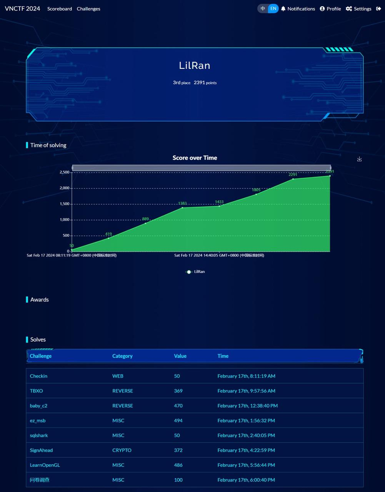
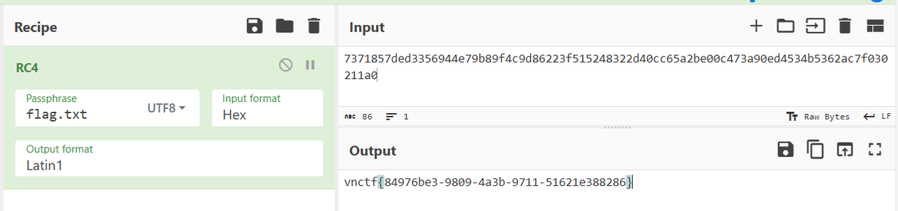
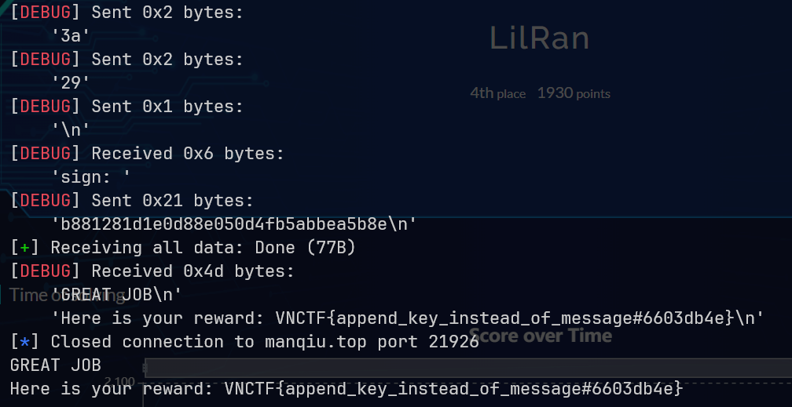
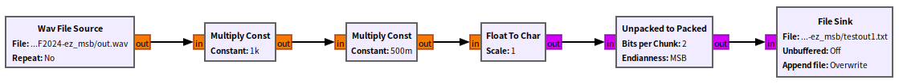
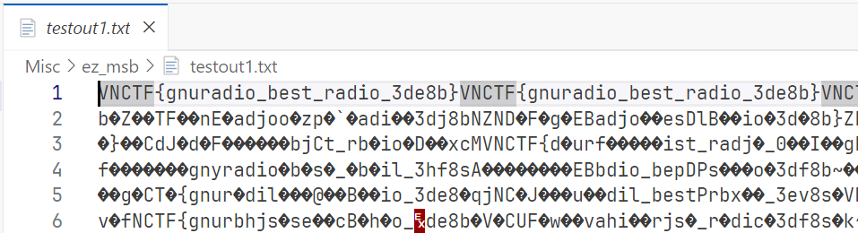
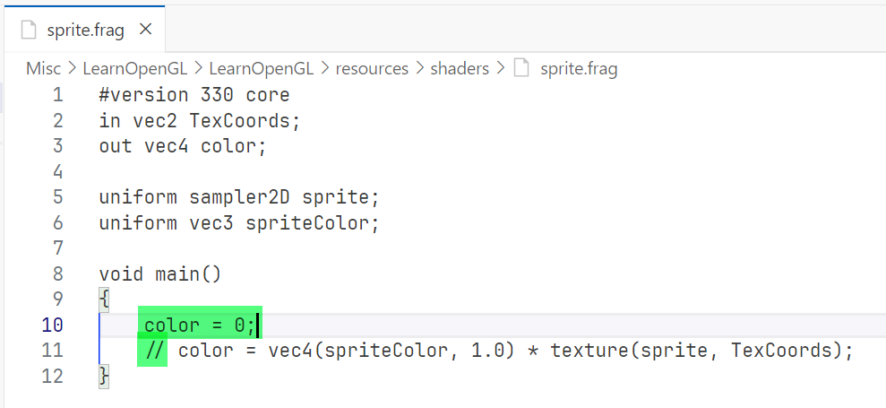
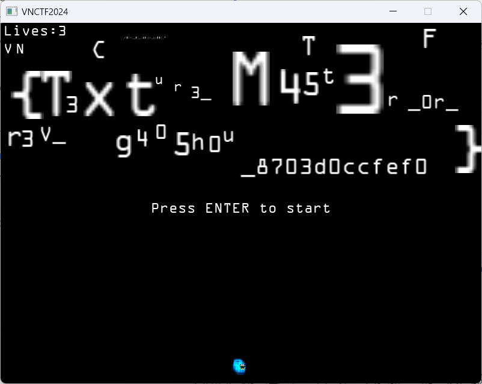
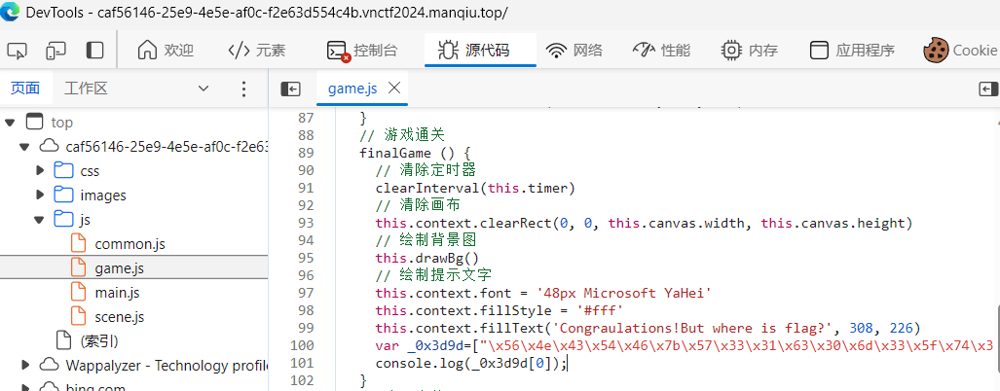
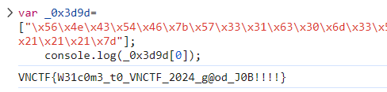

摸了个第三？也顺便加了好多师傅的QQ。隔壁同时进行的SICTF比VNCTF卷多了，在SICTF我还不如新生🤣



[附件下载](https://r3kapig-not1on.notion.site/VNCTF-2024-Jeopardy-eec0dab6c93d46e3a89ec4daff2f13e2)

## Reverse

### TBXO

用eax和栈实现的控制流，汇编层面动态调试起来，不难找到主要逻辑在sub_9610F4处，写出解密程序。

```c
#include <stdio.h>

int main() {
    unsigned char cipher[] =
        {
            0x10, 0x30, 0x36, 0x31, 0x23, 0x86, 0x93, 0xAD, 0xC5, 0xD4,
            0x92, 0x84, 0x66, 0xE3, 0x67, 0x75, 0x6B, 0x69, 0x86, 0xC7,
            0x31, 0x2E, 0x09, 0xA0, 0x33, 0x57, 0x69, 0xDB, 0x93, 0xA8,
            0x13, 0xDD, 0x3E, 0xA5, 0xD8, 0x88, 0x37, 0x54, 0x84, 0x7E};
    for(int i=0; i<5; i++) {
        unsigned int d = 0;
        for (int i = 0; i < 32; i++)
            d -= 0x61c88647;
        unsigned int r = ((unsigned int*)cipher)[2*i+1];
        unsigned int l = ((unsigned int*)cipher)[2*i];
        for(int j=0; j<32; j++) {
            r -= ((l + d) ^ ((l << 4) + 0x79645f65) ^ ((l >> 5) + 0x6b696c69) ^ 0x33);
            l -= ((r + d) ^ ((r << 4) + 0x67626463) ^ ((r >> 5) + 0x696d616e) ^ 0x33);
            d += 0x61c88647;
        }
        ((unsigned int*)cipher)[2*i] = l;
        ((unsigned int*)cipher)[2*i+1] = r;
    }
    printf("%s\n", cipher);
    return 0;
}
```

🚩 `VNCTF{Box_obfuscation_and_you_ar_socool}`

### baby_c2

流量中只关注192.168.218.1与192.168.218.129的TCP流量即可，第84条记录有D盘的文件列表（flag.txt为43字节），第121条记录有flag.txt的加密数据（长度43），从流量包本身信息可以知道当天是2月7日。

ps1脚本，解base64的部分可以去掉iex然后丢进powershell跑，最后一层是写一个PE文件到`%temp%\169sdaf1c56a4s5da4.bin`。

NOP掉40131F处的call和ret、创建函数即可反编译。在405178和405088处会传入文件名，对文件进行加密，然后再传输。

~~长度不变的加密方式，猜一个异或，猜一个RC4~~



但我没找到RC4的实现在哪里，对405178和405088处逐字节异或日期207后，只得到了无意义递减字节。等一个WP。

> 后记：
> 
> 一方面是要异或217，另一方面是我IDAPython脚本写错了，get_db_byte写成byte_value了（捂脸）
> 
> ```python
> def my_patch(frm, sz, byt):
>     for i in range(frm, frm+sz):
>         idc.patch_byte(i, idc.get_db_byte(i) ^ byt)
> 
> my_patch(0x405088, 234, 217)
> my_patch(0x405178, 206, 217)
> ```
> 
> 然后转换为未定义（U），转换为代码（C），创建函数（P），反编译（F5）。

🚩 `vnctf{84976be3-9809-4a3b-9711-51621e388286}`

## Crypto

### SignAhead

套路题，哈希长度扩展攻击

直接用https://github.com/JoyChou93/md5-extension-attack ，md5pad.py修改成用pwntools自动交互，Python2运行。

```python
import md5py
import hashlib
import struct
from pwn import *

def payload(length, str_append):
    pad = ''
    n0 = ((56 - (length + 1) % 64) % 64)
    pad += '\x80' 
    pad += '\x00'*n0 + struct.pack('Q', length*8)
    return pad + str_append

def hashmd5(str):
    return hashlib.md5(str).hexdigest()

context.log_level = 'debug'
c = remote('manqiu.top', 21926)

for _ in range(100):
    c.recvuntil('msg: ')
    msg = c.recvline().strip()
    c.recvuntil('sign: ')
    hash_origin = c.recvline().strip()
    
    str_append = "LilRan :)"
    lenth = 96

    m = md5py.md5()

    str_payload = payload(lenth, str_append)

    c.recvuntil('msg: ')
    c.send(msg)
    for i in str_payload:
        c.send(hex(ord(i))[2:].zfill(2))
    c.sendline()
    c.recvuntil('sign: ')
    c.sendline(m.extension_attack(hash_origin, str_append, lenth))

print c.recvall()
```



🚩 `VNCTF{append_key_instead_of_message#6603db4e}`

## Misc

### ez_msb

GNU Radio，启动！

原wav数据按位与11111001，flag平铺到00000??0。在wav刚开始零点几秒还没有音乐，直接把flag那条路逆过来走就行，可以得到纯净的flag。后面有音乐的位置就是乱码了，并且不懂各种数据类型是怎么转换的，等一个WP。





🚩 `VNCTF{gnuradio_best_radio_3de8b}`

### LearnOpenGL

这个好好玩，做得很精致😆

透过墙上缺的一个洞可以看见白色的线条，而背景图素材上没有，所以flag图层在背景图和砖块之间。想办法把砖块隐藏。

翻文件夹，多次尝试，发现这样patch一下就行。





🚩 `VNCTF{T3xtur3_M45t3r_0r_r3v_g405h0u_8703d0ccfef0}`

### sqlshark

上次做盲注流量还是在~~上次~~我第一次参加CTF的时候，那时我还手动写了一页A4纸，好怀念啊。这次用b神的轮子了。

```python
from FlowAnalyzer import FlowAnalyzer

pth = FlowAnalyzer.get_json_data('Misc/sqlshark/sqlshark.pcap', 'http')
for count, dic in enumerate(FlowAnalyzer(pth).generate_http_dict_pairs()):
    response_num, response_data = dic['response']
    request = dic.get("request")
    if not request:
        continue
    request_num, request_data = request
    if b'success!' in response_data and b'leAst' not in request_data:
        dat = int(request_data.decode().split(r'%29%29%29%29in%28')[1].split(r'%29%29%29')[0])
        print(chr(dat), end='')

# admin_p@ssw0rd
```

🚩 `VNCTF{admin_p@ssw0rd}`

### 问卷调查

🚩 `VNCTF{wen_juan_diao_cha}`

## Web

### Checkin

出题人电脑的F12按键坏了，你能帮他按一按吗





🚩 `VNCTF{W31c0m3_t0_VNCTF_2024_g@od_J0B!!!!}`
