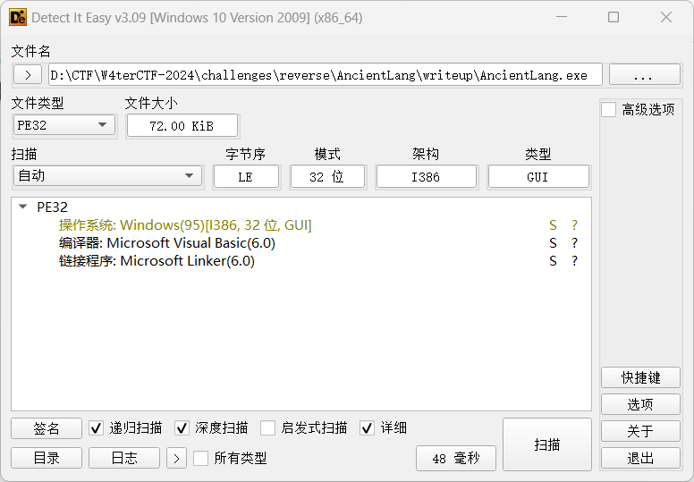
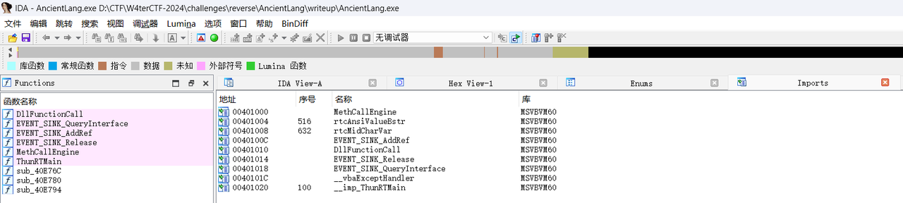
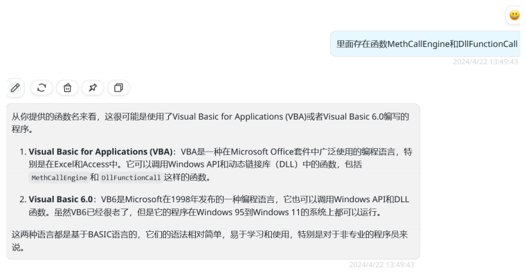
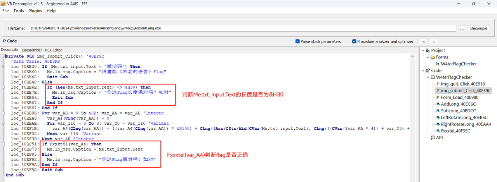
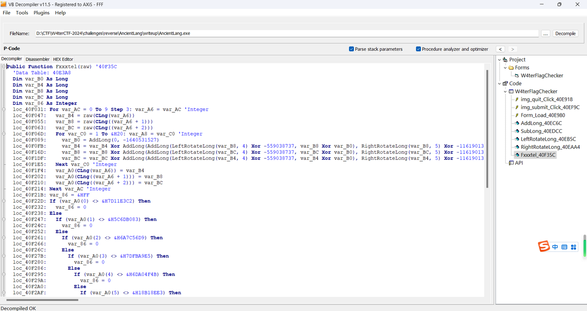
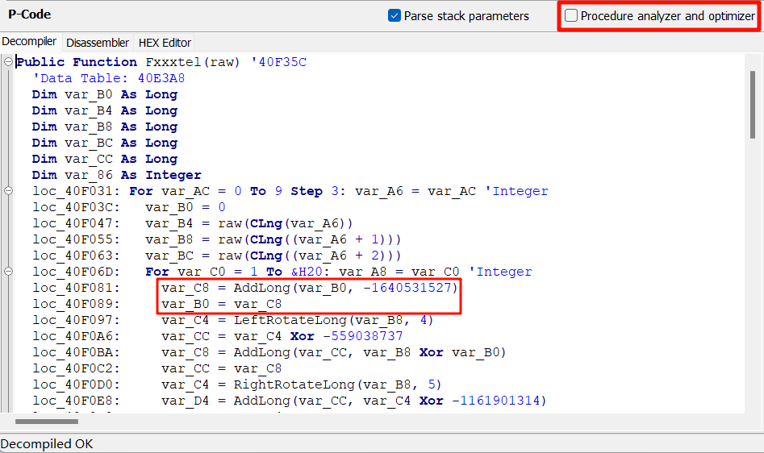
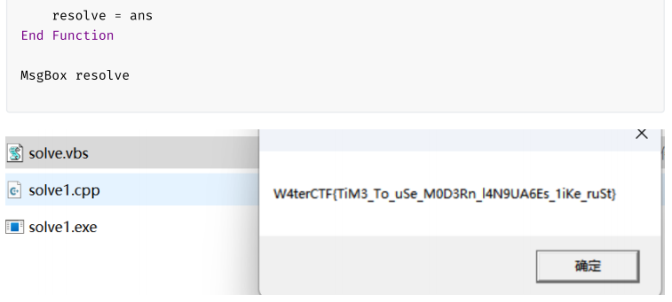
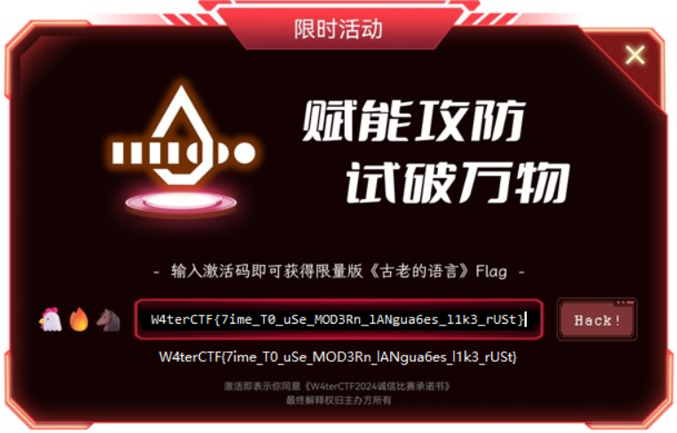
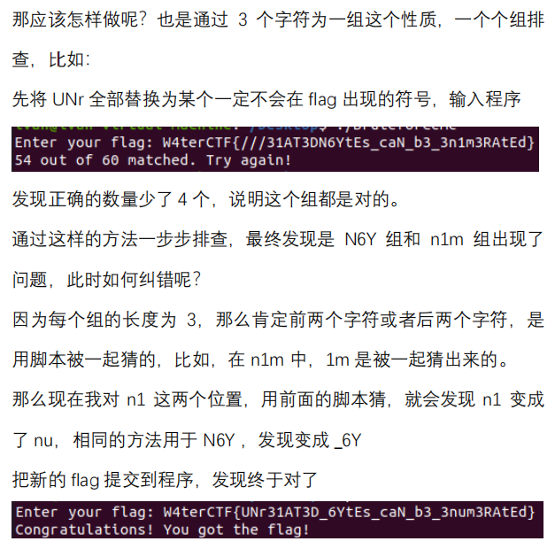
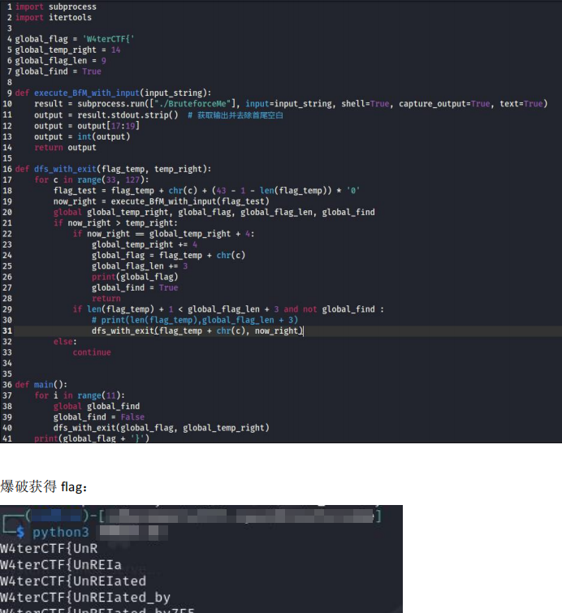

第一次出题，虽然还好没有非预期，但是与预想的结果并不完全符合，并不完美。果然出好题比做题难。

# 古老的语言

> [附件下载](https://files.xinshi.fun/w4terctf-2024/AncientLang.zip)
> 
> **Difficulty:** Normal
> 听说这个程序兼容从 Windows 95 到 Windows 11……
> 盲猜你身边就有人用过这个编程语言 🤔
> **Note:** 附件不含恶意代码，可放心下载运行。
> 
> 💡 反编译器😭我还能完全相信你吗😭你这个you嘴hua舌的家伙😭
> 💡 “Procedure analyzer and optimizer” 是什么功能？关掉会怎么样呢？
> 
> 8 支队伍攻克，597 pts

## 判断语言和找工具

一个有图标的72KB的exe。

判断语言、框架、构建工具等，可以使用DIE（Detect It Easy）。判断是Visual Basic 6.0程序。



如果用IDA打开，看到的几乎全是“数据”，导入表有几个来自MSVBVM60库的函数，搜一下也可以知道是VB程序。



也有选手询问大语言模型，也是可以的：



Python有uncompyle6和pycdc，.NET平台有dnspy和dotPeek，Java有JADX和JEB。结合题目名称“古老的语言”，可以尝试寻找专门逆向VB的软件。上网搜索“VB逆向”，可以找到VB Decompiler软件。



右侧可以看到函数名。（出题人：原本第一版函数是Private的，编译没有保留函数名，出题人自己看到都不想逆，所以故意把函数设为Public，就有函数名了。）

上面可以看到是P-Code。（VB可以编译为P-Code（伪指令）或Native Code（本机指令），两种都要用系统的msvbvm60.dll，P-Code类似于一些逆向题中的VM。这里编译为伪指令也只是为了反编译好看一点。）

## 逻辑分析

先看img_submit_Click过程，容易找到用Me.txt_input.Text判断长度的代码（这时就能知道VB中`<>`是不等于的意思；一开始可能以为`&H30`是30，运行程序测试一下会发现长度应该是48，所以`&H30`是0x30的意思），以及把var_A4传入Fxxxtel函数判断flag是否正确。那么中间几行应该就是把输入的flag从Me.txt_input.Text移到var_A4的逻辑了，实际上var_A4是由12个Long组成的数组（VB的Long是32位有符号数），并且出题人写的逻辑是大端序。其实中间这个过程也可以先不管，先解出Fxxxtel，看看会得到什么就行。

看看Fxxxtel函数（其实是Feistel分组密码结构的意思啦（虽然题目魔改了），写成这样只是抖个机灵，不需要能反应过来，直接逆就完事了）：



下面的连续if明显是与密文比对，上面的两层for就是加密过程了，很简短吧。加密过程和TEA很相似，不同的是每个分组分为3部分而不是2部分、异或改成加法、加法改成异或。

`loc_40F089`有一个很迷惑的`var_B0 = AddLong(0, -1640531527)`，正常人不会这样写代码。这里实际上是`var_B0 = AddLong(var_B0, -1640531527)`，只是var_B0初始化为0，被反编译器错误地优化了。这并不是出题时故意的，只是碰巧，恰好也体现出反编译器并不总是可靠的。如果关闭优化，就正确了：



外层循环是把flag切片赋值给var_B4、var_B8、var_BC，注意VB中For循环是闭区间，这里`For var_AC = 0 To 9 Step 3`，var_AC等于9时是满足条件的。内层循环是var_B4、var_B8、var_BC互相使用并赋新值，重复0x20轮。加法和移位使用函数实现，看着不直观，改写成下面的伪代码（用l、m、r代替var_B4、var_B8、var_BC）：

```c
l = l ^ (((m << 4) ^ -559038737) + (m ^ var_B0) + ((m >> 5) ^ -1161901314))
m = m ^ (((r << 4) ^ -559038737) + (r ^ var_B0) + ((r >> 5) ^ -1161901314))
r = r ^ (((l << 4) ^ -559038737) + (l ^ var_B0) + ((l >> 5) ^ -1161901314))
```

## 写解密算法

TEA是CTF逆向中很经典、很常见的加密算法。乍一看l、m、r总是变来变去的，但是看最后一轮的最后一步操作，这一步前后只改变了r，l是没有变的，所以`(((l << 4) ^ -559038737) + (l ^ var_B0) + ((l >> 5) ^ -1161901314))`这一串是可知的。把最后的r异或这一串，就能得到最后一步之前的r，同理也能得到最后一轮之前的l、m、r，也就能得到开始的l、m、r。写解密程序：

```c
#include <stdio.h>
#define u32 unsigned int

u32 enc[] = {
    0x7D11E3C2, 0x5C6DB083, 0x6A7C56D9, 0x7DFBA9E5, 0x6DA04F4B, 0x18B18EE3,
    0x2624549B, 0x6C98C6D8, 0x75A2E883, -131717161, 0x6E303277, -258141690
};

int main()
{
    for (int i = 0; i < 12; i += 3)
    {
        u32 sum = 0;
        for (int j = 0; j < 32; j++)
            sum += -1640531527;
        u32 l = enc[i], m = enc[i + 1], r = enc[i + 2];
        for (int j = 0; j < 32; j++)
        {
            r ^= ((l << 4) ^ -559038737) + (l ^ sum) + ((l >> 5) ^ -1161901314);
            m ^= ((r << 4) ^ -559038737) + (r ^ sum) + ((r >> 5) ^ -1161901314);
            l ^= ((m << 4) ^ -559038737) + (m ^ sum) + ((m >> 5) ^ -1161901314);
            sum -= -1640531527;
        }
        enc[i] = l, enc[i + 1] = m, enc[i + 2] = r;
    }
    printf("%s\n", enc);
    // et4WFTCrmi7{0T_eeSu_DOM__nR3gNAle6au1l_sr_3k}tSU

    char* flag = (char*)enc;
    for (int i = 0; i < 48; i += 4)
    {
        printf("%c%c%c%c", flag[i+3], flag[i+2], flag[i+1], flag[i]);
    }
    // W4terCTF{7ime_T0_uSe_MOD3Rn_lANgua6es_l1k3_rUSt}

    return 0;
}
```

注意要用unsigned int，注意sum的初始值。最后发现字节序不对，转一下就好。

也有选手将反编译代码复制出来，作为VBScript代码，工作量会比用C或Python重写小很多。





## 出题人的话

之所以出一道VB的题目，最开始是因为中山大学互联网与开源技术协会全员大会上，有几个人都说以前用VB写过程序，恰好出题人高中时也用VB写过程序。虽然出题人从未在比赛中见过VB的题目（可能只是因为见得少），但是VB反编译也不是特别难看，放在新手赛挺合适，所以就出了这道题。

出题时才发现VB整数溢出会报异常，而不是舍弃溢出位，而且VB也没有逻辑移位运算符，所以参考https://www.syue.com/Software/NET/ASPNET/5425.html 用函数实现。参考链接中逻辑右移是有缺陷的，在题目中做了修改。由于考虑不周，我直接用了参考链接中的Rotate（循环移位）这个函数名，但实际上做的是Shift（移位），对选手造成了误导，非常抱歉。因为不想选手花时间检查这些算术运算的逻辑，所以专门定义了字符串，用来说明函数没有魔改。但还是有不少选手在逆这几个函数，也许我应该写“此函数在实现C语言中的逻辑移位，做题时不须关注”的，非常抱歉。

决定出这道题的时候，考点是“对特定语言或框架的处理”和“TEA类似算法的解密”。至于VB Decompiler工具的反编译结果不准确，这是出题出到一半才发现的。于是就想着通过这道题，顺便让选手知道“反编译并不总是可靠的”，毕竟现实中的软件也不会刻意规避这种情况。出题人认为应该有选手注意到`var_B0 = AddLong(0, -1640531527)`很奇怪，然后来私聊询问的。但事实是，错误的反编译结果、比较复杂的TEA类似算法、不提供动态调试的工具这三点结合在一起，导致实际的难度比原来出题人想要的难度高了不少。

正如flag所说，是时候用更现代的编程语言了。这应该是LilRan最后一次用VB了，下次出题时，LilRan的题目将开始锈化。

彩蛋：UI、加密函数名称、应用程序标题、输入“激活码”。

# BruteforceMe

> [附件下载](https://files.xinshi.fun/w4terctf-2024/BruteforceMe.zip)
> 
> **Difficulty:** Easy
> 和你爆了 😡
> 
> 20 支队伍攻克，217 pts

基础题，出题目的是让选手熟悉IDA的使用，并尝试除了写反向算法外的其他解题方法（是因为这个原因，才进行了很多处的算法魔改）。本题灵感来源是CISCN 2023华南赛区分区赛题目“签个到”，在此基础上修改了算法、修改了“flag错误”的输出信息。（所以做出这道题的选手，可以算是做出国赛分区赛的题目了。）

这是一个64位ELF文件，是在64位Linux系统上运行的。去除了符号表，但是在程序分析上没有为难选手，main函数、flag长度、加密过程、密文位置都很好找。

## 逻辑分析

**第一步 算术运算**

main函数接收用户输入的flag，sub_1209函数把flag输入原地逐字节异或0x87再乘17，把输入从ASCII 32-127分散到1-255。然后在main函数中判断flag长度等于43。

因为没有任何一个可打印字符异或0x87再乘17会变成0，所以明文flag长度就等于43。注意这个步骤中，flag的每个字节互不影响。

```c
char *__fastcall sub_1209(char *a1)
{
    int i; // [rsp+1Ch] [rbp-14h]

    for (i = 0; i < strlen(a1); ++i)
    {
        a1[i] ^= 0x87u;
        a1[i] *= 17;
    }
    return a1;
}
```

> 对于写反向算法的解法3：
> 
> 有选手认为乘17这个步骤是不可逆的，其实不是。
> 
> ```c
>             y = (x * 17) % 256
> y * 241 % 256 = (x * 17 * 241) % 256
> y * 241 % 256 = (x % 256) * (17 * 241 % 256) % 256
> y * 241 % 256 = x * 1 % 256
> y * 241 % 256 = x
> ```
> 
> 这里的241就是17的模256逆元，可以通过扩展欧几里得原理求得，或者Python中直接pow(17, -1, 256)。
> 
> 有选手用了一种巧妙的做法，把17看成0b00010001，x乘17就相当于(x<<4)+x，这样就可以反向计算了。虽然出题时并没有想到这一点，17这个数是随便选的。
> 
> 当然也可以稍微爆破一下，看0-255之间哪个x乘17会得到对应的y。

**第二步 Base64**

sub_1290传入上一步产物和长度43，在新的内存区域进行Base64操作，可以明显看到Base64的表。在IDA中把a1类型设为 unsigned char*（对a1按右键，选择 Set lvar type... 输入 unsigned char*a1）会好看一点。

注意这个步骤中，原文的连续3个字节编码后变成4个字节，原文合适位置的连续3个字节与另外3个字节互不影响，编码后合适位置的连续4个字节与另外4个字节互不影响。

```c
_BYTE *__fastcall sub_1290(unsigned __int8 *a1, int a2)
{
    int v4;    // [rsp+14h] [rbp-1Ch]
    int i;     // [rsp+18h] [rbp-18h]
    _BYTE *v6; // [rsp+28h] [rbp-8h]

    v6 = malloc(4 * ((a2 + 2) / 3) + 1);
    if (!v6)
        return 0LL;
    v4 = 0;
    for (i = 0; a2 % 3 ? v4 < a2 - 3 : v4 < a2; i += 4)
    {
        v6[i + 3] = ~aAbcdefghijklmn[a1[v4] >> 2];
        v6[i + 2] = ~aAbcdefghijklmn[(16 * a1[v4]) & 0x30 | (a1[v4 + 1] >> 4)];
        v6[i + 1] = ~aAbcdefghijklmn[(4 * a1[v4 + 1]) & 0x3C | (a1[v4 + 2] >> 6)];
        v6[i] = ~aAbcdefghijklmn[a1[v4 + 2] & 0x3F];
        v4 += 3;
    }
    if (a2 % 3 == 2)
    {
        v6[i + 3] = ~aAbcdefghijklmn[a1[v4] >> 2];
        v6[i + 2] = ~aAbcdefghijklmn[(16 * a1[v4]) & 0x30 | (a1[v4 + 1] >> 4)];
        v6[i + 1] = ~aAbcdefghijklmn[(4 * a1[v4 + 1]) & 0x3C];
        v6[i] = 126;
    }
    else if (a2 % 3 == 1)
    {
        v6[i + 3] = ~aAbcdefghijklmn[a1[v4] >> 2];
        v6[i + 2] = ~aAbcdefghijklmn[(16 * a1[v4]) & 0x30];
        v6[i + 1] = '~';
        v6[i] = 126;
    }
    v6[4 * ((a2 + 2) / 3)] = 0;
    return v6;
}
```

> 对于写反向算法的解法3：
> 
> 这里进行了魔改，四个字符顺序颠倒，且每个字符按位取反，然后用~而不是=来补齐4的倍数个字符。比如正常情况下是`Abc=`，这里就变成了`~` `~c` `~b` `~A`。

**第三步 RC4**

sub_1650传入上一步产物、长度60、密钥"W4terCTF{ZaYu}"，在新的内存区域进行RC4操作。RC4是一种流密码，第一个循环用密钥来初始化S盒，第二个循环用S盒来加密原文。这里进行了魔改，最后一步异或时还异或了(length-i)，即便这样也不改变RC4本身就是自己的反函数的性质，即`RC4(RC4(m))==m`。注意这个步骤中，每个字节互不影响。

```c
_BYTE *__fastcall sub_1650(__int64 a1, int a2, const char *a3)
{
    int v3;               // r12d
    __int64 v4;           // kr00_8
    __int64 v5;           // kr08_8
    char v8;              // [rsp+2Bh] [rbp-135h]
    char v9;              // [rsp+2Bh] [rbp-135h]
    int i;                // [rsp+2Ch] [rbp-134h]
    int j;                // [rsp+2Ch] [rbp-134h]
    int k;                // [rsp+2Ch] [rbp-134h]
    int v13;              // [rsp+30h] [rbp-130h]
    int v14;              // [rsp+30h] [rbp-130h]
    int v15;              // [rsp+34h] [rbp-12Ch]
    _BYTE *v16;           // [rsp+38h] [rbp-128h]
    char v17[264];        // [rsp+40h] [rbp-120h]
    unsigned __int64 v18; // [rsp+148h] [rbp-18h]

    v13 = 0;
    v15 = 0;
    v16 = malloc(a2 + 1);
    for (i = 0; i <= 255; ++i)
        v17[i] = i;
    for (j = 0; j <= 255; ++j)
    {
        v3 = (unsigned __int8)v17[j] + v13;
        v4 = v3 + a3[j % strlen(a3)];
        v13 = (unsigned __int8)(HIBYTE(v4) + v4) - HIBYTE(HIDWORD(v4));
        // 看到有选手对上面一行反编译代码有疑问，可以查看defs.h中的宏定义，HIBYTE指的是最高有效字节（如0x1122334455667788的0x11）。v4是寄存器里的64位整数，但它只是两个0~255的数加起来而已，根本不能使64位的最高字节不为0，所以HIBYTE(v4)和HIBYTE(HIDWORD(v4))都应该是0，所以v13 = v4 % 256。反编译器通常不会做这种推理，而是忠实于原始汇编指令。
        v8 = v17[j];
        v17[j] = v17[v13];
        v17[v13] = v8;
    }
    v14 = 0;
    for (k = 0; k < a2; ++k)
    {
        v15 = (v15 + 1) % 256;
        v5 = (unsigned __int8)v17[v15] + v14;
        v14 = (unsigned __int8)(HIBYTE(v5) + v17[v15] + v14) - HIBYTE(HIDWORD(v5));
        v9 = v17[v15];
        v17[v15] = v17[v14];
        v17[v14] = v9;
        v16[k] = (a2 - k) ^ v17[(unsigned __int8)(v17[v15] + v17[v14])] ^ *(_BYTE *)(k + a1);
    }
    v16[k] = 0;
    return v16;
}
```

最后将结果与byte_4020逐字节对比，输出一致的字节数。

第二步和第三步的魔改可能不太容易注意到，但是应该要看出来用了Base64和RC4。flag明文每3个字符为1组，对应最后密文的4个字节，**每次只穷举3个字符，就必然能对应上密文的4个字节，每组只有`(127-32)**3`种情况，在可接受的时间内可以完成穷举，这是可以分组爆破的原因**。如果像DES那样，每组有8个字节也就是64位，爆破需要数天时间，是不可接受的。

在判断出基本算法后，本题预设3种解法。

## 解法1：复制出反编译代码，分段穷举输入的所有可能

最省事且快的做法，既不需要大量创建线程，也不需要发现所有魔改的地方。缺点是如果遗漏了某个角落里的部分加密过程（比如有些题目在程序加载时会修改密文），就得不到正确的结果。所以必须随便设计一组输入，比对 爆破脚本 与 动态调试原文件 产生的对应的密文是否一致。同时，本题三个加密函数都是无状态（函数式）的，只影响参数，不对全局变量造成影响，否则要考虑的更多。

```c
#include <stdio.h>
#include <stdlib.h>
#include <string.h>
#include "defs.h" // 这是IDA安装路径里的文件，定义了IDA里看到的HIBYTE之类的东西

char *aAbcdefghijklmn = "ABCDEFGHIJKLMNOPQRSTUVWXYZabcdefghijklmnopqrstuvwxyz0123456789+/";

char *__fastcall sub_1209(char *a1)
{
    // 自行复制
}

_BYTE *__fastcall sub_1290(unsigned __int8 *a1, int a2)
{
    // 自行复制
}

_BYTE *__fastcall sub_1650(__int64 a1, int a2, const char *a3)
{
    // 自行复制
}

int main()
{
    // TF{ 留给爆破，用来验证爆破程序是否正确
    char flag[] = "W4terC????????????????????????????????????}";
    char tmp[] = "W4terC????????????????????????????????????}";
    unsigned char res[] = {
        0xF9, 0xB6, 0x61, 0xF4, 0x74, 0x6C, 0xE1, 0x0D, 0xE5, 0xEC,
        0x65, 0x1E, 0x0F, 0x35, 0x59, 0x37, 0x0E, 0x23, 0xE3, 0x55,
        0x2C, 0xE4, 0x24, 0x72, 0x15, 0xC8, 0x5D, 0xAA, 0x53, 0x34,
        0xB9, 0x98, 0x0B, 0x1F, 0x04, 0x71, 0xF9, 0x97, 0xBB, 0x0E,
        0x39, 0x0A, 0x33, 0xE2, 0x66, 0x98, 0x88, 0x72, 0x52, 0x42,
        0xAF, 0x90, 0xA7, 0xE9, 0x5B, 0xEF, 0x71, 0x6D, 0xBB, 0x35
    };
    for (char *i = flag + 6; i < flag + 42; i += 3)
    {
        for (i[0] = 32; i[0] < 127; i[0]++) // 通过i来修改flag数组
        {
            for (i[1] = 32; i[1] < 127; i[1]++)
            {
                for (i[2] = 32; i[2] < 127; i[2]++)
                {
                    strcpy(tmp, flag);
                    sub_1209(tmp);
                    unsigned char *tmp1 = sub_1290(tmp, 43);
                    unsigned char *tmp2 = sub_1650(tmp1, 60, "W4terCTF{ZaYu}");
                    if (!memcmp(tmp2, res, (i - flag + 3) * 4 / 3))
                    {
                        printf("%s\n", flag);
                        free(tmp1);
                        free(tmp2);
                        goto br; // 退出循环，锁定这组结果
                    }
                    free(tmp1);
                    free(tmp2);
                }
            }
        }
    br:
    ;
    }
    return 0;
}
```

在我的电脑上需要爆破48秒（可能是频繁malloc开销大）。输出：

```plain
W4terCTF{?????????????????????????????????}
W4terCTF{UnR??????????????????????????????}
W4terCTF{UnRELa???????????????????????????}
W4terCTF{UnRELat3D????????????????????????}
W4terCTF{UnRELat3D_BY?????????????????????}
W4terCTF{UnRELat3D_BYte5??????????????????}
W4terCTF{UnRELat3D_BYte5_cA???????????????}
W4terCTF{UnRELat3D_BYte5_cAn_6????????????}
W4terCTF{UnRELat3D_BYte5_cAn_63_e?????????}
W4terCTF{UnRELat3D_BYte5_cAn_63_eNuM??????}
W4terCTF{UnRELat3D_BYte5_cAn_63_eNuMeRA???}
W4terCTF{UnRELat3D_BYte5_cAn_63_eNuMeRA7ED}
```

## 解法2：创建进程，分段穷举输入的所有可能

这种解法是多次将程序运行起来，向程序提供输入，统计输出结果。出题时为了这种解法可行，专门在输入错误flag后输出了匹配的个数。**由于每次都要创建新的进程，开销很大，爆破需要的时间更长。**

必须向程序输入43个字符。由于Base64不是对单个字节操作，如果对43个字符逐个爆破，只跑一轮是无法完全匹配的。就算第一次尝试时把这43个字符设为全'A'或者别的什么，也可能碰巧匹配上一部分；由于Base64编码结果的每个字符只由原来的6位得到，“最终匹配数量加一”并不意味着“输入字符多对了一个”。

以下列举几种**真的能运行打印出正确flag**而不是最后靠猜的做法：

**A. 三个字符三个字符地尝试**

保险（但低效）的做法是三个字符三个字符地尝试，尝试所有可能（而不中途提前结束），选择匹配数量最多的一次尝试（匹配数量最多的必然只有一次）。但是这样会导致爆破时间非常长，而每次尝试单个字符的时间相对短很多。

出题人尝试用Python（很慢）pwntools（很慢），在出题人的电脑上，每3个字符都需要3小时才能跑完，这是不可接受的。有选手用Python subprocess，跑完整个flag用了1.5小时。有选手用Rust，跑完整个flag只用了十来分钟。~~这里抄写选手WP~~

```rust
use std::{
    io::Write,
    process::{Command, Stdio},
};

fn main() {
    // Init to 7 to make only 2 out of 60 match
    let mut flag = [7; 43 + 1];
    flag[43] = b'\n';
    flag[42] = b'}';
    let prefix = b"W4terCTF{";
    flag[..prefix.len()].copy_from_slice(prefix);

    let mut last_matched = (prefix.len() / 3 * 4 + 4) as u8;
    let mut command = Command::new("./BruteforceMe");
    command.stdin(Stdio::piped()).stdout(Stdio::piped());

    'loop_i: for i in (prefix.len()..42).step_by(3) {
        println!("{}", flag[..i].escape_ascii());
        for x in 0x21..0x7f {
            println!("progress: {x}");
            flag[i] = x;
            for y in 0x21..0x7f {
                flag[i + 1] = y;
                for z in 0x21..0x7f {
                    flag[i + 2] = z;

                    let mut child = command.spawn().unwrap();
                    let mut stdin = child.stdin.take().unwrap();
                    stdin.write_all(&flag).unwrap();

                    let output = child.wait_with_output().unwrap().stdout;
                    let a = output[17];
                    let b = output[18];

                    let success = a == b'C';
                    if success {
                        break 'loop_i;
                    }

                    let matched = if b == b' ' {
                        a - b'0'
                    } else {
                        (a - b'0') * 10 + (b - b'0')
                    };
                    if matched == last_matched + 4 {
                        last_matched = matched;
                        continue 'loop_i;
                    }
                }
            }
        }
    }
    println!("{}", flag.escape_ascii());
}
```

```python
# 在出题人的电脑上每3个字符都需要3小时才能跑完，这是不可接受的，这段代码看看就好了

from itertools import product
from pwn import *
from string import printable
from tqdm import tqdm

context.log_level = 'ERROR'
flag = list(b'W4terC' + b'\xff' * 36 + b'}')
alphabet = printable[:-6]
dic = list(product(alphabet, repeat=3))
max_match_count = 0

for i in range(6, 42, 3):
    tmp_flag = ''
    for j in tqdm(dic):
        j = ''.join(j)
        flag[i:i+3] = list(j.encode())
        s = process('./BruteforceMe')
        s.sendline(bytes(flag))
        match_count = int(s.recvall().decode().split()[3])
        s.close()
        if match_count > max_match_count:
            max_match_count = match_count
            tmp_flag = j
    flag[i:i+3] = list(tmp_flag.encode())
    print(bytes(flag))
```

**B. 尝试单个字符，跑完一轮后打乱字母表**

看到选手很巧妙地每次跑完43个字符后，把爆破的字母表(A-Za-z0-9_)随机打乱。这样可以让每个未完成的三字节分组的**第一个字节**发生变化。~~第二次抄写选手WP~~，贴一份简化后的脚本，两分钟内能跑完：

```python
import subprocess
import random

def run_and_get_result() -> int:
    global flag   # 貌似会比传参快一些
    command = ["./BruteforceMe"]
    process = subprocess.Popen(command, stdin=subprocess.PIPE, stdout=subprocess.PIPE, stderr=subprocess.PIPE, text=True)
    process.stdin.write(''.join(flag))
    process.stdin.flush()
    output_data, _ = process.communicate()
    if 'Congratulations' in output_data:
        print(''.join(flag))
        exit()
    return int(output_data.split()[3])

if __name__ == "__main__":
    result = 0
    flag = list("W4terCTF{#################################}")
    alphabet = list("abcdefghijklmnopqrstuvwxyzABCDEFGHIJKLMNOPQRSTUVWXYZ0123456789_")
    while result < 60:
        random.shuffle(alphabet)   # 这是精髓
        for t in range(43):
            for v in alphabet:
                tmp = flag[t]
                flag[t] = v
                new_result = run_and_get_result()
                if new_result >= result:
                    print(''.join(flag))
                    result = new_result
                else:
                    flag[t] = tmp
        print(f"best: {result}")
        print(''.join(flag))
```

**C. 总是查找出问题的是哪个字符**

~~这里第三次抄写选手WP~~：



**D. 根据Base64的特点进行剪枝**

以标准Base64为例，假如某三个字符编码后得到的是`W***`，这个`W`已经对上了。那么第一个字符一定是`010110??`，即`X` `Y` `Z` `[`这四个字符中的一个。这样就只需要尝试`X**` `Y**` `Z**` `[**`，大大减少了可能的空间。第二个字符以此类推。~~这里第四次抄写选手WP~~，贴个脚本：



## 解法3：写反向算法

这是最传统的做法，这种做法就和题目名称无关了，需要看出所有魔改的地方才行。详见上文逻辑分析。

```python
import Base64

def decode_flag(enc: bytes) -> bytes:
    tmp = list(my_rc4_encode(enc, b'W4terCTF{ZaYu}'))  # RC4的encode和decode是一样的

    for i in range(0, len(tmp), 4):
        # 负数就是按位取反加一，按位取反就是负数减一，再加回256回到0~255之间
        # 或者说，反码加原码会等于11111111即255
        tmp[i], tmp[i+3] = 255-tmp[i+3], 255-tmp[i]
        tmp[i+1], tmp[i+2] = 255-tmp[i+2], 255-tmp[i+1]
    tmp = bytes(tmp).replace(b'\x81', b'=')
    tmp = list(Base64.b64decode(tmp))

    for i in range(len(tmp)):
        # 这里的pow(17, -1, 256)见上文逻辑分析第一步
        tmp[i] = tmp[i] * pow(17, -1, 256) % 256
        tmp[i] ^= 0x87

    return bytes(tmp)

def my_rc4_encode(raw: bytes, key: bytes) -> bytes:
    s = list(range(256))
    j = 0
    out = []
    for i in range(256):
        j = (j + s[i] + key[i % len(key)]) % 256
        s[i], s[j] = s[j], s[i]
    j = k = 0
    for i in range(len(raw)):
        k = (k + 1) % 256
        j = (j + s[k]) % 256
        s[k], s[j] = s[j], s[k]
        out.append(raw[i] ^ s[(s[k] + s[j]) % 256] ^ (len(raw)-i))
    return bytes(out)

if __name__ == '__main__':
    enc = bytes([
        0xF9, 0xB6, 0x61, 0xF4, 0x74, 0x6C, 0xE1, 0x0D, 0xE5, 0xEC,
        0x65, 0x1E, 0x0F, 0x35, 0x59, 0x37, 0x0E, 0x23, 0xE3, 0x55,
        0x2C, 0xE4, 0x24, 0x72, 0x15, 0xC8, 0x5D, 0xAA, 0x53, 0x34,
        0xB9, 0x98, 0x0B, 0x1F, 0x04, 0x71, 0xF9, 0x97, 0xBB, 0x0E,
        0x39, 0x0A, 0x33, 0xE2, 0x66, 0x98, 0x88, 0x72, 0x52, 0x42,
        0xAF, 0x90, 0xA7, 0xE9, 0x5B, 0xEF, 0x71, 0x6D, 0xBB, 0x35
    ])
    print(decode_flag(enc))
```

彩蛋：杂鱼~❤️
