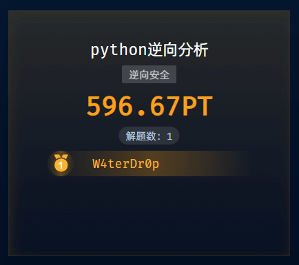
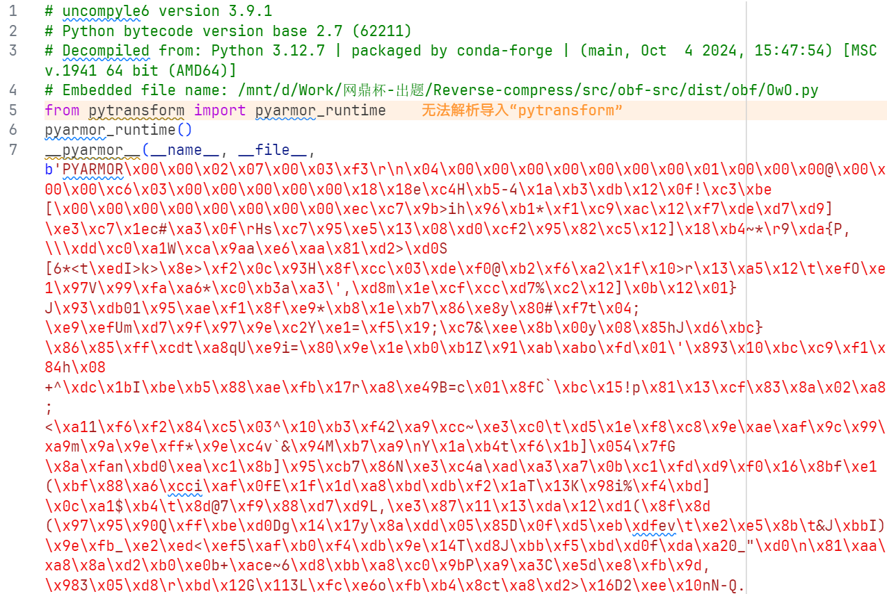
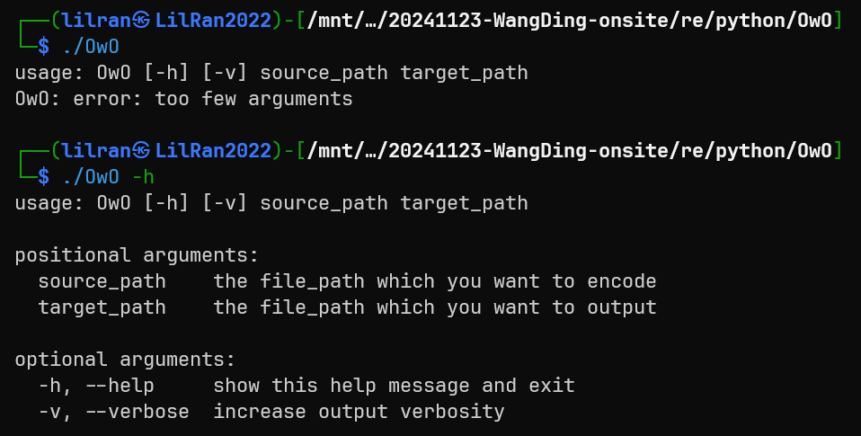
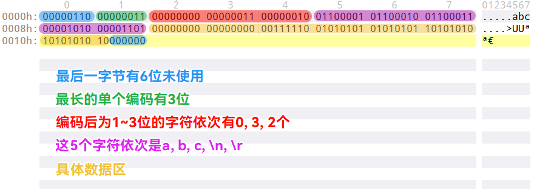
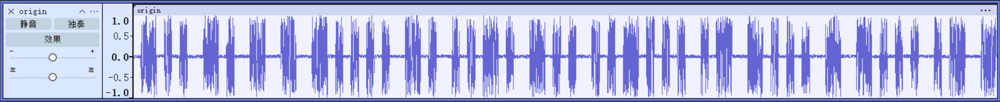
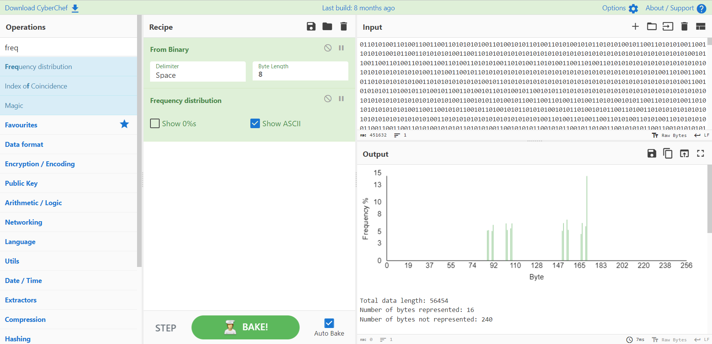
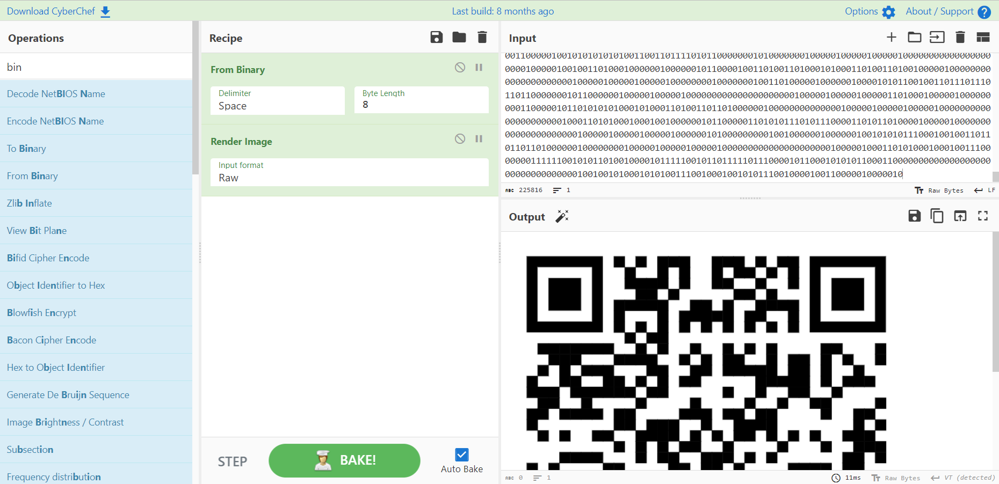

零分逆，十分猜。如有师傅有逆向解法思路欢迎交流

附件文件夹中 OwO/OwO 是打包的可执行文件

使用 Python 2\.7 运行 pyinstxtractor 和 uncompyle6，得到一组 pyarmor 代码文件



可执行文件可直接运行，还有 \-h



# 哈夫曼部分

题目描述中有名称 compress，尝试用可执行文件编码一段样例文本

编码前：

```Plain Text
aaa
```

编码后：

```Plain Text
0000h: 06 01 01 61 00  ...a.
```

编码前：

```Plain Text
aaaaaaaaa
bbbbbbbbccccccccc
```

编码后：

```Plain Text
0000h: 00000110 00000011 00000000 00000011 00000010 01100001 01100010 01100011  .....abc 
0008h: 00001010 00001101 00000000 00000000 00111110 01010101 01010101 10101010  ....>UUª 
0010h: 10101010 10000000                                                        ª€
```

观察可知上面的 a 变成了 00，b 变成了 01，c 变成了 10，\\r 变成了 111，\\n 变成了 110

符合哈夫曼编码规律

用不同的原文多次尝试，推出文件结构：



仓促写一个能跑就行的解码脚本：

```python
with open('output.bin', 'rb') as f:
    data = f.read()

empty = data[0]
bit_max_len = data[1]
bit_len = data[2:2+bit_max_len]
char_map = dict()

read_ptr = 2 + bit_max_len
prefix = 0
for Len, i in enumerate(bit_len):  # 编码后长度为 Len 的字符有 i 个
    for j in range(i):
        char_map[bin(prefix)[2:].rjust(Len+1, '0')] = data[read_ptr]
        read_ptr += 1
        prefix += 1
    prefix = prefix << 1

raw_data = data[read_ptr:]
raw_data = bin(int.from_bytes(raw_data, 'big'))[2:].zfill(len(raw_data*8))

raw_ptr = 0
output_buf = []
raw_len = len(raw_data)
while raw_ptr < raw_len:
    if raw_ptr % 100000 == 0:   # 定期输出进度
        print(raw_ptr, raw_len)
    flag = False
    for l in range(1, bit_max_len+1):
        try:
            if raw_data[raw_ptr:raw_ptr+l] in char_map.keys():
                output_buf.append(char_map[raw_data[raw_ptr:raw_ptr+l]])
                raw_ptr += l
                flag = True
                break
        except:   # raw_ptr+l 越界时保证退出循环
            raw_ptr = 100000000000000
    if not flag:   # raw_ptr+l 越界时保证退出循环
        break

with open('origin.bin', 'wb') as f:
    f.write(bytes(output_buf))
```

运行得到解压后的 wav 文件，可压缩回去比对验证

# 音频部分



全段音频视觉上非常长，每段近似有声和无声的片段总是要么1单位长度，要么2单位长度

本地没有存类似的脚本，仓促写一个能跑就行的判断是0还是1的脚本，每次取64个采样点的二进制数据做平均：

```python
from ctypes import c_short

data = open('origin.wav', 'rb').read()[44:]
samples = [c_short(int.from_bytes(data[i:i+2], 'little')).value for i in range(0, len(data), 2)]
block = [sum(abs(j) for j in samples[i:i+64]) // 64 for i in range(0, len(samples), 64)]
info = ['1' if i > 5000 else '0' for i in block]
print(len(info))
print(''.join(info))

```

结果丢进CyberChef，发现序列由若干个01与10组成：



经尝试，发现把01换成1，同时10换成0，可解码出PNG文件：

```python
open('01.txt', 'w').write(open('01-10.txt').read()[1::2])
```



保存图片扫码即为 flag。
