[本站上的 XYCTF 2024 (baby_AIO) Writeup by 摸鱼](/posts/ctf-writeups/xyctf-2024-aio/)

[XYCTF 2024 Writeup by 摸鱼](https://vilanruise.notion.site/7cc7b25425c049dea62755b96a805f29)

[复现平台](https://gz.imxbt.cn/games/4/)

# 前言

好玩，爱玩。

原本看到出题人名单，就想着只来看一眼题目就走，后来和luoingly师傅组了队，虽然叫“摸鱼”，但还是认真做题了。然后发现Reverse很多题目质量很高。下面的Writeup也按照我认为的题目质量排序，越靠前的题目越值得做。~~（但是Misc很多题目质量一言难尽）~~

比赛持续时间很长、题目数量很多，中间有三分之一以上的时间忙着准备长城杯半决赛、给校赛出题、准备MSC分享会去了，最后也没有来得及AK Reverse，也没有来得及现学Pwn。后续此WP将补上两道Unity和部分题目的预期解。打算之后WP做题法补Pwn题，然后看情况可能会更新一篇补题WP。

最后摸鱼队排在第8名，主要是Misc、Web、Reverse接近AK，但是Crypto和Pwn分别差十几题。摸鱼队的Misc和Web几乎都是luoingly师傅做的（orz），Reverse是我做的。在摸鱼前面的队伍有熟悉的暨大Xp0int和深大Aurora。W4terDr0p的三个只打了半年CTF的新人，在前两周时也排进过前二十，orz。

我喜欢打新生赛，是因为新生赛能学到新东西，且相比于大比赛没那么“功利”，也通常不需要在一道题上花很多时间。而且我想找回去年这个时间打[第一场新手赛](/posts/ctf-writeups/w4terctf-2023/)的感觉，那是我打CTF最快乐的一次。

没想到XYCTF参赛人数多达一千多支队伍，看得出来主办方和运维真的很辛苦，感谢。

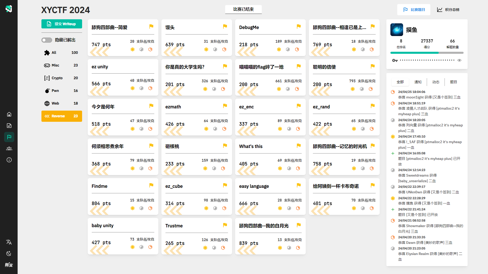

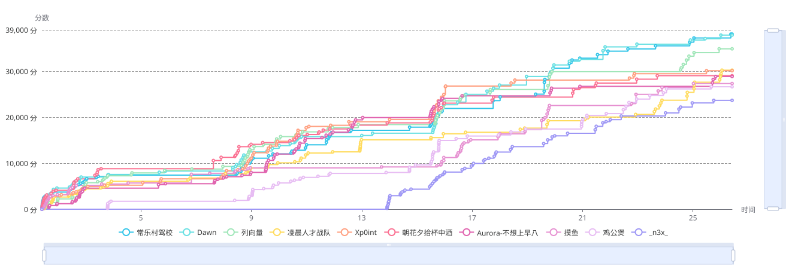

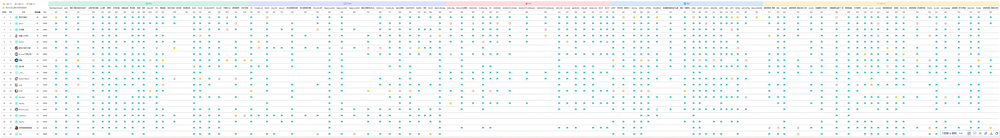

# 舔狗四部曲--我的白月光

> 不再如过去，真的要再见了。
> 出题人：@H1m
> 13支队伍攻克

通过在 main 函数中调用 Windows API 实现的 GUI 程序。程序逻辑：

- main 函数前 6 行初始化窗体
- 从 _mm_load_si128 到异或 0x66 是将大量数据复制到栈上并解密，解密结果看不出规律
- 八句 sub_140002630 在窗体上绘制八行以 UTF16-LE 编码的文字，最后一行是 `flag{L0v3_(还有两个部分在等待你)` ，并正常调用 MessageBoxA 🚩
- 从 GetModuleHandleA 到 VirtualProtect 之后是获得导入函数表的地址，遍历导入表，找到导入表中存放 MessageBoxA 地址的位置，修改其内存权限，并改为 sub_140001470 的地址，之后调用 MessageBoxA 就会调用 sub_140001470 了
- 如下操作进行 440 次：
    - 从 _mm_load_si128 到异或 0x66 是对另一大段数据进行相同的解密过程，解密结果： `in the circus i know something are here, at the right time you can choose to skipfffffffffffffffffff`
    - 调用 MessageBoxA ，实际调用 sub_140001470
        - 对另一大段数据进行相同的解密过程，解密结果： `please do not try to find her she do not belong to ago memories i will give you some flags:i8_a_k3y_and now go back please!`🚩
        - 调用 MessageBoxW ，弹出 7 个对话框
        - 返回 1
    - 将返回值最低位取反，写到栈上数组对应位置，实际上得到一个 440 字节的全为 0x00 的数组，如果不劫持 MessageBoxA 则是一个 440 字节的每个元素要么为 0x00 要么为 0x01 的数组
- 在 for 循环中调用 440 次 sub_140001070 即 sprintf ， IDA 反编译得到的实参列表不正确，右键 Set call type… 对函数调用增加一个参数，改为 `__int64 (__fastcall *)(char *Buffer, size_t BufferCount, char *Format, unsigned int MoYuTeam)`
    
    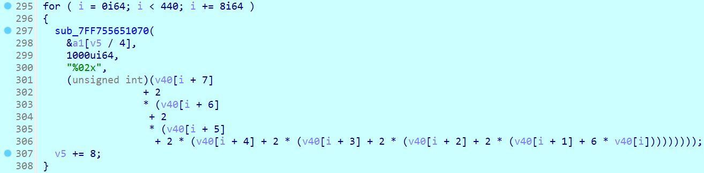
    
    这里的 v40 数组是上面的 440 字节的数组，对数组中每 8 个占 1 字节的布尔值合并成 1 字节，然后转为十六进制文本表示，并放到栈上另一个位置，最终得到 440 / 8 * 2 = 110 字符的十六进制文本
    
- sub_140001290 是魔改的 Base64 算法，对这 110 字符的十六进制文本进行 Base64 并放到栈上另一个位置，魔改是输入 3 字节和输出 4 字节均使用小端序，相当于先把原文倒过来，然后进行正常 Base64 ，最后再将编码结果倒过来
- 最后将编码结果与字符串字面量比较，并输出比较结果。解码得：
    
    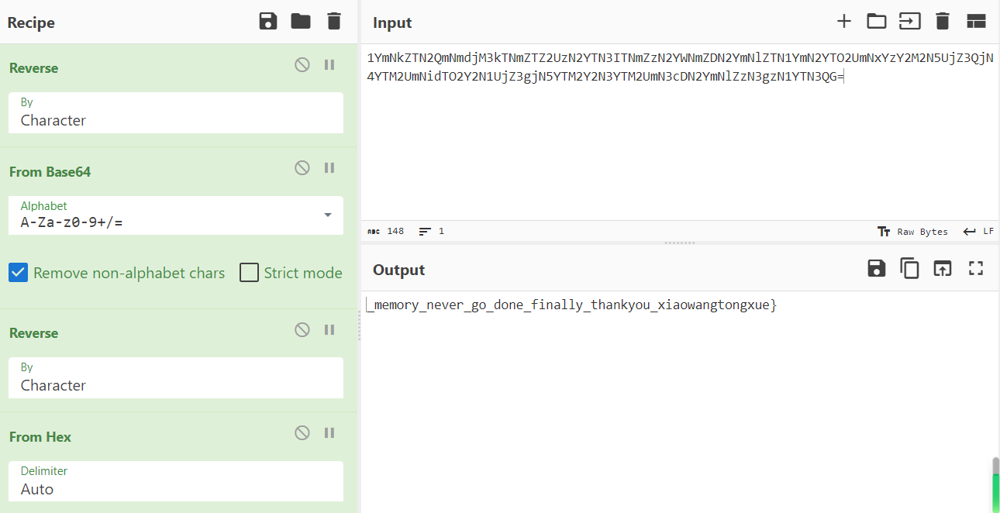

🚩 `flag{L0v3_i8_a_k3y_and_memory_never_go_done_finally_thankyou_xiaowangtongxue}`

# 馒头

> 听说你数据结构与算法学的很好？
> 出题人：@Ea5y
> 31支队伍攻克

从“本地类型”可以看到结构体定义

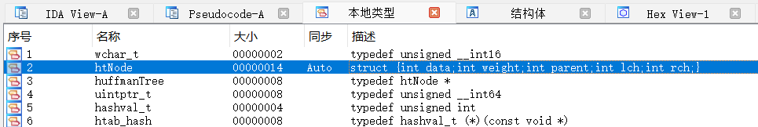

发现是用数组实现的哈夫曼树，整理一下反编译的代码，加上注释

```c
typedef struct
{
    int data;
    int weight;
    int parent;
    int lch;
    int rch;
} htNode;

typedef htNode *huffmanTree;

int initHuffmanTree(huffmanTree *HT)
{
    *HT = (huffmanTree)malloc(960);
    for (int i = 1; i <= 47; ++i)  // 下标0留空不用，下标1-24是叶子节点，下标25-47是非叶子节点
    {
        (*HT)[i].parent = (*HT)[i].lch = (*HT)[i].rch = -1;
    }
    puts("please input flag:");
    for (int i_0 = 1; i_0 <= 24; ++i_0)  // 叶子节点的data是1-24，weight是输入的字符
    {
        (*HT)[i_0].data = i_0;
        (*HT)[i_0].weight = getchar();
    }
    return 1;
}

void creatHuffmanTree(huffmanTree *HT, int n)
{
    int j;      // [rsp+8h] [rbp-18h]
    int rnode;  // [rsp+Ch] [rbp-14h]
    int min2;   // [rsp+10h] [rbp-10h]
    int lnode;  // [rsp+14h] [rbp-Ch]
    int min1;   // [rsp+18h] [rbp-8h]
    int i;      // [rsp+1Ch] [rbp-4h]

    if (n > 1)
    {
        for (i = n + 1; i < 2 * n; ++i)  // 对第25个节点到第47个节点赋值，data未初始化但应该初始化为0才好
        {
            min1 = 0x7FFF;
            lnode = -1;
            min2 = 0x7FFF;
            rnode = -1;
            for (j = 1; i > j; ++j)  // 找到两个最小的节点
            {
                if (min1 > (*HT)[j].weight && (*HT)[j].parent == -1)
                {
                    min2 = min1;
                    rnode = lnode;
                    min1 = (*HT)[j].weight;
                    lnode = j;
                }
                else if (min2 > (*HT)[j].weight && (*HT)[j].parent == -1)
                {
                    min2 = (*HT)[j].weight;
                    rnode = j;
                }
            }
            (*HT)[lnode].parent = (*HT)[rnode].parent = i;
            (*HT)[i].lch = lnode;
            (*HT)[i].rch = rnode;
            (*HT)[i].weight = (*HT)[lnode].weight + (*HT)[rnode].weight;
        }
        // 这时(*HT)[47]是根节点
    }
}

int ans1[58] = { 2270, 917, 446, 217, 106, 51, 20, 15, 17, 229, 114, 16, 11, 471, 233, 116, 14, 13, 238, 118, 12, 7, 1353, 557, 248, 123, 6, 24, 309, 137, 67, 3, 5, 172, 84, 4, 1, 796, 383, 186, 89, 2, 8, 197, 97, 48, 23, 10, 21, 413, 203, 101, 22, 9, 210, 104, 19, 18 };

int check_flag(huffmanTree HT, int i)
{
    static int index = 0;
    if (i <= 24)  // 对于叶子，只比对下标
    {
        if (HT[i].data != ans1[index++])
            return 0;
    }
    else  // 对于非叶子，只比对权值，如果左孩子是叶子，再比对左孩子的权值
    {
        if (HT[i].weight != ans1[index++])
            return 0;
        if (HT[HT[i].lch].data <= 24 && HT[HT[i].lch].data > 0)
        {
            if (HT[HT[i].lch].weight != ans1[index++])
                return 0;
        }
    }
    if (HT[i].lch <= 0)  // 递归终止条件
        return 1;
    return check_flag(HT, HT[i].lch) && check_flag(HT, HT[i].rch);  // 先序遍历
}
```

比对下标的时候，下标不会大于24；而权值不会小于32（ASCII可打印字符）。可以据此区分开叶子和非叶子。

才58个数据，写解题程序如果出错了还要debug，不如手撕🐶

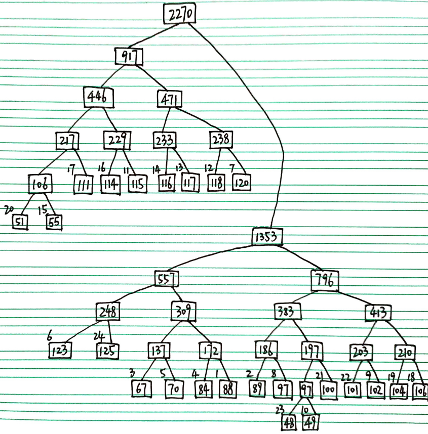

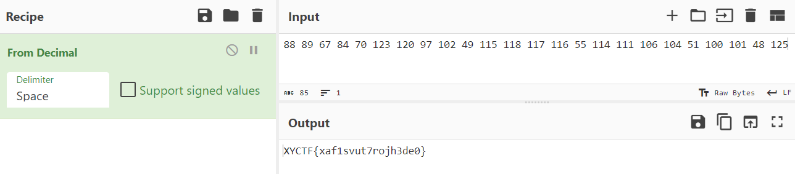

🚩 `XYCTF{xaf1svut7rojh3de0}`

# 舔狗四部曲--记忆的时光机

> 一切都晚了，开始你的时空探索。
> 出题人：@H1m
> 19支队伍攻克

通过在栈上存放地址，每次执行一段操作后，读栈上保存的地址并跳转，实现函数内的控制流。动态调试一下

check 函数第一次 jmp 后可以知道 flag 长度为 48

走到 enc 被调用处，edi 寄存器是用户输入的字符串指针，esi 寄存器是即将比对的字符下标，每次调用 enc 将加密一个字符，手动记录关键逻辑如下

```c
edi = (char*)Input
esi = (int)Idx
r10 = esi
esi += 6
r11 = (char*)Key
r8d = (char)Input[Idx]
r8d ^= esi
r8d ^= 0x66
r8d -= 6
r9d = (char)Key[Idx]
r8d ^= r9d
eax = r8d
```

```c
#include <stdio.h>

unsigned char ans[] =
    {
        0x69, 0x58, 0x61, 0x63, 0x67, 0x4C, 0x4D, 0x32, 0x98, 0x20,
        0x4D, 0x51, 0x7B, 0x25, 0x75, 0x51, 0xA3, 0x58, 0x60, 0x72,
        0x42, 0x62, 0x67, 0x66, 0x37, 0x6C, 0x30, 0x46, 0x66, 0x4F,
        0x5D, 0x03, 0x5D, 0xA4, 0x66, 0x01, 0x43, 0x68, 0x7D, 0x7C,
        0x55, 0x4F, 0x7A, 0x3F, 0x6C, 0x12, 0x21, 0x09};

const char *key = "i_have_get_shell_but_where_is_you_my_dear_baby!!";

int main() {
    for (int i = 0; i < 48; i++) {
        ans[i] ^= key[i];
        ans[i] += 6;
        ans[i] ^= 0x66;
        ans[i] ^= (i + 6);
    }
    printf(ans);
    return 0;
}
```

🚩 `flag{Br0k3n_m3m0r1es_for3v3r_Sh1n@_1n_The_H3@$T}`

# ez_rand

> Release太简单啦;flag格式：XYCTF{}
> 出题人：@upsw1ng
> 65支队伍攻克

动态调试发现：在不同的时刻随机生成的异或 key 不相同；

只取 time(0) 返回值的低 16 位（ax）传递给 srand，足够小，可以爆破；

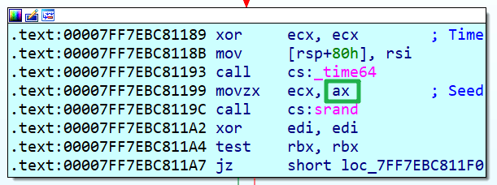

rand 函数（看导入表知道是来自 api-ms-win-crt-utility-l1-1-0 的）总是返回一个范围是 16 位的整数。

为确保爆破用的 rand 同样是来自 api-ms-win-crt-utility-l1-1-0 的，这里同样使用 VS 2022 Release 配置（后面发现其实 Debug 或者 GCC 的结果都是相同的）。

```c
#include <stdio.h>
#include <stdlib.h>
#define u8 unsigned char
#define u16 unsigned short
#define u32 unsigned int
#define u64 unsigned long long

u8 ida_chars[] =
    {
        0x5D, 0x0C, 0x6C, 0xEA, 0x46, 0x19, 0xFC, 0x34, 0xB2, 0x62,
        0x23, 0x07, 0x62, 0x22, 0x6E, 0xFB, 0xB4, 0xE8, 0xF2, 0xA9,
        0x91, 0x12, 0x21, 0x86, 0xDB, 0x8E, 0xE9, 0x43, 0x4D};

const char* tmpl = "XYCTF{XXXXXXXXXXXXXXXXXXXXXX}";

int main() {
    for(u32 i = 0; i <= 0xFFFF; i++) {
        u32 flag = 1;
        srand(i);
        for(int j = 0; j < 29; j++) {
            u32 eax = rand(); // 16 bits
            u32 r8d = eax;
            u64 mul = (u64)eax * (u64)0x80808081;
            u32 edx = (mul >> 32) >> 7;
            u32 ecx;
            // always 0:
            // ecx = edx >> 31;
            // edx += ecx;
            ecx = edx * 0xFF;
            r8d -= ecx;
            r8d ^= ida_chars[j];
            if (j < 6 || j == 28) {
                if (r8d != tmpl[j]) {
                    flag = 0;
                    break;
                }
            }
            // or:
            // if (r8d < 32 || r8d >= 127) {
            //     flag = 0;
            //     break;
            // }
        }
        if(flag) {
            printf("Seed: %u\t", i);
            srand(i);
            for (int j = 0; j < 29; j++) {
                u32 eax = rand();
                u32 r8d = eax;
                u64 mul = (u64)eax * (u64)0x80808081;
                u32 edx = (mul >> 32) >> 7;
                u32 ecx;
                ecx = edx * 0xFF;
                r8d -= ecx;
                r8d ^= ida_chars[j];
                printf("%c", r8d);
            }
            printf("\n");
        }
    }
}

// Seed: 21308     XYCTF{R@nd_1s_S0_S0_S0_easy!}
```

# 舔狗四部曲--简爱

> 爱情就像re，持之以恒，终得真爱；flag格式：FLAG{} 难度：medium
> 出题人：@CDM258
> 20支队伍攻克

file 可知给出的是可重定位目标文件（只编译了、没有链接），链接一下

```bash
gcc jianai -o jianai1
```

中文字符串是国标码，打印出来全是问号，坏（问了出题人说是用 Dev C++ 编辑的）

IDA 反编译的结果中，对几个字符串的复制与引用很混乱（问了出题人发现是因为用了栈上的可变长度数组），动态调试才知道每一处分别用的是哪个地址的字符串

TEA 是骗人的，真正的加密逻辑在 howtolove 函数（参数是用户输入原样），密文需要与 fake flag 一致，z3 梭了

```python
from z3 import *

s = Solver()
temp = [BitVec(f'flag{i}', 8) for i in range(32)]
moyu_z3_vars = temp[:]

for i in range(32):
    s.add(temp[i] >= 0x20, temp[i] <= 0x7e)

v2 = [0] * 0x1C20
v2[32] = 2;
v2[65] = 2;
v2[66] = 4;
v2[98] = 2;
v2[99] = 5;
v2[185] = 2;
v2[186] = 2;
v2[187] = 1;
v2[188] = 1;
v2[189] = 1;
v2[190] = 1;
v2[191] = 1;
v2[192] = 1;
v2[193] = 1;
v2[194] = 1;
v2[195] = 1;
v2[196] = 1;
v2[197] = 1;
v2[198] = 1;
v2[199] = 1;
v2[200] = 1;
v2[201] = 1;
v2[202] = 1;
v2[203] = 1;
v2[204] = 1;
v2[205] = 1;
v2[206] = 1;
v2[207] = 1;
v2[208] = 1;
v2[209] = 1;
v2[210] = 1;
v2[211] = 1;
v2[212] = 1;
v2[213] = 1;
v2[214] = 1;
v2[215] = 1;
v2[216] = 1;
v2[217] = 1;
v2[218] = 1;
v2[219] = 1;
v2[220] = 1;
v2[221] = 1;
v2[222] = 1;
v2[223] = 1;
v2[224] = 1;
v2[225] = 1;
v2[226] = 1;
v2[227] = 1;
v2[228] = 1;
v2[229] = 2;
v2[232] = 2;
v2[256] = 2;
v2[257] = 5;
v2[303] = 1;
v2[304] = 1;
v2[305] = 1;
v2[306] = 1;
v2[307] = 2;
v2[308] = 5;
v2[328] = 1;
v2[329] = 1;
v2[330] = 1;
v2[331] = 1;
v2[332] = 1;
v2[333] = 1;
v2[334] = 1;
v2[335] = 1;
v2[336] = 1;
v2[337] = 1;
v2[338] = 1;
v2[339] = 1;
v2[340] = 1;
v2[341] = 1;
v2[342] = 2;
v2[353] = 2;
v2[354] = 5;
v2[430] = 2;
v2[431] = 2;
v2[432] = 5;
v2[523] = 2;
v2[524] = 5;
v2[564] = 2;
v2[565] = 5;
v2[627] = 2;
v2[628] = 1;
v2[629] = 1;
v2[630] = 1;
v2[631] = 1;
v2[632] = 1;
v2[633] = 1;
v2[634] = 1;
v2[635] = 1;
v2[636] = 1;
v2[637] = 1;
v2[638] = 1;
v2[639] = 1;
v2[640] = 1;
v2[641] = 1;
v2[642] = 1;
v2[643] = 1;
v2[644] = 1;
v2[645] = 1;
v2[646] = 1;
v2[647] = 2;
v2[648] = 4;
v2[649] = 1;
v2[650] = 1;
v2[651] = 1;
v2[652] = 1;
v2[653] = 2;
v2[680] = 2;
v2[687] = 2;
v2[688] = 4;
v2[698] = 2;
v2[766] = 2;
v2[767] = 5;
v2[818] = 2;
v2[819] = 1;
v2[820] = 2;
v2[827] = 2;
v2[828] = 5;
v2[846] = 2;
v2[847] = 5;
v2[890] = 2;
v2[891] = 1;
v2[892] = 1;
v2[893] = 1;
v2[894] = 1;
v2[895] = 1;
v2[896] = 1;
v2[897] = 1;
v2[898] = 1;
v2[899] = 1;
v2[900] = 1;
v2[901] = 1;
v2[902] = 1;
v2[903] = 1;
v2[904] = 1;
v2[905] = 1;
v2[906] = 1;
v2[907] = 1;
v2[908] = 1;
v2[909] = 1;
v2[910] = 1;
v2[911] = 1;
v2[912] = 1;
v2[913] = 1;
v2[914] = 1;
v2[915] = 1;
v2[916] = 1;
v2[917] = 1;
v2[918] = 1;
v2[919] = 1;
v2[920] = 1;
v2[921] = 1;
v2[922] = 1;
v2[923] = 1;
v2[924] = 1;
v2[925] = 1;
v2[926] = 1;
v2[927] = 1;
v2[928] = 1;
v2[929] = 1;
v2[930] = 1;
v2[931] = 1;
v2[932] = 1;
v2[933] = 2;
v2[934] = 5;
v2[989] = 2;
v2[994] = 2;
v2[995] = 1;
v2[996] = 1;
v2[997] = 1;
v2[998] = 1;
v2[999] = 1;
v2[1000] = 1;
v2[1001] = 1;
v2[1002] = 1;
v2[1003] = 1;
v2[1013] = 1;
v2[1014] = 1;
v2[1015] = 1;
v2[1016] = 1;
v2[1017] = 1;
v2[1018] = 1;
v2[1019] = 1;
v2[1020] = 1;
v2[1021] = 1;
v2[1022] = 1;
v2[1023] = 1;
v2[1024] = 1;
v2[1025] = 1;
v2[1026] = 1;
v2[1027] = 2;
v2[1028] = 3;
v4 = 0;
v3 = 0;
while ( 1 ):
  while ( 1 ):
    while ( 1 ):
      while ( not v2[v3] ):
        v3 += 1
        temp[v4] += 1
      if ( v2[v3] != 1 ):
        break;
      v3 += 1
      temp[v4] -= 1
    if ( v2[v3] != 2 ):
      break;
    v3 += 1
    v4 += 1
  if ( v2[v3] == 3 ):
    break;
  if ( v2[v3] == 4 ):
    temp[v4] = temp[v4] + temp[v4 + 1] - 70;
    v3 += 1
  elif ( v2[v3] == 5 ):
    temp[v4] = temp[v4] - temp[v4 + 1] + 70;
    v3 += 1

for i in range(32):
    s.add(temp[i] == ord('flag{Love_is_not_one_sided_Love}'[i]))

if s.check() == sat:
    model = s.model()
    print(''.join([chr(model[moyu_z3_vars[i]].as_long()) for i in range(32)]))
```

🚩 `FLAG{vm_is_A_3ecreT_l0Ve_revers}`

# ez_cube

> 你会玩魔方吗？我反正不会。flag{What_you_input}
> 出题人：@Showmaker
> 98支队伍攻克

4种字符、长度最多12，可爆

```python
import itertools
from tqdm import tqdm

def reset():
  global pr, pb, pg, po, py, pw
  pr = [0] * 9
  pb = [1] * 9
  pg = [2] * 9
  po = [3] * 9
  py = [4] * 9
  pw = [5] * 9
  pb[1] = 0
  pr[1] = 2
  pg[1] = 1

def R():
  global pr, pb, pg, po, py, pw
  v0 = pr[2];
  v1 = pr[5];
  v2 = pr[8];
  pr[2] = pw[2];
  pr[5] = pw[5];
  pr[8] = pw[8];
  pw[2] = po[6];
  pw[5] = po[3];
  pw[8] = po[0];
  po[0] = py[8];
  po[3] = py[5];
  po[6] = py[2];
  py[2] = v0;
  py[5] = v1;
  py[8] = v2;
  v3 = pg[1];
  pg[1] = pg[3];
  pg[3] = pg[7];
  pg[7] = pg[5];
  pg[5] = v3;
  v4 = pg[0];
  pg[0] = pg[6];
  pg[6] = pg[8];
  pg[8] = pg[2];
  pg[2] = v4;

def U():
  global pr, pb, pg, po, py, pw
  v0 = pr[0];
  v1 = pr[1];
  v2 = pr[2];
  pr[0] = pg[0];
  pr[1] = pg[1];
  pr[2] = pg[2];
  pg[0] = po[0];
  pg[1] = po[1];
  pg[2] = po[2];
  po[0] = pb[0];
  po[1] = pb[1];
  po[2] = pb[2];
  pb[0] = v0;
  pb[1] = v1;
  pb[2] = v2;
  v3 = py[1];
  py[1] = py[3];
  py[3] = py[7];
  py[7] = py[5];
  py[5] = v3;
  v4 = py[0];
  py[0] = py[6];
  py[6] = py[8];
  py[8] = py[2];
  py[2] = v4;

def r():
  global pr, pb, pg, po, py, pw
  v0 = pr[2];
  v1 = pr[5];
  v2 = pr[8];
  pr[2] = py[2];
  pr[5] = py[5];
  pr[8] = py[8];
  py[2] = po[6];
  py[5] = po[3];
  py[8] = po[0];
  po[0] = pw[8];
  po[3] = pw[5];
  po[6] = pw[2];
  pw[2] = v0;
  pw[5] = v1;
  pw[8] = v2;
  v3 = pg[1];
  pg[1] = pg[5];
  pg[5] = pg[7];
  pg[7] = pg[3];
  pg[3] = v3;
  v4 = pg[0];
  pg[0] = pg[2];
  pg[2] = pg[8];
  pg[8] = pg[6];
  pg[6] = v4;

def u():
  global pr, pb, pg, po, py, pw
  v0 = pr[0];
  v1 = pr[1];
  v2 = pr[2];
  pr[0] = pb[0];
  pr[1] = pb[1];
  pr[2] = pb[2];
  pb[0] = po[0];
  pb[1] = po[1];
  pb[2] = po[2];
  po[0] = pg[0];
  po[1] = pg[1];
  po[2] = pg[2];
  pg[0] = v0;
  pg[1] = v1;
  pg[2] = v2;
  v3 = py[1];
  py[1] = py[5];
  py[5] = py[7];
  py[7] = py[3];
  py[3] = v3;
  v4 = py[0];
  py[0] = py[2];
  py[2] = py[8];
  py[8] = py[6];
  py[6] = v4;

if __name__ == '__main__':
  a = []
  for l in range(2, 13):
    a += itertools.product('RrUu', repeat=l)
  for s in tqdm(a):
    reset()
    for c in s:
      if c == 'R':
        R()
      elif c == 'r':
        r()
      elif c == 'U':
        U()
      elif c == 'u':
        u()
    if not all(all(x == t[0] for x in t) for t in [pr, pb, pg]):
      continue
    print(''.join(s))
```

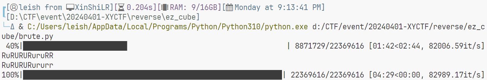

🚩 `flag{RuRURURuruRR}`

# Findme

> 小叮当藏起来了，你能找到他吗?
> 出题人：@ShowMaker
> 15支队伍攻克

Doraemon4 会初始化一个 512 字节的 BOX，然后用 BOX 加密 Doraemon3 得到  Doraemon1。由于 BOX 初始状态已知，正向顺序重新跑一次即可。复制反编译代码到新的 C 源文件，fputc 和 fgetc 互换，直接跑得到 Doraemon3。

```c
#include <stdio.h>
#include <string.h>

const char *Str = "Find_Doraemon";

unsigned char BOX[512];

void init_box()
{
    char *v0;        // rdi
    __int64 i;       // rcx
    char v3[32];     // [rsp+0h] [rbp-20h] BYREF
    char v4;         // [rsp+20h] [rbp+0h] BYREF
    unsigned int v5; // [rsp+24h] [rbp+4h]
    char v6;         // [rsp+44h] [rbp+24h]
    char v7[532];    // [rsp+70h] [rbp+50h] BYREF
    unsigned int j;  // [rsp+284h] [rbp+264h]
    int v9;          // [rsp+2A4h] [rbp+284h]
    int v10;         // [rsp+2C4h] [rbp+2A4h]

    v5 = strlen(Str);
    memset(v7, 0, 0x200);
    for (j = 0; j < 0x200; ++j)
    {
        v6 = j;
        BOX[j] = -(char)j;
        v7[j] = Str[j % v5];
    }
    v9 = 0;
    v10 = 0;
    while (v9 < 512)
    {
        v10 = ((unsigned __int8)v7[v9] + BOX[v9] + v10) % 512;
        unsigned char tmp = BOX[v9];
        BOX[v9] = BOX[v10];
        BOX[v10] = tmp;
        ++v9;
    }
}

int main()
{
    size_t v3;           // rax
    int v5;              // eax
    FILE *fout;        // [rsp+28h] [rbp+8h]
    FILE *fin;            // [rsp+48h] [rbp+28h]
    int v8;              // [rsp+64h] [rbp+44h]
    int v9;              // [rsp+84h] [rbp+64h]
    int v10;             // [rsp+A4h] [rbp+84h]
    int v11;             // [rsp+C4h] [rbp+A4h]
    unsigned __int8 v12; // [rsp+104h] [rbp+E4h]
    unsigned __int8 v13; // [rsp+144h] [rbp+124h]
    int i;               // [rsp+164h] [rbp+144h]

    init_box();
    v8 = 0;
    v10 = 0;
    v11 = 0;
    fout = fopen("Doraemon3", "wb");
    fin = fopen("Doraemon1", "rb");
    while (!feof(fin))
    {
        v10 = (v10 + 1) % 512;
        v11 = (BOX[v10] + v11) % 512;
        unsigned char tmp = BOX[v10];
        BOX[v10] = BOX[v11];
        BOX[v11] = tmp;
        v13 = BOX[(unsigned __int8)((BOX[v11] + BOX[v10]) % 512)];
        v12 = v13 ^ fgetc(fin);
        fputc(v12, fout);
        srand(BOX[v8 % 512]);
        v9 = rand() % 4;
        for (i = 0; i < v9; ++i)
        {
            v5 = rand();
            fgetc(fin);
        }
        ++v8;
    }
    fclose(fout);
    fclose(fin);

    return 0;
}
```

Doraemon3 本身已经是解密程序，解密 Doraemon2 得到 Here。输入密钥 Doraemon 直接跑得到 GIF89a 文件


# 舔狗四部曲--相逢已是上上签

> 听说你PE,工具,算法都学的很好尊嘟假嘟?
> 出题人：@upsw1ng
> 18支队伍攻克

蓝底处 PE 头位置修改为 100h

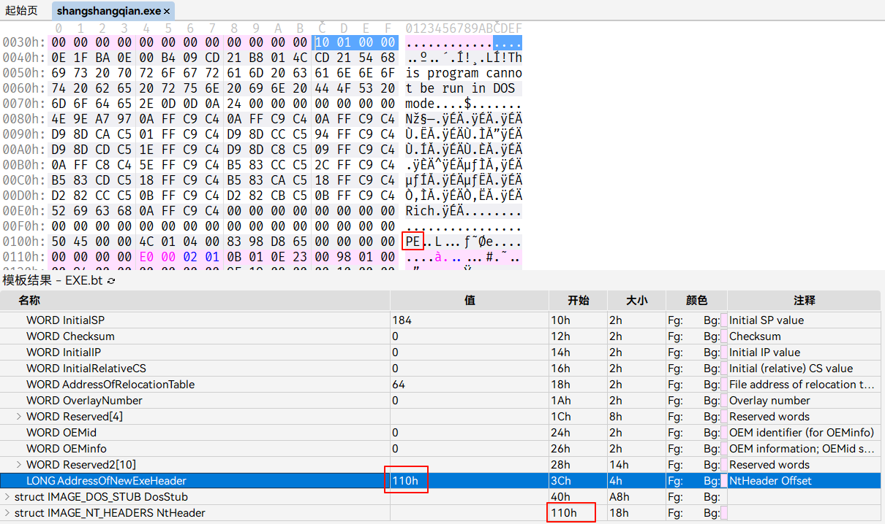

6 个变量 6 个方程，z3 启动

```python
from z3 import *

s = Solver()
key = [BitVec(f'key_{i}', 8) for i in range(6)]

s.add(532 * key[5]
     + 829 * key[4]
     + 258 * key[3]
     + 811 * key[2]
     + 997 * key[1]
     + 593 * key[0] == 292512)
s.add(576 * key[5]
     + 695 * key[4]
     + 602 * key[3]
     + 328 * key[2]
     + 686 * key[1]
     + 605 * key[0] == 254496)
s.add(580 * key[5]
     + 448 * key[4]
     + 756 * key[3]
     + 449 * key[2]
     + 512 * key[1]
     + 373 * key[0] == 222479)
s.add(597 * key[5]
     + 855 * key[4]
     + 971 * key[3]
     + 422 * key[2]
     + 635 * key[1]
     + 560 * key[0] == 295184)
s.add(524 * key[5]
     + 324 * key[4]
     + 925 * key[3]
     + 388 * key[2]
     + 507 * key[1]
     + 717 * key[0] == 251887)
s.add(414 * key[5]
     + 495 * key[4]
     + 518 * key[3]
     + 884 * key[2]
     + 368 * key[1]
     + 312 * key[0] == 211260)

if s.check() == sat:
    m = s.model()
    print(''.join([chr(m[k].as_long()) for k in key]))
```

key: `XYCTF!`

```c
#include <stdio.h>
#define u32 unsigned int

char* Key = "XYCTF!";

void sub_401000(u32 *a1, int a2)
{
    int v2;          // ecx
    int v3;          // eax
    int v4;          // edx
    int v5;          // [esp+4h] [ebp-1Ch]
    int v6;          // [esp+Ch] [ebp-14h]
    unsigned int v7; // [esp+10h] [ebp-10h]
    unsigned int v8; // [esp+18h] [ebp-8h]
    unsigned int i;  // [esp+1Ch] [ebp-4h]

    if (a2 > 1)
    {
        v6 = 52 / a2 + 6;
        v7 = 0;
        v8 = a1[a2 - 1];
        do
        {
            v7 -= 0x61C88647;
            v5 = (v7 >> 2) & 5;
            for (i = 0; i < a2 - 1; ++i)
            {
                v2 = ((v8 ^ Key[v5 ^ i & 5]) + (a1[i + 1] ^ v7)) ^ (((16 * v8) ^ (a1[i + 1] >> 3)) + ((4 * a1[i + 1]) ^ (v8 >> 5)));
                v3 = a1[i];
                a1[i] = v2 + v3;
                v8 = v2 + v3;
            }
            v4 = (((v8 ^ Key[v5 ^ i & 5]) + (*a1 ^ v7)) ^ (((16 * v8) ^ (*a1 >> 3)) + ((4 * *a1) ^ (v8 >> 5)))) + a1[a2 - 1];
            a1[a2 - 1] = v4;
            v8 = v4;
            --v6;
        } while (v6);
    }
}

void decrypt(u32 *a1, int a2)
{
    int v5;          // [esp+4h] [ebp-1Ch]
    int v6;          // [esp+Ch] [ebp-14h]
    unsigned int v7; // [esp+10h] [ebp-10h]
    unsigned int v8; // [esp+18h] [ebp-8h]
    int i;  // [esp+1Ch] [ebp-4h]

    if (a2 > 1)
    {
        v7 = (-0x61C88647) * (52 / a2 + 6);
        for (v6 = 0; v6 < 52 / a2 + 6; ++v6)
        {
            v5 = (v7 >> 2) & 5;
            for (i = a2 - 1; i >= 0; --i)
            {
                v8 = a1[(i - 1 + a2) % a2];
                a1[i] -= ((v8 ^ Key[v5 ^ i & 5]) + (a1[(i + 1) % a2] ^ v7)) ^ (((16 * v8) ^ (a1[(i + 1) % a2] >> 3)) + ((4 * a1[(i + 1) % a2]) ^ (v8 >> 5)));
            }
            v7 += 0x61C88647;
        }
    }
}

int main() {
    int v6[8];
    v6[0] = 1718186609;
    v6[1] = -1989270907;
    v6[2] = -988247013;
    v6[3] = 1924988163;
    v6[4] = 1400902090;
    v6[5] = 1302415020;
    v6[6] = -2040328853;
    v6[7] = -124282896;
    decrypt(v6, 8);
    printf("%s\n", v6);
    return 0;
}
```

🚩 `XYCTF{XXTEA_AND_Z3_1s_S0_easy!!}`

# easy language

> 易语言一定很easy吧(玩的时候声音建议开小点)。
> 出题人：@yuro
> 28支队伍攻克

看到一段base64、故意用感叹号补齐的16个字符、明文字符串AES-ECB，直接试。靠谱的方法以后再来探索吧

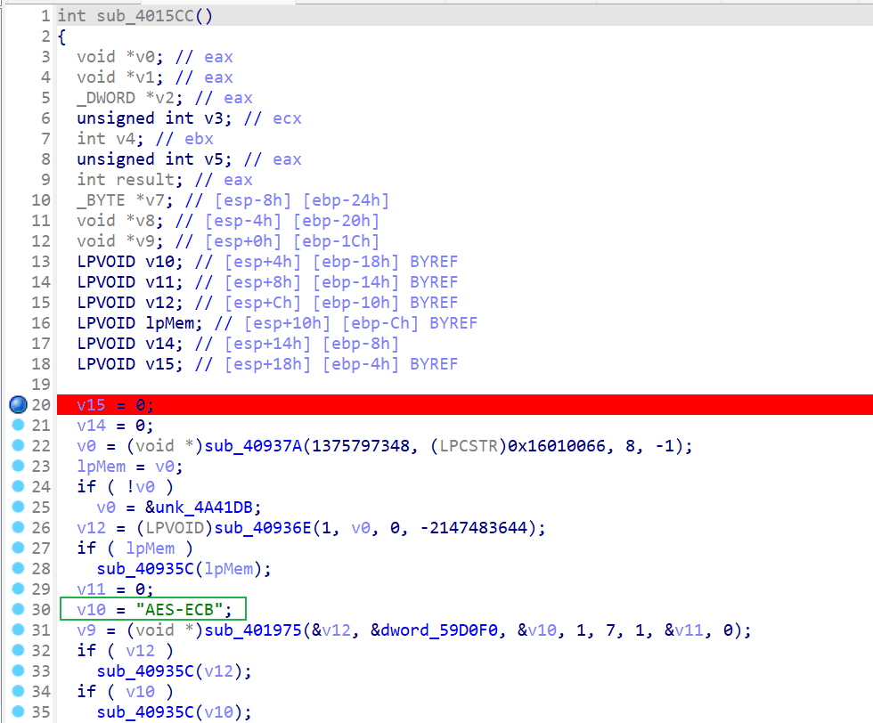

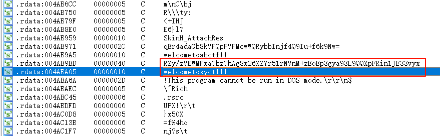

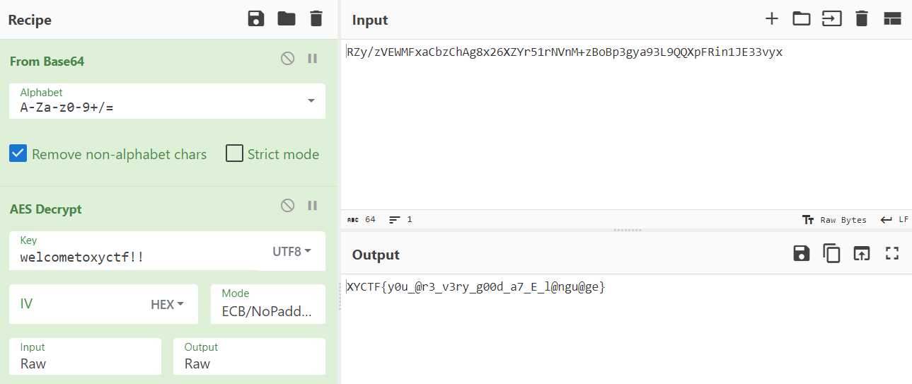

🚩 `XYCTF{y0u_@r3_v3ry_g00d_a7_E_l@ngu@ge}`

# 今夕是何年

> 只要运行就有 flag。都是兄弟，怎么会骗你呢。
> 出题人：@Suyun
> 47支队伍攻克

既生「TCPL」，何生「今夕是何年」？

原本还以为“今夕是何年”意思是“都 4202 年了还能遇到上古可执行文件”，直到丢 Ghidra 才知道是“龙”啊

Rust ，能看到明文 flag 头，但是逆不动一点

Ubuntu 22.04 的 apt 没有 qemu-loongarch64 ，自己编译整个 qemu 需要五六 GB 磁盘空间，被塞满了🤣👉🤡

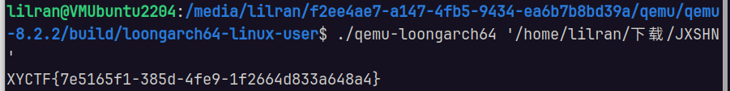

# Trustme

> 什么漏洞，这么EZ~
> 出题人：@JSTQ
> 126支队伍攻克

在 `ProxyApplication` 中找到对 `classes.dex` 尾部数据异或 255 然后写回 APK 的逻辑

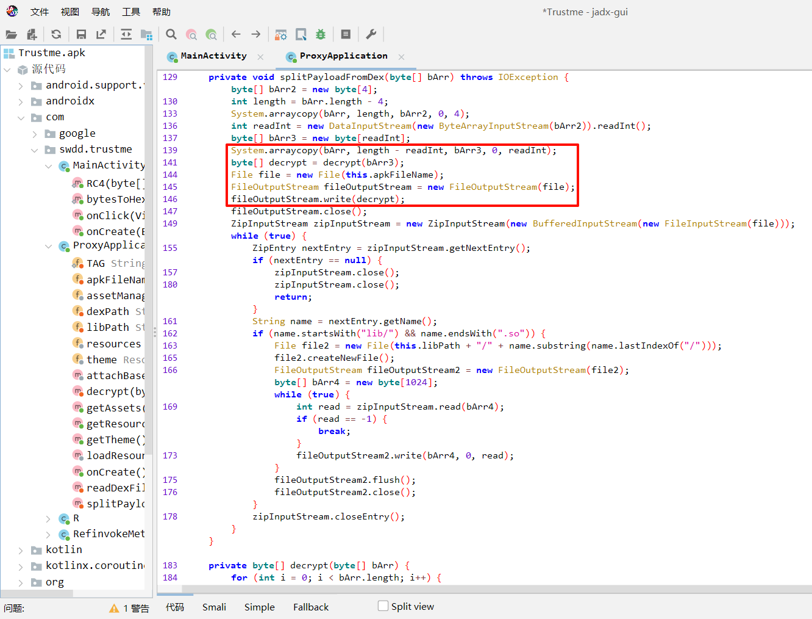

手动提取这部分数据异或 255 得到 APK 文件，找到对 `mydb.db` 异或 255 的逻辑

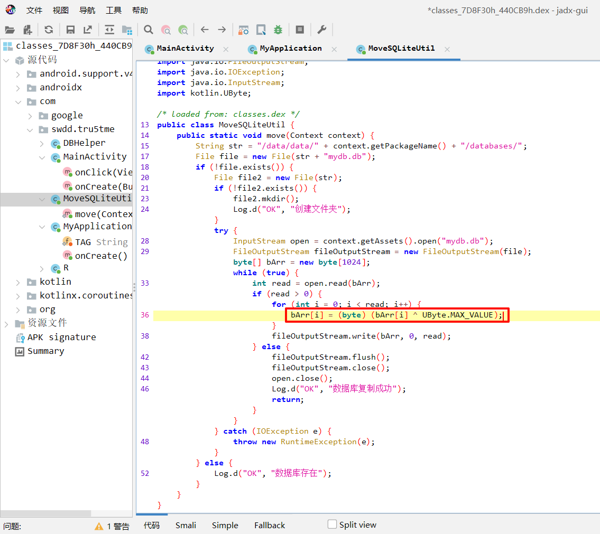

在 SQLite 二进制文件中看到 flag 字符串

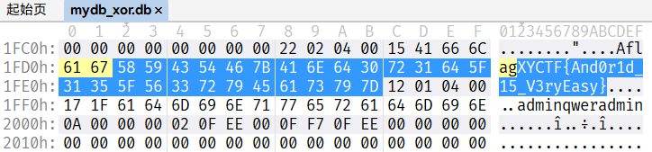

🚩 `XYCTF{And0r1d_15_V3ryEasy}`

# 何须相思煮余年

> 为什么没有代码呀？
> 出题人：@upsw1ng
> 79支队伍攻克

用 CyberChef 将文本存为二进制文件，拖到 IDA （32位或64位都可以）发现包含一个完整的函数（有函数序言和函数尾声），P 键创建函数后可以反编译

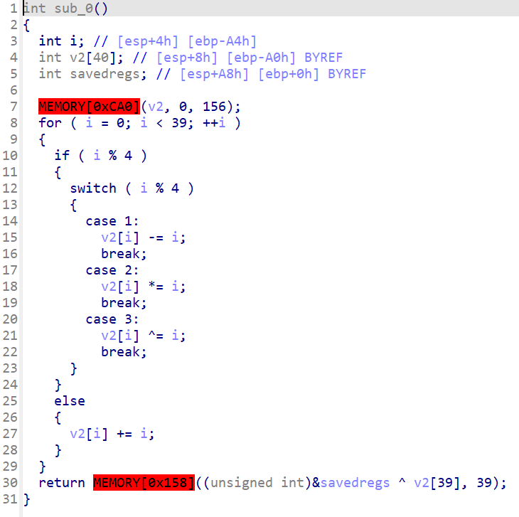

```python
enc = [88,88,134,87,74,118,318,101,59,92,480,60,65,41,770,110,73,31,918,39,120,27,1188,47,77,24,1352,44,81,23,1680,46,85,15,1870,66,91,16,4750]

for i in range(39):
    if i % 4 == 0: enc[i] -= i
    elif i % 4 == 1: enc[i] += i
    elif i % 4 == 2: enc[i] //= i
    elif i % 4 == 3: enc[i] ^= i

print(bytes(enc))
```

🚩 `XYCTF{5b3e07567a9034d06851475481507a75}`

# What's this

> 这是什么文件?
> 出题人：@ZhaoWu
> 69支队伍攻克

DIE 可知 格式: Lua Bytecode (.LUAC)(v5.1)[LittleEndian]

找工具 [https://www.52pojie.cn/thread-1224918-1-1.html](https://www.52pojie.cn/thread-1224918-1-1.html)

反编译得到源代码，包含大量无意义逻辑，只需追溯 output 变量的赋值过程即可

CyberChef 梭了

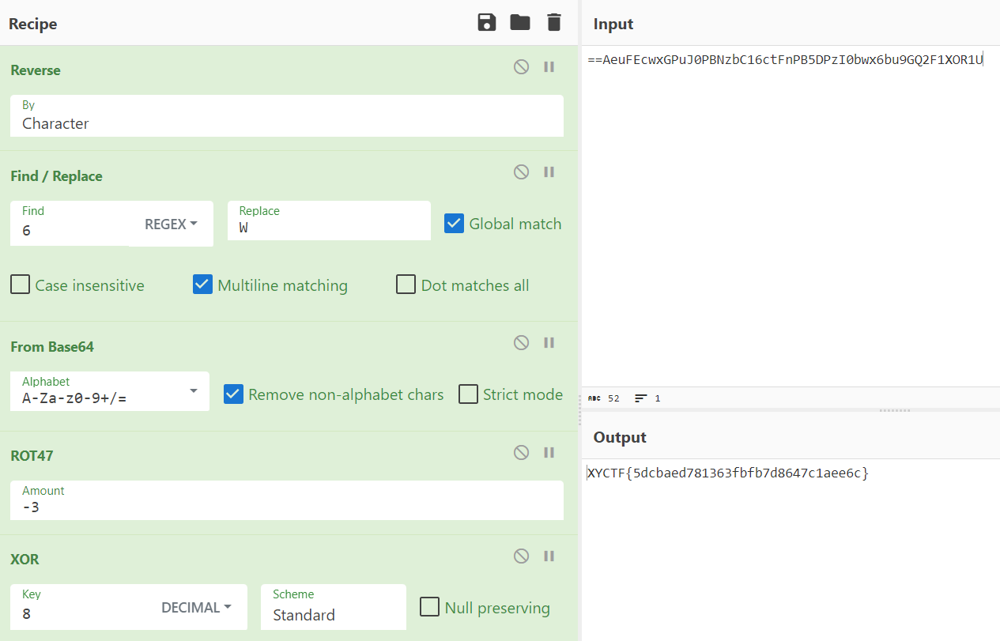

🚩 `XYCTF{5dcbaed781363fbfb7d8647c1aee6c}`

# 你是真的大学生吗？ (luoingly)

> 你是冤种大学生吗？
> 出题人：@dev1l
> 326支队伍攻克

MSDOS程序，需要读汇编。

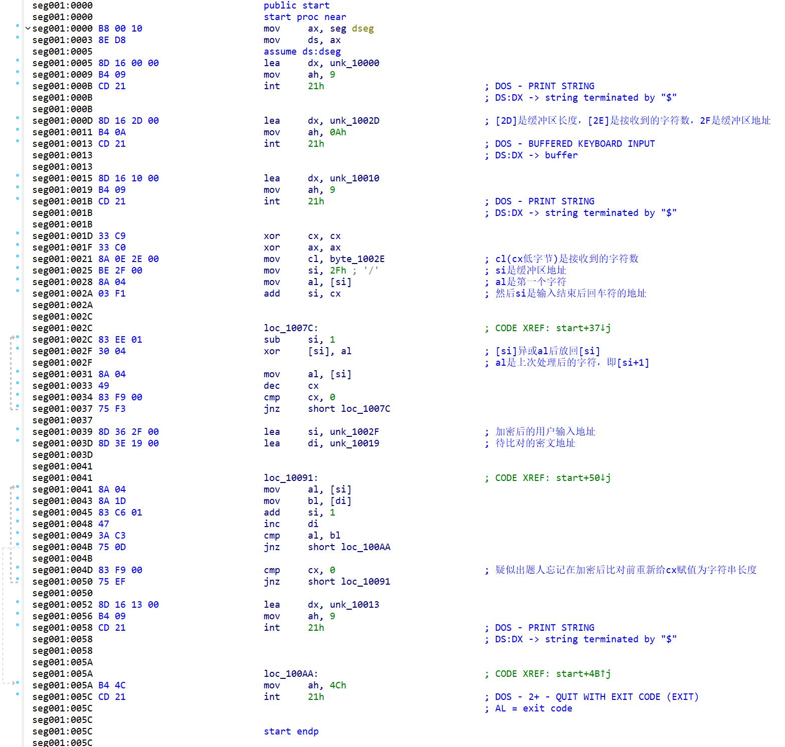

```python
src = [0x76, 0x0e, 0x77, 0x14, 0x60, 0x06, 0x7d, 0x04, 0x6b, 0x1e,
       0x41, 0x2a, 0x44, 0x2b, 0x5c, 0x03, 0x3b, 0x0b, 0x33, 0x05]

dst = [0x00] * 20
for i in range(19):
    dst[i] = src[i] ^ src[i + 1]
dst[19] = src[19] ^ dst[0]
print("".join([chr(i) for i in dst]))
```

🚩 `xyctf{you_know_8086}`

# ez_enc

> 你们要的签到题。
> 出题人：@Showmaker
> 89支队伍攻克

通过字符串引用定位到主要逻辑在 sub_140011960 ，搓个 z3

```c
from z3 import *

s = Solver()
items = [BitVec('flag[%d]' % i, 8) for i in range(34)]
moyu_z3_decls = items[:]

for i in range(34):
    s.add(items[i] < 127)
    s.add(items[i] >= 32)

enc = [
    0x27, 0x24, 0x17, 0x0B, 0x50, 0x03, 0xC8, 0x0C, 0x1F, 0x17,
    0x36, 0x55, 0xCB, 0x2D, 0xE9, 0x32, 0x0E, 0x11, 0x26, 0x02,
    0x0C, 0x07, 0xFC, 0x27, 0x3D, 0x2D, 0xED, 0x35, 0x59, 0xEB,
    0x3C, 0x3E, 0xE4, 0x7D
]

for i in range(33):
    items[i] = b'IMouto'[i % 6] ^ (items[i + 1] + items[i] % 20) & 0xff

for i in range(34):
    s.add(items[i] == enc[i])

if s.check() == sat:
    m = s.model()
    print(''.join(chr(m[moyu_z3_decls[i]].as_long()) for i in range(34)))

# Rlag{!_r3ea11y_w4nt_@_cu7e_s1$ter}
# flag{!_r3ea11y_w4nt_@_cu7e_s1$ter}
```

# 砸核桃

> 来帮zhaowu开个核桃 非恶意文件！！！
> 出题人：@ZhaoWu
> 159支队伍攻克

DIE 可知 打包工具: NsPacK(3.x)[-]

x32dbg 运行到 0x40641D 处，脱壳

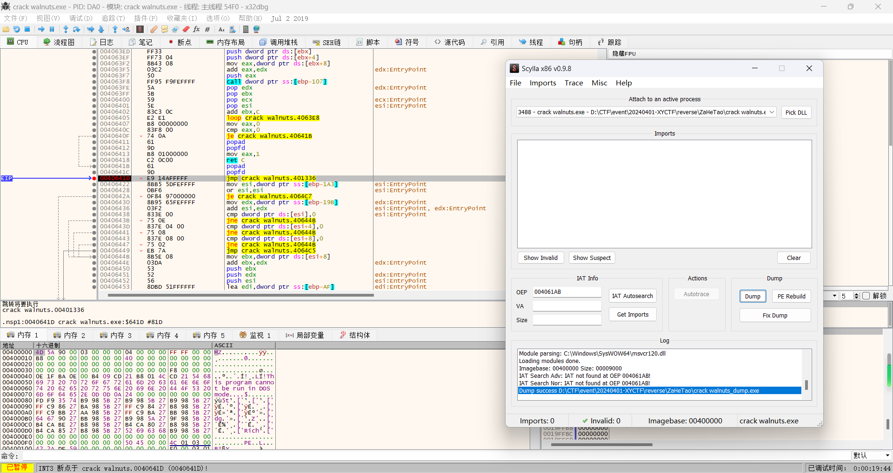

脱壳后整理一下反编译结果

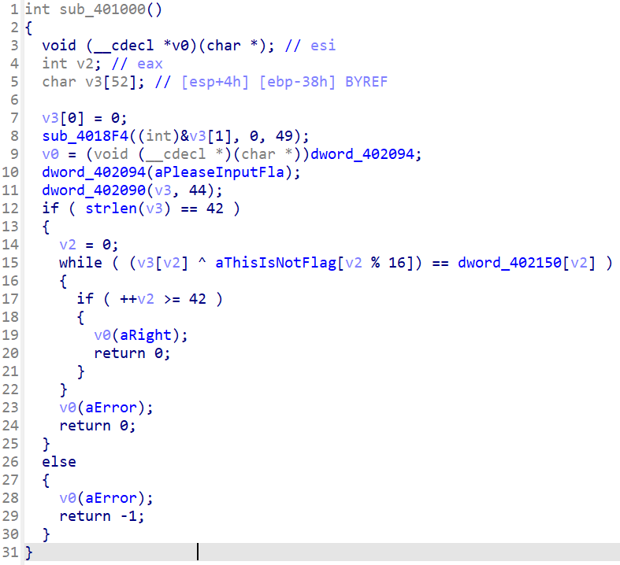

解密

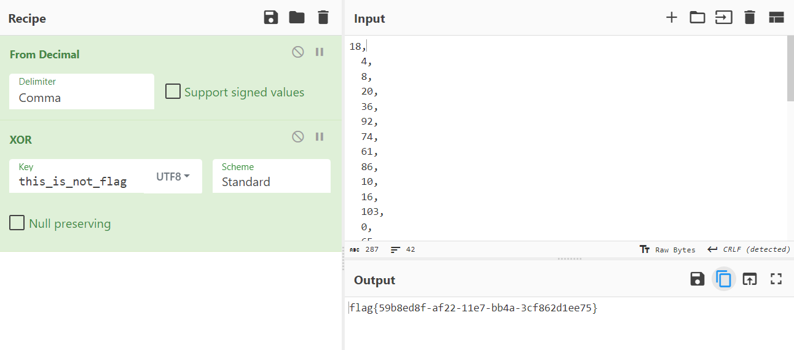

🚩 `flag{59b8ed8f-af22-11e7-bb4a-3cf862d1ee75}`

# ezmath

> 上过初中就会写
> 出题人：@dev1l
> 64支队伍攻克

pydumpck 一把解开，下面两行可以等效替换，这件事用 IDE 的一些神奇的查找替换功能就能做到

```python
sum((lambda .0: [ <参数1> for _ in .0 ])(range(<参数2>)))

<参数1> * <参数2>
```

整理一下，发现 flag 中的每个字符都平方然后减去一个倍数

```python
(((((((((((((((((((((flag[23] * flag[23] + flag[12] * flag[12] + flag[1] * flag[1] - flag[24] * 222) + flag[22] * flag[22] + flag[31] * flag[31] + flag[26] * flag[26] - flag[9] * 178 - flag[29] * 232) + flag[17] * flag[17] - flag[23] * 150 - flag[6] * 226 - flag[7] * 110) + flag[19] * flag[19] + flag[2] * flag[2] - flag[0] * 176) + flag[10] * flag[10] - flag[12] * 198) + flag[24] * flag[24] + flag[9] * flag[9] - flag[3] * 168) + flag[8] * flag[8] - flag[2] * 134) + flag[14] * flag[14] - flag[13] * 170) + flag[4] * flag[4] - flag[10] * 142) + flag[27] * flag[27] + flag[15] * flag[15] - flag[15] * 224) + flag[16] * flag[16] - flag[11] * 230 - flag[1] * 178) + flag[28] * flag[28] - flag[5] * 246 - flag[17] * 168) + flag[30] * flag[30] - flag[21] * 220 - flag[22] * 212 - flag[16] * 232) + flag[25] * flag[25] - flag[4] * 140 - flag[31] * 250 - flag[28] * 150) + flag[11] * flag[11] + flag[13] * flag[13] - flag[14] * 234) + flag[7] * flag[7] - flag[8] * 174) + flag[3] * flag[3] - flag[25] * 242) + flag[29] * flag[29] + flag[5] * flag[5] - flag[30] * 142 - flag[26] * 170 - flag[19] * 176) + flag[0] * flag[0] - flag[27] * 168) + flag[20] * flag[20] - flag[20] * 212) + flag[21] * flag[21] + flag[6] * flag[6] + flag[18] * flag[18] - flag[18] * 178) + 297412 == 0
```

有个 flag[31] * 250 ，而 flag[31] 为右大括号即 125 ，直接猜两倍

```python
flag = [0] * 32
flag[24] = 222
flag[9] = 178
flag[29] = 232
flag[23] = 150
flag[6] = 226
flag[7] = 110
flag[0] = 176
flag[12] = 198
flag[3] = 168
flag[2] = 134
flag[13] = 170
flag[10] = 142
flag[15] = 224
flag[11] = 230
flag[1] = 178
flag[5] = 246
flag[17] = 168
flag[21] = 220
flag[22] = 212
flag[16] = 232
flag[4] = 140
flag[31] = 250
flag[28] = 150
flag[14] = 234
flag[8] = 174
flag[25] = 242
flag[30] = 142
flag[26] = 170
flag[19] = 176
flag[27] = 168
flag[20] = 212
flag[18] = 178
print(''.join([chr(flag[i] // 2) for i in range(32)]))
# XYCTF{q7WYGscUuptTYXjnjKoyUTKtG}
```

后续：看提示说配方，下面两行可以等效替换

```python
flag[1] * flag[1] - flag[1] * 178

(flag[1] - 89) ** 2 - 89 ** 2
```

减去的这些常数合起来应该刚好是 297412 ，也就是 32 个平方项之和等于 0 ，所以每个平方项都等于 0 。合理（话说这题为什么放在 Reverse）

# 给阿姨倒一杯卡布奇诺

> 到点了，该喝茶了。flag格式：XYCTF{}
> 70支队伍攻克

经典 TEA ，注意静态变量 data1 和 data2 的处理

```c
#include <stdio.h>
#define uint32_t unsigned int

void decrypt(uint32_t *v, uint32_t *key)
{
    static uint32_t data1 = 0x5F797274;
    static uint32_t data2 = 0x64726168;
    int i;   // [rsp+20h] [rbp-10h]
    uint32_t sum; // [rsp+24h] [rbp-Ch]
    uint32_t v1;  // [rsp+28h] [rbp-8h]
    uint32_t v0;  // [rsp+2Ch] [rbp-4h]

    sum = 0x6E75316C * 32;
    uint32_t data1_tmp = v[0];
    uint32_t data2_tmp = v[1];
    v0 = v[0];
    v1 = v[1];
    for (i = 31; i >= 0; i--)
    {
        v1 -= ((v0 >> 5) + key[3]) ^ (v0 + sum) ^ (key[2] + 16 * v0) ^ (sum + i);
        v0 -= ((v1 >> 5) + key[1]) ^ (v1 + sum) ^ (key[0] + 16 * v1) ^ (sum + i);
        sum -= 0x6E75316C;
    }
    v[0] = v0 ^ data1;
    v[1] = v1 ^ data2;
    data1 = data1_tmp;
    data2 = data2_tmp;
}

int main()
{
    uint32_t key[4];   // [rsp+60h] [rbp-40h] BYREF
    uint32_t array[8]; // [rsp+70h] [rbp-30h]
    array[0] = 0x9B28ED45;
    array[1] = 0x145EC6E9;
    array[2] = 0x5B27A6C3;
    array[3] = 0xE59E75D5;
    array[4] = 0xE82C2500;
    array[5] = 0xA4211D92;
    array[6] = 0xCD8A4B62;
    array[7] = 0xA668F440;
    key[0] = 0x65766967;
    key[1] = 0x756F795F;
    key[2] = 0x7075635F;
    key[3] = 0x6165745F;
    for (int i = 0; i <= 7; i += 2)
    {
        decrypt(array + i, key);
    }
    for(int i=0; i<32; i++)
    {
        printf("%c", ((char*)array)[i]);
    }
    return 0;
}

// 133bffe401d223a02385d90c5f1ca377
```

🚩 `XYCTF{133bffe401d223a02385d90c5f1ca377}`

# DebugMe

> 康康你的debugger
> 出题人：@yuro
> 189支队伍攻克

复现一下 NewStarCTF 2023 Week 2 AndroDbgMe 即可

yixinBC ✌️ 的视频非常好 [BV182421T7BS](https://www.bilibili.com/video/BV182421T7BS) 从 27:22 开始

解包，添加可调试配置，打包签名，安装， adb 启动调试， JEB 附加

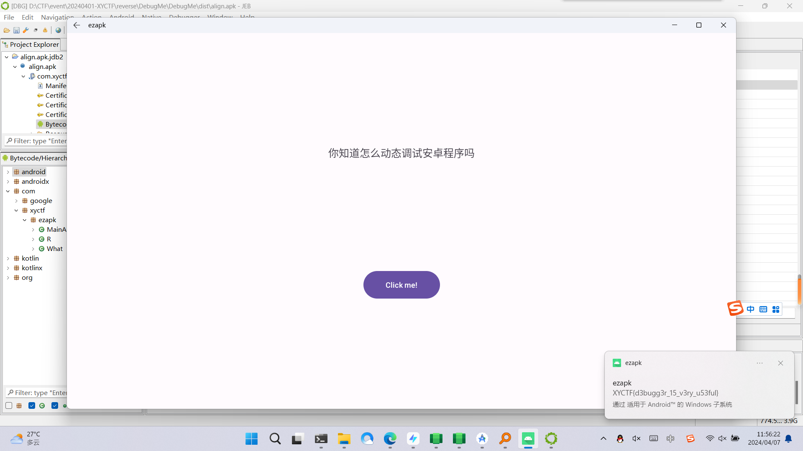

# 喵喵喵的flag碎了一地 (ClearWine)

> 小猫把flag给咬碎了，你能还原吗?
> 出题人：@ZhaoVVu
> 661支队伍攻克

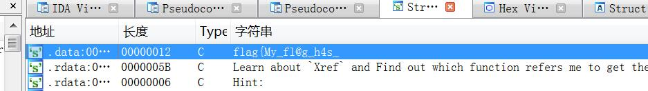

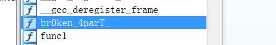

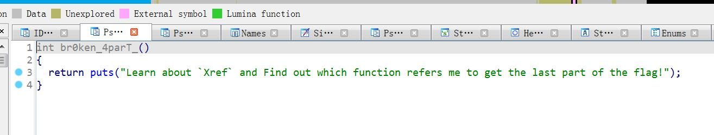

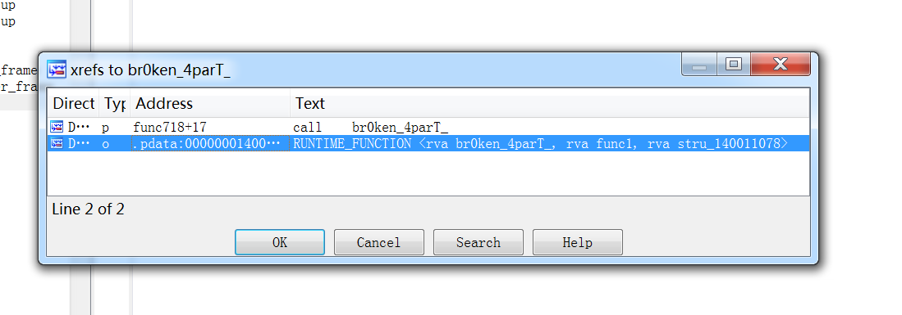

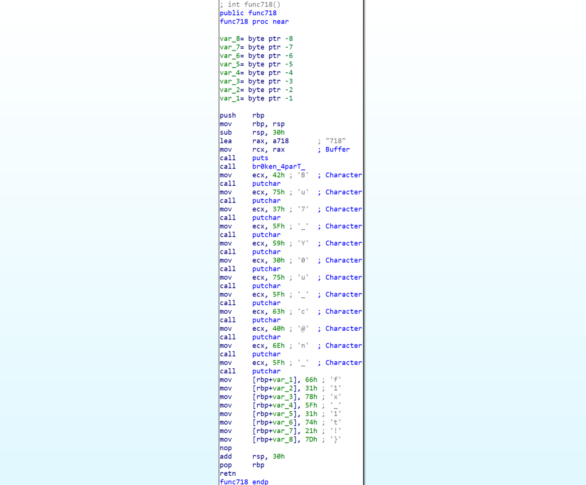

🚩 `flag{My_fl@g_h4s_br0ken_4parT_Bu7_Y0u_c@n_f1x_1t!}`

# 聪明的信使 (ClearWine)

> 传统加密，童叟无欺。
> 出题人：@ZhaoWu
> 793支队伍攻克

对字符串中的字母进行凯撒加密，key=9

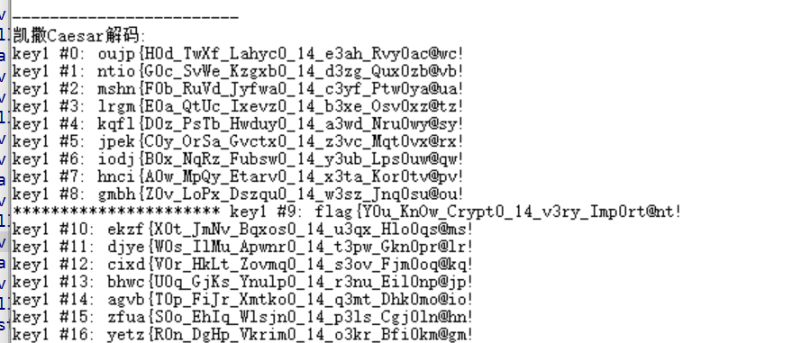

🚩 `flag{Y0u_KnOw_Crypt0_14_v3ry_Imp0rt@nt!}`
